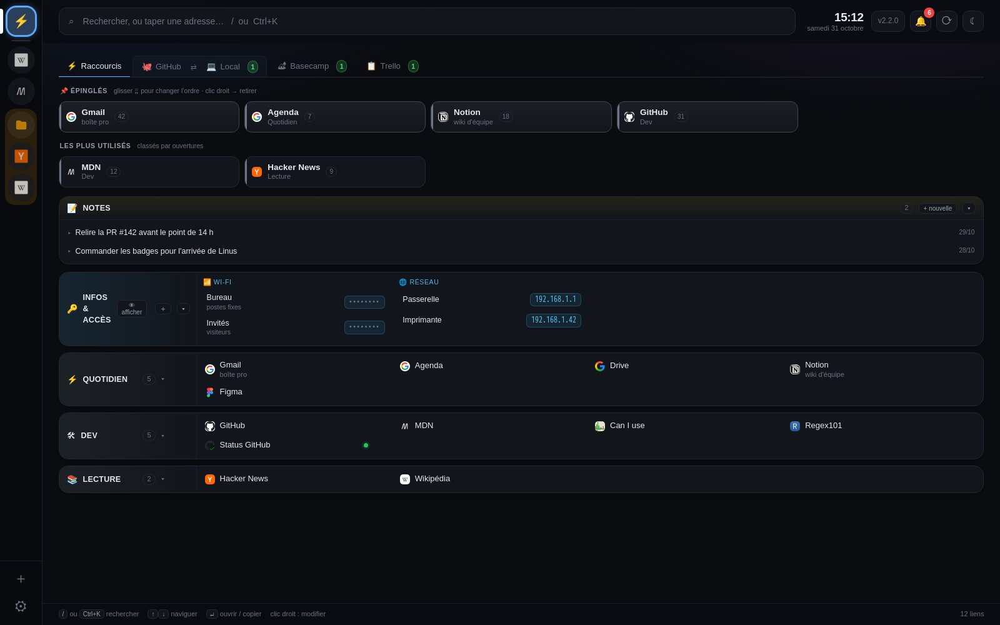
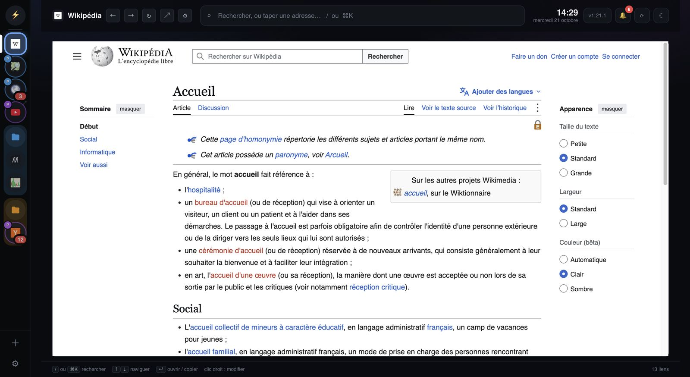
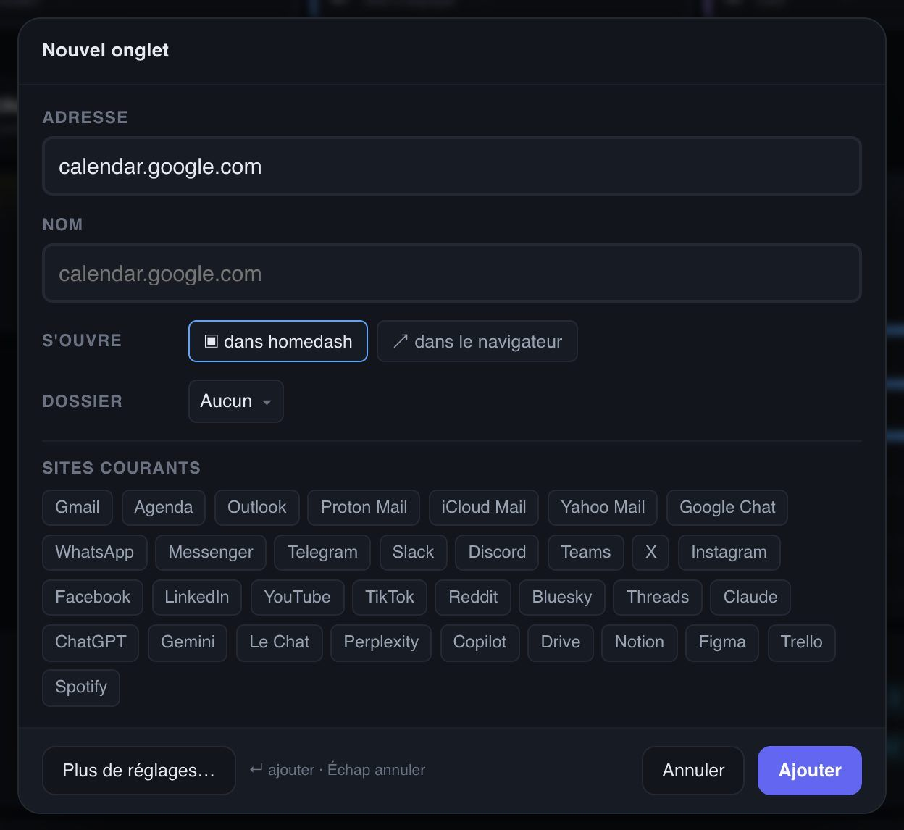
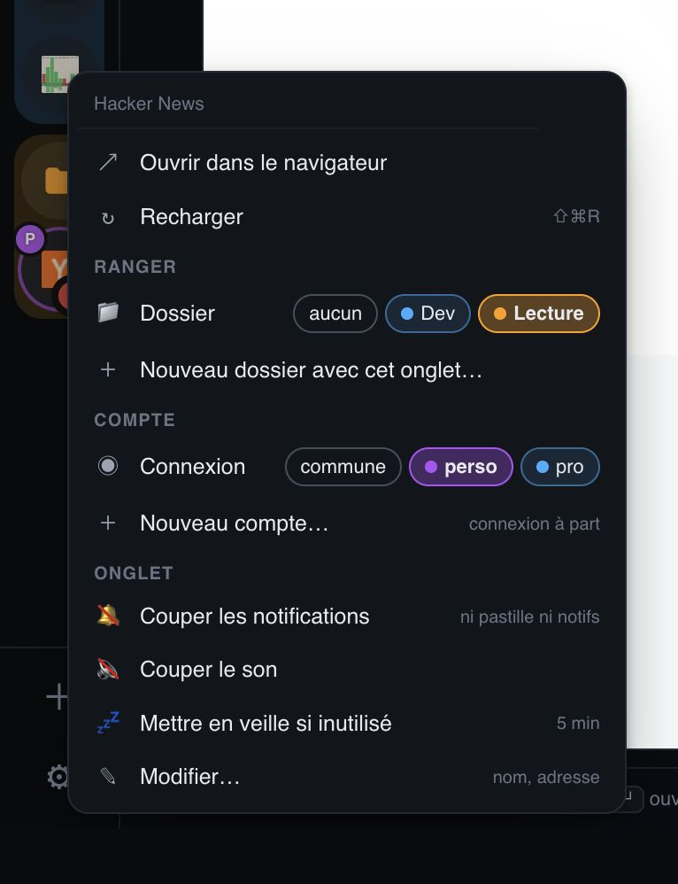
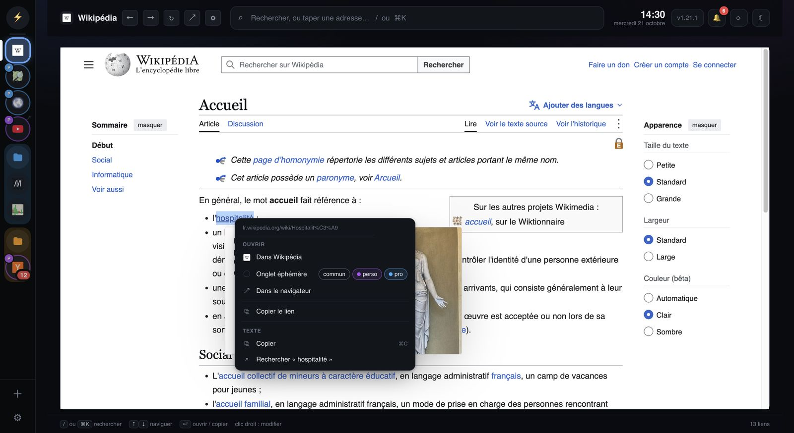
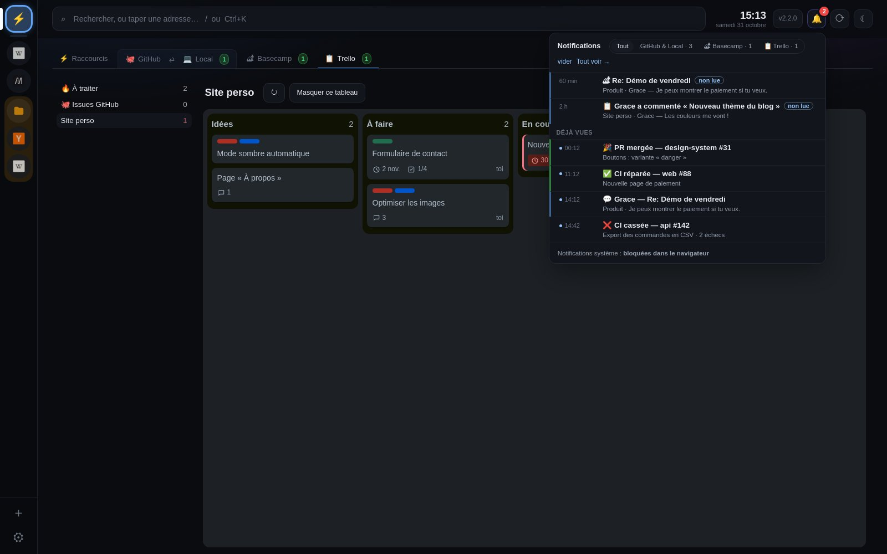
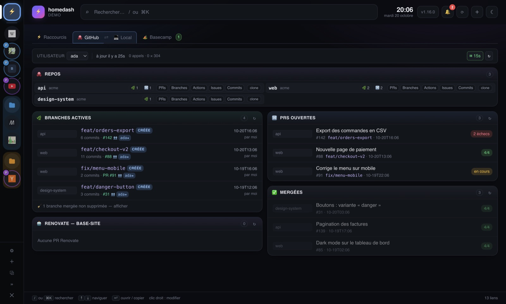
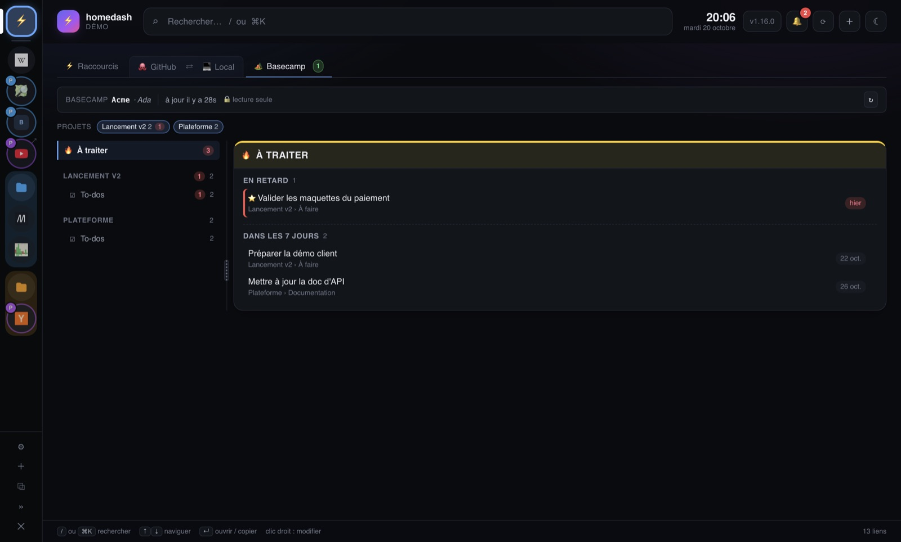
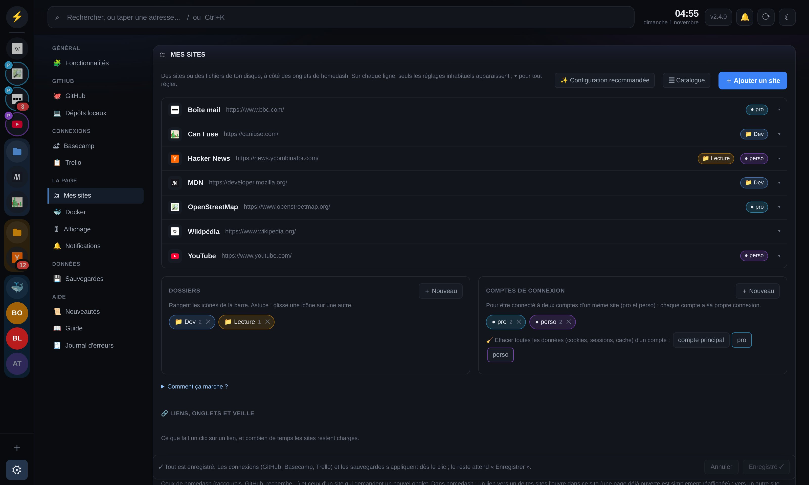
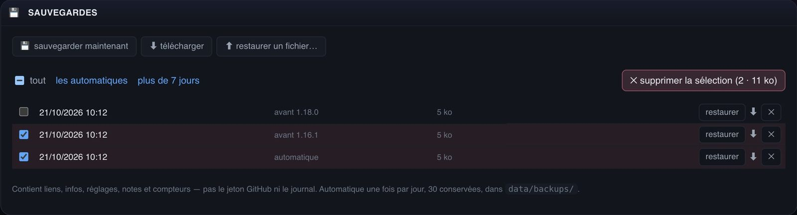

# Guide

Installation : voir le [README](README.md). Ce guide est aussi dans homedash : **Réglages → Aide →
Guide**, une partie par pastille.

## ⚡ Raccourcis

Ta page d'accueil : tes liens, des notes, des infos à copier.

**Premier lancement** : la carte **👋 Pour commencer**, en haut, liste ce qu'il reste à brancher (tes sites,
GitHub, tes dossiers de code, Basecamp, la taille de ton écran). Chaque bouton mène au bon réglage, avec
le pas-à-pas ; une étape faite se coche toute seule. La carte disparaît quand tout est fait, ou avec
*Masquer* (*Réglages → Affichage → Pour commencer* la remet). Tu ne te sers pas de GitHub, de Basecamp ou
de l'onglet Local ? Décoche-les dans *Réglages → Fonctionnalités* : leur étape disparaît.

#### Comment faire

- **Modifier quoi que ce soit** : clic droit dessus (un lien, une catégorie, une info, une note).
- **Nouvelle catégorie** : clic droit sur une catégorie → *Nouvelle catégorie…*
- **Épingler un lien** : clic droit → *Épingler*. Glisse une tuile par sa poignée ⠿ pour la déplacer.
- **Copier une info** (Wi-Fi, IP…) : un clic. Une valeur secrète se copie sans s'afficher.

#### Bon à savoir

- « Les plus utilisés » se remplit tout seul, d'après tes clics.
- Un lien **surveillé** a un voyant : vert, le site répond ; rouge, il ne répond pas.

## 🗂 Mes sites

Tes sites (Gmail, Chat, Claude…) et fichiers dans la barre de gauche, à côté de homedash. Elle est là
même sans aucun site : son **＋** ajoute le premier.

#### Comment faire

- **Ajouter** : ＋ en bas de la barre, puis une adresse ou un site courant.
- **Ouvrir** : clic sur l'icône. En haut : ← → ↻, ↗ (navigateur), partager (copie le lien), ⚙ (modifier).
  L'adresse s'affiche au survol du nom. **⚡** ramène à homedash.
- **Tout le reste** : clic droit sur l'icône (copier le lien, dossier, compte, notifications, son, veille,
  modifier, supprimer).
- **Partager un onglet** : le bouton partager en haut (ou clic droit → *Copier le lien*) copie l'adresse
  de la page affichée, sans l'ouvrir dans le navigateur.
- **Ranger** : glisse une icône sur une autre pour créer un dossier.
- **Largeur de la barre, la cacher** : clic droit sur la barre, hors d'une icône.

| Ajouter un site | Clic droit sur une icône |
| --- | --- |
|  |  |

#### Bon à savoir

- La **pastille rouge** compte les non-lus du site. Un onglet trop bavard : *Couper les notifications*.
- **Comptes** : deux connexions pour un même site (Gmail « pro » et « perso »), *Nouveau compte…*
- **Onglet éphémère** (contour pointillé) : un site le temps d'une recherche, avec sa barre d'adresse.
  Un lien cliqué dans l'appli en ouvre un en haut de l'endroit où tu es (voir *Appli de bureau*) ;
  clic droit sur la barre → *Nouvel onglet éphémère* en ouvre un seul, dans la barre de gauche.
- Un **fichier** de ton disque marche aussi (`~/Documents/procédure.pdf`) : lu, jamais modifié.
- Dans un navigateur, Gmail, Chat et la plupart des grands sites refusent de s'afficher dans une page :
  l'**appli de bureau** les affiche tous.

## 💻 Appli de bureau

homedash dans sa propre fenêtre, sur Mac et Windows. Docker reste nécessaire : l'appli affiche ton
homedash.

#### Ce qu'elle ajoute

- **Tous les sites s'affichent**, Gmail et Chat compris. Tu t'y connectes une fois, c'est gardé.
- **Non-lus** sur les icônes de la barre et sur l'icône de l'appli (Dock, barre des tâches).
- **Un lien s'ouvre en onglet, là où tu es** : cliqué dans le dash (raccourci, PR, tâche Basecamp,
  recherche…), il s'ouvre en onglet à côté de *Raccourcis*, *GitHub*, *Basecamp* ; cliqué dans un site
  (X, Chat…), en onglet en haut de ce site. Tu restes où tu étais. Si le site est dans *Mes sites*, l'onglet
  ouvert est connecté avec le même compte. ✕ ou clic molette pour fermer ; ⚡ ramène au dash, là où tu
  l'avais laissé.
- **Plutôt le navigateur ?** *Réglages → Liens & onglets → Liens qui ouvrent un nouvel onglet → Dans le
  navigateur*. Valable pour les liens du dash et ceux d'un site qui ouvrent un nouvel onglet (un lien qui
  change juste de page reste dans le site). Dans les deux cas, ⌘clic (Ctrl+clic sous Windows, ou ⇧clic)
  fait l'inverse, et le clic droit propose les deux.
- **Garder ces onglets** : ils disparaissent à la relance de l'appli, sauf *Garder ouvert* (clic droit
  sur l'onglet). Pour les garder tous d'office : *Réglages → Liens & onglets → Onglets ouverts par un lien*.
- **Clic droit dans un site** : ouvrir le lien ailleurs (en onglet ici, dans le site de *Mes sites*,
  éphémère dans la barre de gauche, navigateur), copier, rechercher.

#### Installer et mettre à jour

- **Installer** : une fois, avec la commande du [README](README.md) (Mac ou Windows). Construite sur ta
  machine, elle n'est pas bloquée au premier lancement.
- **Mettre à jour** : *Aide → Mettre à jour maintenant*. homedash et l'appli se mettent à jour ;
  l'appli se reconstruit et se relance seule quand une version le demande (« 💻 appli requise » dans
  les nouveautés).
- **Quelque chose semble cassé** : *Aide → Forcer la mise à jour* reconstruit tout.

#### Raccourcis

| Mac | Windows | Action |
| --- | --- | --- |
| `⌘R` | `Ctrl+R` | Recharger homedash |
| `⇧⌘R` | `Ctrl+Maj+R` | Recharger le site ouvert |
| `⌘[` `⌘]` | `Ctrl+[` `Ctrl+]` | Page précédente / suivante (aussi les boutons de la souris) |
| `⌘,` | `Ctrl+,` | Réglages |
| `⌘Q` | Fermer la fenêtre | Quitter (sur Mac, fermer la fenêtre la cache seulement) |

#### Bon à savoir

- **Mémoire** : au démarrage, seuls les mails et messageries sont chargés ; les autres au premier clic.
  Clic droit → *Mettre en veille si inutilisé* libère un onglet après 5 min sans y aller (durée dans
  *Réglages → Liens & onglets*).
- **Son** : 🔊 sur l'icône d'un onglet qui joue du son ; un clic le coupe.
- **Sans l'appli**, homedash s'installe aussi comme une page : ⊕ *Installer* dans Chrome, *Fichier →
  Ajouter au Dock* dans Safari.

## 🔔 Notifications

La cloche, en haut à droite : ce qui s'est passé (CI, PRs, branches à nettoyer, Basecamp, nouvelle
version).

#### Comment faire

- **Voir** : clic sur la cloche ; *Tout voir* ouvre l'historique. Une seule liste, la plus récente en
  haut ; filtres *Tout*, *GitHub & Local*, *Basecamp*.
- **Notifs Basecamp** : les non lues en tête (« non lue »), puis celles déjà vues, qui **restent** une
  fois lues dans Basecamp : tu peux y revenir.
- **Tout actualiser** : ⟳ à côté de la cloche relit GitHub, Basecamp, tes dépôts, la cloche et les
  non-lus de tes sites (ceux en veille sont réveillés).
- **Notifications du système** : *activer* en bas de la cloche (coupées au départ).
- **Faire taire un onglet** : clic droit sur son icône → *Couper les notifications*.
- **Le nombre sur l'icône de l'appli** : non-lus des sites, cloche, ou les deux (*Réglages →
  Notifications*).

#### Bon à savoir

- Ouvrir la cloche efface ses nouveautés. Une notif Basecamp reste comptée tant qu'elle n'est pas lue
  dans Basecamp.
- **🧹 Branche mergée** : annoncée une seule fois, en une ligne même si elle est dans plusieurs dépôts ;
  un clic ouvre l'onglet Local et sa commande.
- **Rien sur l'icône du Dock ?** macOS l'affiche seulement si *Pastilles de l'app* est activé pour
  homedash : *Réglages → Notifications → ouvrir les réglages de notifications du Mac*.

## 🐙 GitHub et 💻 Local

Ton code en ligne (GitHub) et sur ton disque (Local), côte à côte.

- **GitHub** (dès qu'un compte est connecté, rafraîchi toutes les 15 s) : 🌿 branches actives avec leur
  PR et leur CI, 🔀 PRs ouvertes (CI, revues, conflits), ✅ mergées (🧹 = la copie locale peut partir).
- **Local** : tes clones, branche par branche, avec un verdict.

| Verdict | Ce que ça veut dire |
| --- | --- |
| 🗑 à supprimer | Son contenu existe ailleurs : sans risque |
| 🔍 à vérifier | Sans doute finie, mais une partie n'existe que là |
| ⚠ à garder | Des commits uniquement sur ton disque |
| 🔧 en cours | Travail actif |

#### Bon à savoir

- **Tes clones peuvent être n'importe où** : *Réglages → Dépôts locaux → + ajouter un dossier*, puis
  🏠 dossier personnel ou 💽 le disque (`C:` sous Windows, `/Volumes` sur Mac pour les disques externes).
  Tout est lu en lecture seule. Sur Mac, un dossier hors de `/Users` et `/Volumes` doit d'abord être
  partagé dans Docker Desktop (Réglages → Resources → File sharing).
- **Rien n'est exécuté** : les commandes proposées (`git branch -d …`) sont à copier et lancer toi-même.
- **Branche courante pas à jour** : en retard sur sa version en ligne → `git pull` ; sur une autre
  branche que main/master, main a avancé → `git fetch origin && git merge origin/main`. Les deux à la
  fois : le pull d'abord.
- Plusieurs comptes GitHub : choisis lequel afficher en haut de l'onglet.

## 🏕 Basecamp

Tes tâches Basecamp sans ouvrir Basecamp. **Lecture seule** : homedash ne coche rien et ne poste que
les rapports d'issues que tu publies (ci-dessous).

- **🔥 À traiter** : tout ce qui est en retard ou dû dans les 7 jours.
- **Un projet** (à gauche) : ses tableaux et ses to-dos. Les pastilles du haut masquent un projet.
- **Se connecter** (une fois, pas besoin d'être admin) : le pas-à-pas est dans *Réglages → Basecamp*.
  Le jeton se renouvelle ensuite tout seul.

**Lire une tâche sans ouvrir Basecamp** : 💬 au survol (ou clic droit → *Voir la tâche et ses
échanges*) ouvre sa fiche : description, étapes, issues liées, et tous les échanges, le plus récent en
haut, captures affichées. **🐙 issue sur cet échange** en fait une issue : le commentaire devient la demande, la tâche le
contexte. La recherche y mène aussi (**💬 Voir la tâche**, ou l'échange trouvé).

**D'une tâche à une issue GitHub, et retour** (homedash n'écrit que l'issue que tu crées, et le rapport
que tu publies) :

1. **🐙＋ au survol d'une tâche** (ou clic droit → *Créer une issue GitHub…*) : une fenêtre propose le
   repo, le titre de la tâche et un champ *Besoin*. Le repo choisi est retenu pour le projet Basecamp :
   la fois suivante, il est déjà sélectionné. Si la tâche a déjà une issue ouverte, la fenêtre le
   signale. **Créer sur GitHub** (ou ⌘ Entrée) la crée aussitôt avec le compte GitHub de homedash (pas
   besoin d'être connecté à github.com), et elle apparaît tout de suite sur la tâche ; **Ouvrir le
   formulaire** ouvre plutôt celui de GitHub, pré-rempli (dans l'appli de bureau, **↗ navigateur**
   l'ouvre dans ton navigateur, où tu es connecté à GitHub). Le *Besoin* reprend la description, les
   étapes de la tâche (une capture y devient un lien 🖼 vers Basecamp, ouvrable seulement connecté à
   Basecamp) ; dessous, **ses échanges, une case chacun** : seuls ceux cochés vont dans l'issue (les 5
   plus récents le sont d'office, *tout* / *aucun* pour aller vite). Le lien vers la tâche est ajouté
   tout seul. Marche aussi au
   clic droit sur un lien de tâche dans le site Basecamp de l'appli.
2. **Donne l'issue à Claude Code** : à la création, une commande est copiée toute seule, par exemple
   `cd ~/dev/api && claude '…'` ; colle-la dans un terminal, Claude Code démarre dans le repo avec
   l'issue. (Si le repo n'est pas cloné dans un dossier de l'onglet Local, c'est le prompt seul qui
   est copié, à coller dans Claude Code.) La consigne est dans l'issue : tirer de la conversation
   Basecamp le vrai besoin et la solution, reformulés en termes techniques (en commentaire de l'issue
   si ce n'est pas limpide), lui donner ses étiquettes (parmi celles du repo), faire le travail, poster un
   commentaire de rapport qui commence par `<!-- homedash:bc-report -->`, puis fermer l'issue.
3. **La cloche sonne quand le rapport est prêt** (*📤 Rapport prêt*) ; un clic ouvre **🐙 Issues
   GitHub**. **📤 publier sur BC** apparaît aussi à côté de la tâche (et dans **🐙 Issues GitHub**, à gauche, avec le
   rapport à relire) : un clic, une confirmation, et le rapport est posté en commentaire de la tâche, à
   ton nom (ceux qui la suivent sont notifiés). Le bouton devient *✓ publié*, lien vers le commentaire.
   Un rapport ne part qu'une fois ; publié, l'issue disparaît de la tâche et de la liste.
   **▶ prompt de départ** (sur chaque issue ouverte de **🐙 Issues GitHub**) recopie ce qui a été copié
   à la création, si tu ne l'as pas collé tout de suite.
   **📝 rapport final** (sur chaque issue de **🐙 Issues GitHub**, terminées comprises) : tes précisions
   (facultatives : « insiste sur… », « ne parle pas de… »), puis **Copier le prompt** ; colle-le dans la
   session Claude Code qui a fait le travail : il vérifie tout, poste le rapport final et ferme l'issue. Le dernier
   rapport posté fait foi : il remplace le précédent et redevient publiable, même si l'ancien l'a été.
4. **Pas de rapport à publier ?** ✕ écarte l'issue sans rien envoyer. Une issue **fermée sans rapport**
   est écartée d'office (abandonnée). Les terminées se retrouvent avec *afficher les terminées*, en bas
   de **🐙 Issues GitHub** ; *rétablir* y remet une issue écartée.

Le jeton GitHub doit pouvoir lire les issues (*Issues : Read-only* pour un jeton fine-grained), et les
écrire pour *Créer sur GitHub* (*Issues : Read and write* ; un jeton classic `repo` le fait déjà).

## 🔎 Recherche

`/` ou `⌘K` : tout retrouver, et ouvrir une adresse.

- **Un mot** : liens, onglets, repos, PRs, branches, infos, notes, pages déjà vues.
- **Chercher à un seul endroit** : clic sur la loupe, à gauche de la barre → *Raccourcis*, *Mes sites*,
  *GitHub & Local*, *Basecamp* ou *Le web*. La loupe s'allume tant que la recherche est limitée ;
  *Partout* revient à la recherche complète (elle l'est aussi à chaque rechargement).
- **Basecamp** (s'il est connecté) : tes tâches tout de suite, puis, un instant après ta frappe, tout
  Basecamp : to-dos, cartes, messages, commentaires, documents (sans les archivés). La carte à droite
  montre un extrait, l'échéance, l'auteur ; Entrée ouvre l'élément dans Basecamp. Pour une tâche ou
  un de ses commentaires : **💬 Voir la tâche** (sa fiche, ouverte sur l'échange trouvé), **🐙 Créer une
  issue** (ou *Issue sur cet échange*), et **Voir dans le dash** si elle t'est assignée (son tableau
  dans l'onglet Basecamp, la tâche mise en évidence).
- **Fautes de frappe** : les mots se cherchent dans n'importe quel ordre, une faute par mot tolérée
  (« shopping diag » trouve « Assistant Shoping interne (Diag) »). La recherche dans tout Basecamp,
  elle, ne les tolère pas.
- **Une adresse** (`exemple.com`, `localhost:3000`) : Entrée l'ouvre.
- **Un raccourci** en premier mot : `g` Google, `gh` GitHub, `yt` YouTube, `w` Wikipédia, `maps`, `tr`
  traduction, `mdn`.
- **Une action** : « réglages », « thème », « nouvelle catégorie », « éphémère »…

`↑` `↓` pour choisir, `↵` pour ouvrir ou copier, `Échap` pour effacer. `⌘S` enregistre les réglages.

## ⚙️ Réglages

Tout ce qui se règle, rangé par thème. `⌘S` (ou le bouton du bas) enregistre ; la barre du bas signale
ce qui ne l'est pas encore. Tu quittes Réglages sans enregistrer ? homedash te le propose ; *Plus tard*
garde tes modifications en brouillon, retrouvées au retour.

| Partie | Ce qu'on y fait |
| --- | --- |
| 🧩 Fonctionnalités | Couper GitHub, Local ou Basecamp si tu ne t'en sers pas |
| 🐙 GitHub | Pour le compte choisi en haut : connexion, repos suivis (et où ils apparaissent), équipe, ce que montre l'onglet ; ＋ compte pour un autre compte GitHub |
| 💻 Dépôts locaux | Les dossiers où chercher tes clones |
| 🏕 Basecamp | La connexion |
| 🗂 Mes sites | Tes sites (une ligne chacun, clic pour l'ouvrir), dossiers, comptes de connexion |
| 🔗 Liens & onglets | Où s'ouvrent les liens, onglets ouverts par un lien, mise en veille |
| 🎛 Affichage | Ce qui s'affiche (horloge, tuiles…), taille de l'écran, journal de performance |
| 🔔 Notifications | Notifications du bureau, pastille de l'icône de l'appli |
| 💾 Sauvegardes | Restaurer, télécharger, faire le ménage |
| 📖 Aide | Nouveautés, ce guide, journal d'erreurs, journal de performance (s'il est activé) |

**Couper une fonctionnalité** (🧩 Fonctionnalités) : décochée, elle disparaît de la page (onglet,
recherche, cartes de l'accueil, ses parties de Réglages, ses notifications dans la cloche et
l'historique, même passées) et homedash ne lit plus le service. Rien n'est
effacé : jeton, connexion et réglages sont gardés, et la recocher remet tout en place. Le choix vaut pour
ton homedash seulement.

## 💾 Sauvegardes

homedash sauvegarde tes liens, réglages et notes tout seul : chaque jour, et avant chaque mise à jour.

- **Revenir en arrière** : *restaurer* sur une ligne. L'état actuel est sauvegardé juste avant.
- **Faire le ménage** : coche des lignes (ou *tout*, *les automatiques*, *plus de 7 jours*), puis
  *supprimer la sélection*.
- **Changer de machine** : *télécharger*, puis *restaurer un fichier…* sur l'autre. Les jetons ne sont
  pas dans les sauvegardes : recolle-les ensuite.

## 🆘 En cas de souci

| Ce que tu vois | Quoi faire |
| --- | --- |
| « Connexion à homedash… » | homedash redémarre (mise à jour, réveil) : la page revient toute seule. Si ça dure, lance Docker Desktop |
| « Tes réglages ne se lisent plus » | Le fichier a été abîmé (souvent une modification à la main) : *Revenir à la dernière sauvegarde* |
| Pas d'onglet GitHub | Aucun jeton : *Réglages → GitHub → Connexion*, le pas-à-pas « Comment créer un jeton » y est ouvert |
| Un repo n'est pas proposé | Repo d'un collègue où tu es collaborateur : onglet *Partagés avec toi*. Sinon le jeton n'y a pas accès : ajoute-le dans *Repository access* du jeton, sur GitHub |
| Onglet Local vide | Ajoute un dossier dans *Réglages → Dépôts locaux* (dossier personnel, ou 💽 ailleurs sur le disque) |
| Une pastille ne bouge pas | L'onglet est peut-être en veille : clique dessus pour le recharger |
| Des lettres au lieu des icônes | *Réglages → Affichage → Favicons* doit être coché |
| Un site boude (captcha refusé, page qui tourne en boucle) | Clic droit sur son icône → *Effacer les données de ce site*, puis reconnecte-toi. Sinon ↗ l'ouvre dans ton navigateur |
| Rien sur l'icône du Dock | *Pastilles de l'app* désactivé dans macOS : voir *Notifications* ci-dessus |

Autre chose ? Ouvre une **[issue sur GitHub](https://github.com/lepetitpaco/homedash/issues/new)** :
ce que tu faisais, ce que tu attendais, ce qui s'est passé, et ta version (en haut à droite). *Réglages
→ Aide → Journal d'erreurs → Copier pour une issue* donne le détail technique à coller dedans.
