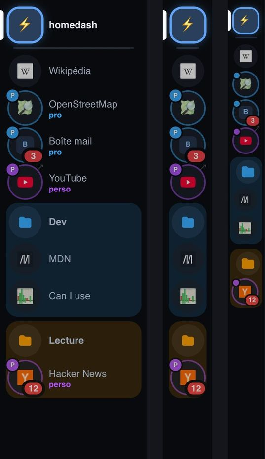
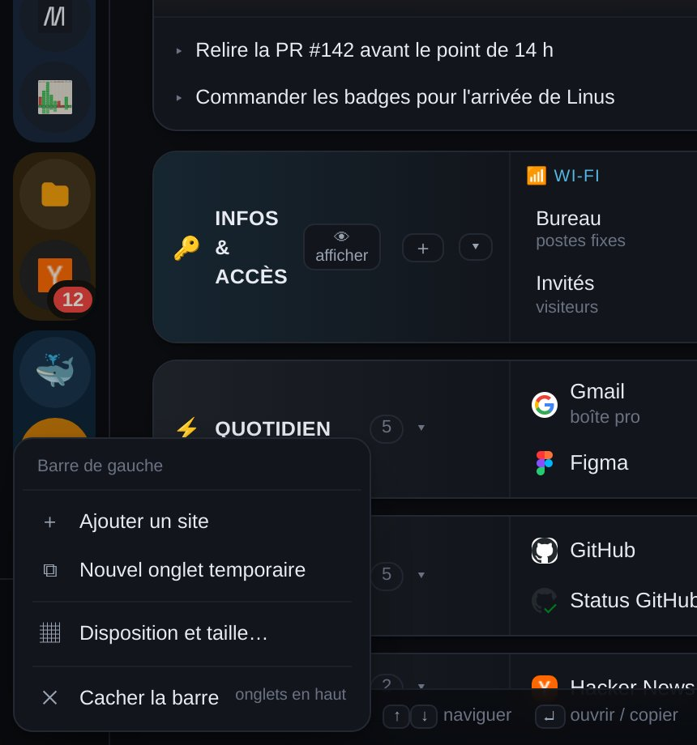
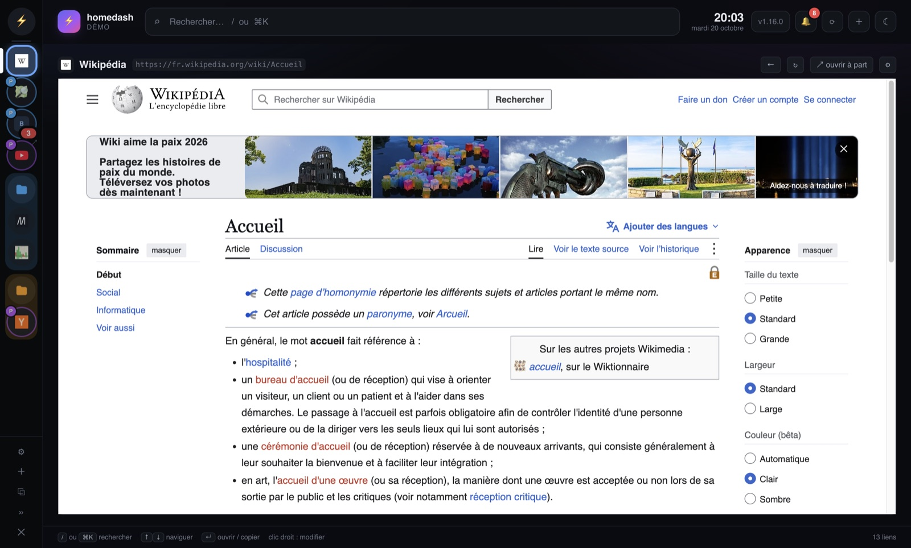
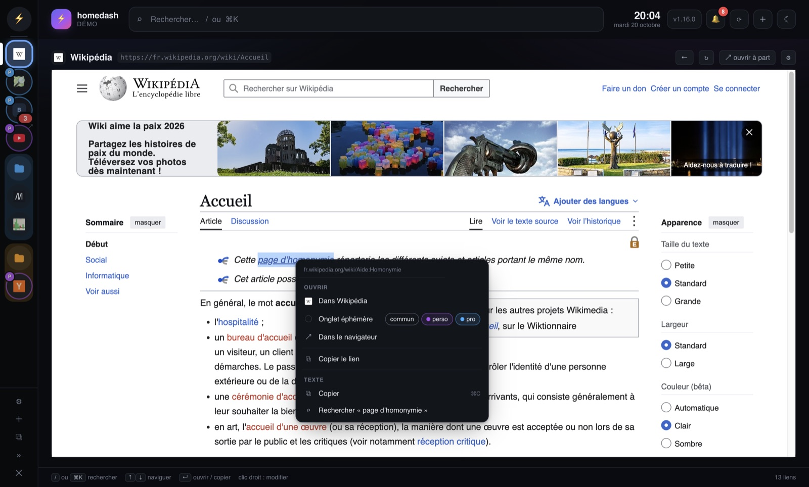

# Guide

Installation : voir le [README](README.md). Chaque partie ci-dessous est aussi une page de
**Réglages → Aide**, dans homedash.

## ⚡ Raccourcis

Ta page d'accueil : tes liens, des notes, des infos à copier.

#### Comment faire

- **Modifier quoi que ce soit** : clic droit dessus (un lien, une catégorie, une info).
- **Nouvelle catégorie** : ＋ en haut à droite.
- **Épingler un lien** : clic droit → *Épingler*. Pour changer l'ordre, glisse la tuile par sa poignée ⠿.
- **Copier une info** (Wi-Fi, IP…) : un clic. Les valeurs secrètes se copient sans s'afficher.

#### Bon à savoir

- « Les plus utilisés » se remplit tout seul, d'après tes clics.
- Un lien **surveillé** a un voyant : vert, le site répond ; rouge, il ne répond pas.

## 🗂 Onglets perso

Tes sites (Gmail, Chat, Claude…) et fichiers, à côté de homedash, dans la barre de gauche.

#### Comment faire

- **Ajouter un onglet** : ＋ en bas de la barre. Tape une adresse, ou choisis un site courant.
- **Ouvrir** : clic sur l'icône. **⚡** ramène à homedash.
- **Modifier** : clic droit sur l'icône → *Modifier…*.
- **Ranger dans un dossier** : glisse une icône sur une autre.
- **Changer la largeur, cacher la barre** : clic droit sur la barre, hors d'une icône.

#### Bon à savoir

- La **pastille rouge** compte les non-lus du site (appli de bureau).
- **Un onglet trop bavard** : clic droit sur son icône → *Couper les notifications*. Plus de pastille,
  plus de notifications de ce site.
- **Comptes** (appli de bureau) : deux connexions pour un même site, par exemple Gmail « pro » et
  « perso ». Clic droit sur l'icône → *Nouveau compte…*.
- Un **fichier** de ton disque marche aussi : `~/Documents/procédure.pdf`. Il est lu, jamais modifié.
- Dans un navigateur, Gmail, Chat et la plupart des grands sites refusent de s'afficher dans une page.
  L'**appli de bureau** les affiche tous.

## 🐙 GitHub et 💻 Local

Ton code en ligne (GitHub) et sur ton disque (Local), côte à côte.

**GitHub** (dès qu'un compte est connecté, rafraîchi toutes les 15 s) :

- 🌿 **Branches actives** : tes branches, leur PR, leur CI.
- 🔀 **PRs ouvertes** : CI, revues, conflits.
- ✅ **Mergées** : 🧹 = la branche locale peut partir.

**Local** : tes clones, branche par branche, avec un verdict.

| Verdict | Ce que ça veut dire |
| --- | --- |
| 🗑 à supprimer | Son contenu existe ailleurs : sans risque |
| 🔍 à vérifier | Sans doute finie, mais une partie n'existe que là |
| ⚠ à garder | Des commits uniquement sur ton disque |
| 🔧 en cours | Travail actif |

#### Bon à savoir

- **Rien n'est exécuté** : les commandes (`git branch -d …`) sont à copier et lancer toi-même.
- Plusieurs comptes GitHub : choisis lequel afficher en haut de l'onglet.

## 🏕 Basecamp

Tes tâches Basecamp, sans ouvrir Basecamp. **Lecture seule** : homedash ne coche ni ne poste rien.

#### Comment faire

- **🔥 À traiter** : tout ce qui est en retard ou dû dans les 7 jours.
- **Un projet** à gauche : ses tableaux et ses to-dos.
- **Masquer un projet** : les pastilles en haut de l'onglet.

**Se connecter** (une fois, pas besoin d'être admin) : le pas-à-pas est dans **Réglages → Basecamp**.
En résumé :

1. Crée une appli sur [launchpad.37signals.com/integrations](https://launchpad.37signals.com/integrations).
2. Colle son Client ID et son Client Secret dans Réglages → Basecamp.
3. **Se connecter à Basecamp**, puis colle l'adresse de la page où tu arrives.

Le jeton se renouvelle ensuite tout seul.

## 🔔 Notifications

La cloche, en haut à droite : ce qui s'est passé (CI, PRs, Basecamp…).

#### Comment faire

- **Voir** : clic sur la cloche. **Tout voir** ouvre l'historique.
- **Notifications du Mac** : *activer* en bas de la cloche (désactivées au départ).
- **Faire taire un onglet** : clic droit sur son icône → *Couper les notifications* (ou 🔕 sur sa ligne,
  dans Réglages → Onglets perso).

#### Bon à savoir

- Ouvrir la cloche efface ses nouveautés. Une notif Basecamp reste comptée tant qu'elle n'est pas lue
  dans Basecamp.
- **Nouvelle version de homedash** : la cloche le dit, dans les 10 min.

## 💻 Appli de bureau

homedash dans sa propre fenêtre, comme Slack : sur Mac (dans le Dock) ou sur Windows (dans la barre des
tâches). Docker reste nécessaire.

#### Ce qu'elle ajoute

- **Tous les sites s'affichent**, Gmail et Chat compris. Tu t'y connectes une fois, c'est gardé.
- **Pastilles de non-lus** sur les onglets et sur l'icône du Dock. Elles s'effacent dès que tu lis.
- **Liens entre onglets** : un lien YouTube cliqué dans Chat s'ouvre dans ton onglet YouTube.
- **Clic droit dans un site** : ouvrir un lien ailleurs, copier, rechercher.
- **Onglets éphémères** (contour pointillé) : un site le temps d'une recherche. Clic droit sur un lien,
  ou clic droit sur la barre → *Nouvel onglet éphémère*.

#### Installer sur Mac

- **Le plus simple** : dans le dossier homedash, `sh desktop/build-local.sh --install`.
- **Ou** le `.dmg` de la [dernière release](https://github.com/davidgennaoui/homedash/releases/latest)
  (`-arm64` : Mac M1, M2…, `-x64` : Intel). Au premier lancement : *Réglages Système → Confidentialité
  et sécurité → Ouvrir quand même*.

#### Installer sur Windows

- Le `-win-x64-setup.exe` de la [dernière release](https://github.com/davidgennaoui/homedash/releases/latest) :
  double-clic, c'est installé (pas besoin d'être administrateur), avec un raccourci dans le menu Démarrer.
- Au premier lancement, Windows affiche « Windows a protégé votre ordinateur » : *Informations
  complémentaires → Exécuter quand même*.
- Sans installation : le `.zip`, à décompresser, puis `homedash.exe`.
- Sur Windows, les raccourcis s'écrivent `Ctrl` au lieu de `⌘`. Fermer la fenêtre quitte l'appli.

#### Bon à savoir

- **Mettre à jour** homedash met aussi l'appli à jour : pas besoin de la réinstaller.
- **Mémoire** : au démarrage, seuls les mails et messageries sont chargés ; les autres au premier clic.
- **Mise en veille** : clic droit sur une icône → *Mettre en veille si inutilisé*. L'onglet libère sa
  mémoire après 5 min sans y aller.
- **Son** : 🔊 sur l'icône d'un onglet qui joue du son ; un clic le coupe.
- **Précédent / suivant** : boutons de la souris, ou ⌘[ et ⌘].
- `⌘R` recharge homedash ; `⇧⌘R` seulement le site ouvert.
- Fermer la fenêtre la cache ; `⌘Q` quitte.

**Sans l'appli** : dans Chrome, ⊕ *Installer* dans la barre d'adresse ; dans Safari, *Fichier → Ajouter
au Dock*.

## ⚙️ Réglages

Tout ce qui se règle, rangé par thème dans le menu de gauche.

#### Comment faire

- **Enregistrer** : `⌘S`, ou le bouton en bas. La barre du bas signale ce qui n'est pas enregistré.
- **Un onglet perso** : clic sur sa ligne pour l'ouvrir. Les pastilles de la ligne se basculent d'un clic.

| Partie | Ce qu'on y fait |
| --- | --- |
| 🔑 Compte & équipe | Jeton GitHub, membres de l'équipe, autre compte GitHub |
| 📦 Repos suivis | Les repos à suivre, et où ils apparaissent |
| 💻 Dépôts locaux | Les dossiers où chercher tes clones |
| 🏕 Basecamp | La connexion |
| 🗂 Onglets perso | Tes onglets, le catalogue de sites, la mise en veille |
| 🎛 Affichage | Taille de l'écran, thème, horloge, notifications, journal de performance |
| 💾 Sauvegardes | Restaurer, télécharger, faire le ménage |
| 📖 Aide | Les nouveautés et ce guide |

## 💾 Sauvegardes

homedash sauvegarde tes liens, réglages et notes tout seul : chaque jour, et avant chaque mise à jour.

#### Comment faire

- **Revenir en arrière** : *restaurer* sur une ligne. L'état actuel est sauvegardé juste avant.
- **Faire le ménage** : coche des lignes (ou *tout*, *les automatiques*, *plus de 7 jours*), puis
  *supprimer la sélection*.
- **Changer de machine** : *télécharger*, puis *restaurer un fichier…* sur l'autre.

#### Bon à savoir

- Le jeton GitHub n'est pas dans les sauvegardes : à recoller après une restauration sur une autre machine.

## 🔎 Recherche

`/` ou `⌘K` : tout retrouver, et aussi une barre d'adresse.

#### Ce que tu peux taper

- **Un mot** : tes liens, onglets, repos, PRs, branches, infos, notes, pages déjà vues.
- **Une adresse** (`exemple.com`, `localhost:3000`) : Entrée l'ouvre.
- **Un raccourci** en premier mot : `g` Google, `gh` GitHub, `yt` YouTube, `w` Wikipédia, `maps`,
  `tr` traduction, `mdn`.
- **Une action** : « réglages », « thème », « éphémère »…

| Touche | Action |
| --- | --- |
| `/` ou `⌘K` | Rechercher |
| `↑` `↓` puis `↵` | Choisir, puis ouvrir ou copier |
| `Échap` | Effacer, fermer |
| `⌘S` | Enregistrer les réglages |

## 🆘 En cas de souci

| Problème | Solution |
| --- | --- |
| Pas d'onglet GitHub | Aucun jeton : Réglages → Compte & équipe |
| Un repo n'est pas proposé | Le jeton n'y a pas accès : ajoute-le dans *Repository access* du jeton, sur GitHub |
| Onglet Local vide | Ajoute un dossier dans Réglages → Dépôts locaux (dans ton dossier personnel) |
| Config cassée | Réglages → Sauvegardes → restaurer celle de la veille |
| Une pastille ne bouge pas | L'onglet est peut-être en veille : clique dessus pour le recharger |
| Changer de machine | Réglages → Sauvegardes → télécharger, puis restaurer sur l'autre |

Un bug, une idée, une question sans réponse ici :
**[ouvre une issue sur GitHub](https://github.com/davidgennaoui/homedash/issues/new)** (il faut avoir
accès au dépôt). Dis ce que tu faisais, ce que tu attendais, ce qui s'est passé, et ta version (en haut
à droite).
