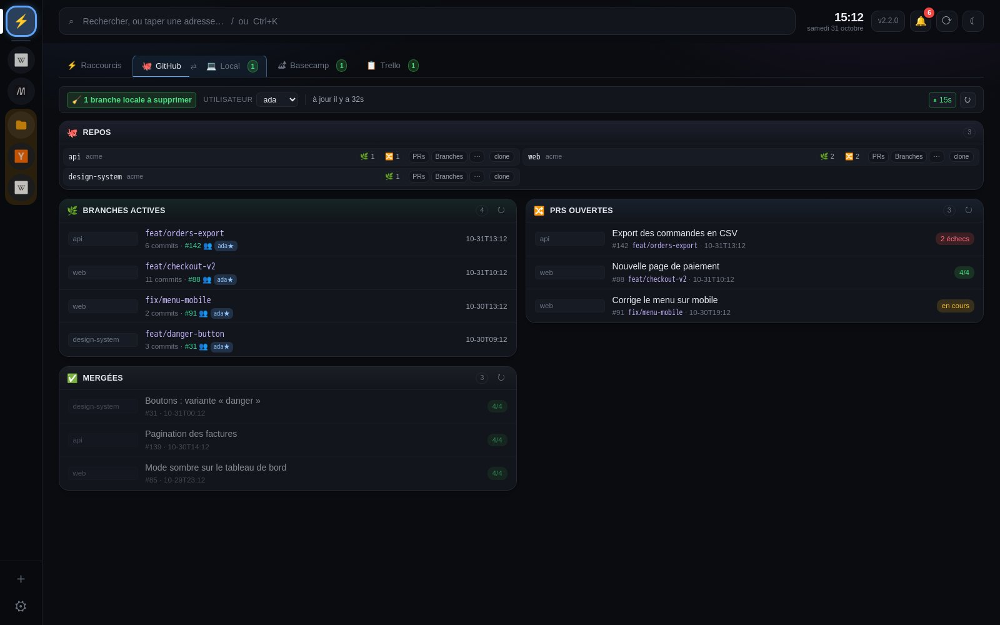
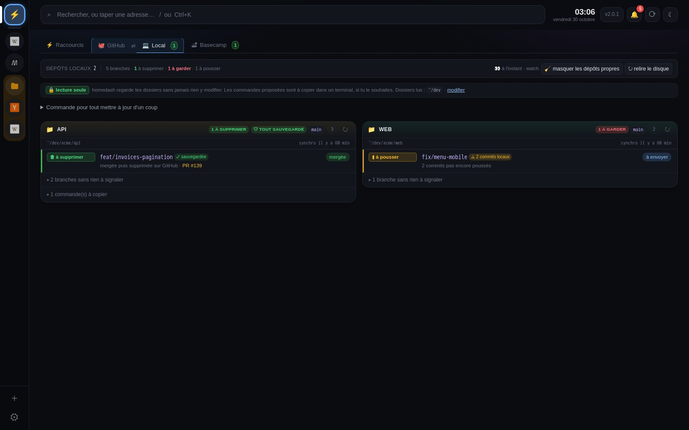
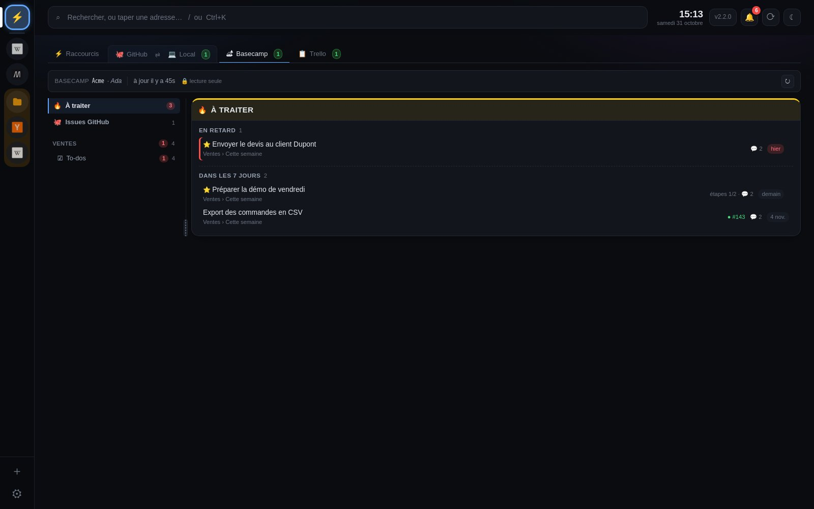

# Guide

Installation : voir le [README](README.md). Ce guide est aussi dans homedash : **Réglages → Aide →
Guide**, une partie par pastille.

## ⚡ Raccourcis

Ta page d'accueil : tes liens, des notes, des infos à copier.

**Premier lancement** : la carte **👋 Pour commencer**, en haut, liste ce qu'il reste à brancher (tes sites,
GitHub, tes dossiers de code, Basecamp, Trello, la taille de ton écran). Chaque bouton mène au bon réglage, avec
le pas-à-pas ; une étape faite se coche toute seule. La carte disparaît quand tout est fait, ou avec
*Masquer* (*Réglages → Affichage → Pour commencer* la remet). Tu ne te sers pas de GitHub, de Basecamp, de Trello ou
de l'onglet Local ? Décoche-les dans *Réglages → Fonctionnalités* : leur étape disparaît.

#### Comment faire

- **Modifier quoi que ce soit** : clic droit dessus (un lien, une catégorie, une info, une note).
- **Nouvelle catégorie** : clic droit sur une catégorie → *Nouvelle catégorie…*
- **Masquer une catégorie** : clic droit → *Masquer*. Un lien en bas de Raccourcis (« 2 catégories
  masquées — afficher ») les réaffiche.
- **Épingler un lien** : clic droit → *Épingler*. Glisse une tuile par sa poignée ⠿ pour la déplacer.
- **Copier une info** (Wi-Fi, IP…) : un clic. Une valeur secrète se copie sans s'afficher.
- **Replier** : la flèche d'une catégorie, de *Notes* ou d'*Infos*. homedash s'en souvient.

#### Bon à savoir

- « Les plus utilisés » se remplit tout seul, d'après tes clics.
- Un lien **surveillé** a un voyant : vert, le site répond ; rouge, il ne répond pas.

## 🗂 Mes sites

Tes sites (Gmail, Chat, Claude…) et fichiers dans la barre de gauche, à côté de homedash. Elle est là
même sans aucun site : son **＋** ajoute le premier.

#### Comment faire

- **Ajouter** : ＋ en bas de la barre, puis une adresse ou un site courant.
- **Ouvrir** : clic sur l'icône. En haut : ← → ↻, ↗ (navigateur), partager (copie le lien), ⚙ (modifier).
  L'adresse s'affiche au survol du nom. **⚡** ramène à homedash.
- **Containers Docker** (développeurs) : *Réglages → Docker* ajoute un dossier 🐳 dans la barre, avec un lien vers
  chaque container qui publie un port web. Tu choisis lesquels ; homedash lit la liste et ne change rien.
- **Tout le reste** : clic droit sur l'icône (copier le lien, dossier, compte, notifications, son, veille,
  modifier, supprimer).
- **Partager un onglet** : le bouton partager en haut (ou clic droit → *Copier le lien*) copie l'adresse
  de la page affichée, sans l'ouvrir dans le navigateur.
- **Ranger** : glisse une icône sur une autre pour créer un dossier.
- **Largeur de la barre, la cacher** : clic droit sur la barre, hors d'une icône.

| Ajouter un site | Clic droit sur une icône |
| --- | --- |
|  |  |

#### Bon à savoir

- La **pastille rouge** compte les non-lus du site. Un onglet trop bavard : *Couper les notifications*.
- **Comptes** : deux connexions pour un même site (Gmail « pro » et « perso »), *Nouveau compte…* Pour
  tout un dossier : clic droit sur le dossier → *Compte de tout le dossier* ; la lettre du compte ne
  s'affiche alors que sur les sites qui font exception.
- **Onglet temporaire** (contour pointillé) : un lien vers un site qui n'est pas dans ta barre l'ouvre en
  haut, là où tu es. Le petit chiffre en bas à gauche d'une icône compte les onglets ouverts dans ce
  site. Il se ferme au redémarrage ou après 3 h sans y aller ; clic droit → *Garder dans Mes sites* pour
  le conserver, ou *Fermer tous les onglets temporaires*.
- **⋯ au survol** d'un lien, d'une tuile ou d'une catégorie : le même menu que le clic droit.
- **Catalogue** (*Réglages → Mes sites*) : un clic ajoute un site avec son icône et un réglage recommandé
  (messageries chargées au démarrage, réseaux sociaux en veille, musique sans veille), et des raccourcis directs
  comme Instagram Direct. Tout se change ensuite dans la fiche du site. Pour les sites déjà là : ✨ *Configuration
  recommandée*, qui montre ce qui change avant d'appliquer.
- Un **fichier** de ton disque marche aussi (`~/Documents/procédure.pdf`) : lu, jamais modifié.
- Dans un navigateur, Gmail, Chat et la plupart des grands sites refusent de s'afficher dans une page :
  l'**appli de bureau** les affiche tous.

## 💻 Appli de bureau

homedash dans sa propre fenêtre, sur Mac et Windows. Elle n'ouvre aucun port ; tes données sont dans
`~/Library/Application Support/homedash/data` (Mac) ou `%APPDATA%\homedash\data` (Windows).

#### Ce qu'elle ajoute

- **Tous les sites s'affichent**, Gmail et Chat compris. Tu t'y connectes une fois, c'est gardé.
- **Non-lus** sur les icônes de la barre et sur l'icône de l'appli (Dock, barre des tâches).
- **Un site = un seul endroit** : un lien vers un de tes sites (Gmail, Chat, GitHub…) l'ouvre dans ce
  site, dans la barre de gauche, avec son compte ; une page déjà ouverte est simplement réaffichée. Un lien
  vers un autre site s'ouvre en onglet temporaire, en haut, là où tu es : à côté de *Raccourcis* depuis le
  dash, en haut du site depuis un site. ✕ ou clic molette pour fermer ; ⚡ ramène au dash, et recliqué,
  à *Raccourcis*.
- **Plutôt le navigateur ?** *Réglages → Mes sites → Liens qui ouvrent un nouvel onglet → Dans le
  navigateur*. Valable pour les liens du dash et ceux d'un site qui ouvrent un nouvel onglet (un lien qui
  change juste de page reste dans le site). Dans les deux cas, ⌘clic (Ctrl+clic sous Windows, ou ⇧clic)
  fait l'inverse, et le clic droit propose les deux.
- **Garder un onglet** : il se ferme au redémarrage ou après 3 h sans y aller, sauf *Garder dans Mes
  sites* (clic droit sur l'onglet).
- **Clic droit sur un lien** : *Dans <ton site>*, *Nouvel onglet temporaire* (avec le compte de ton
  choix) ou *Dans le navigateur* ; copier, rechercher.

#### Installer et mettre à jour

- **Installer** : voir le [README](README.md#installer) (une autorisation au premier lancement, une seule fois).
- **Mettre à jour** : *Aide → Vérifier les mises à jour*, ou le bouton des nouveautés. L'appli
  télécharge, vérifie, sauvegarde tes données, puis se remplace et se relance. Sous Windows, si
  l'installation échoue, homedash reste ouvert ou se rouvre, et te le dit.
- **homedash n'existe que dans l'appli** : elle n'ouvre aucun port, et http://localhost:7777 dans un
  navigateur ne montre rien. Pour l'ouvrir aussi dans un navigateur : coche *Réglages → Affichage →
  Accès depuis le navigateur* ; http://localhost:7777 marche alors, sur ta machine seulement, tant que
  l'appli tourne.

#### Raccourcis

| Mac | Windows | Action |
| --- | --- | --- |
| `⌘R` | `Ctrl+R` | Recharger le site ouvert (sur un onglet de homedash : relire ses données) |
| `⇧⌘R` | `Ctrl+Maj+R` | Recharger tout homedash (tous les sites se rechargent) |
| `⌘[` `⌘]` | `Ctrl+[` `Ctrl+]` | Page précédente / suivante (aussi les boutons de la souris) |
| `⌘,` | `Ctrl+,` | Réglages |
| `⌘Q` | Clic droit sur l'icône près de l'horloge → *Quitter* | Quitter. Fermer la fenêtre la cache seulement : pastilles et cloche continuent |

#### Bon à savoir

- **Mémoire** : au démarrage, seuls les mails et messageries sont chargés, l'un après l'autre (leurs pastilles arrivent dans les premières secondes) ; les autres au premier clic.
  *Réglages → Mes sites* affiche ce que consomme chaque site : 💤 *Libérer* le décharge tout de suite, jusqu'au
  prochain clic. Clic droit → *Mettre en veille si inutilisé* libère un onglet après 5 min sans y aller.
- **Son** : 🔊 sur l'icône d'un onglet qui joue du son ; un clic le coupe.
- **Sans l'appli**, homedash s'installe aussi comme une page : ⊕ *Installer* dans Chrome, *Fichier →
  Ajouter au Dock* dans Safari.

## 🔔 Notifications

La cloche, en haut à droite : ce qui s'est passé (CI, PRs, branches à nettoyer, Basecamp, Trello, nouvelle
version).

#### Comment faire

- **Voir** : clic sur la cloche ; *Tout voir* ouvre l'historique. Une seule liste, la plus récente en
  haut ; filtres *Tout*, *GitHub & Local*, *Basecamp*, *Trello* (ces deux derniers quand le service est connecté).
- **Notifs Basecamp** : les non lues en tête (« non lue »), puis celles déjà vues, qui **restent** une
  fois lues dans Basecamp : tu peux y revenir.
- **Tout actualiser** : ⟳ à côté de la cloche relit GitHub, Basecamp, Trello, tes dépôts, la cloche et les
  non-lus de tes sites (ceux en veille sont réveillés).
- **Notifications du système** : *activer* en bas de la cloche (coupées au départ).
- **Faire taire un onglet** : clic droit sur son icône → *Couper les notifications*.
- **Le nombre sur l'icône de l'appli** : non-lus des sites, cloche, ou les deux (*Réglages →
  Notifications*).

#### Bon à savoir

- Ouvrir la cloche efface ses nouveautés. Une notif Basecamp ou Trello reste comptée tant qu'elle n'est
  pas lue dans Basecamp ou Trello.
- **🧹 Branche mergée** : annoncée une seule fois, en une ligne même si elle est dans plusieurs dépôts ;
  un clic ouvre l'onglet Local et sa commande.
- **Rien sur l'icône du Dock ?** macOS l'affiche seulement si *Pastilles de l'app* est activé pour
  homedash : *Réglages → Notifications → ouvrir les réglages de notifications du Mac*.

## 🐙 GitHub et 💻 Local

Ton code en ligne (GitHub) et sur ton disque (Local), côte à côte.

- **GitHub** (dès qu'un compte est connecté, rafraîchi toutes les 15 s) : 🌿 branches actives avec leur
  PR et leur CI, 🔀 PRs ouvertes (CI, revues, conflits), ✅ mergées (🧹 = la copie locale peut partir). Quand un workflow
  tourne sur un repo suivi, ⚙️ *En cours* apparaît en haut avec le détail de ses jobs, puis disparaît à la fin.
- **Local** : tes clones, branche par branche, avec un verdict.

| Verdict | Ce que ça veut dire |
| --- | --- |
| 🗑 à supprimer | Son contenu existe ailleurs : sans risque |
| 🔍 à vérifier | Sans doute finie, mais une partie n'existe que là |
| ⚠ à garder | Des commits uniquement sur ton disque |
| 🔧 en cours | Travail actif |

#### Bon à savoir

- **Tes clones peuvent être n'importe où** : *Réglages → Dépôts locaux → + ajouter un dossier*, puis
  🏠 dossier personnel ou 💽 le disque (`C:` sous Windows, `/Volumes` sur Mac pour les disques externes).
  Tout est lu en lecture seule.
- **Rien n'est exécuté** : les commandes proposées (`git branch -d …`) sont à copier et lancer toi-même.
- **Branche courante pas à jour** : en retard sur sa version en ligne → `git pull` ; sur une autre
  branche que main/master, main a avancé → `git fetch origin && git merge origin/main`. Les deux à la
  fois : le pull d'abord.
- Plusieurs comptes GitHub : choisis lequel afficher en haut de l'onglet.

## 🏕 Basecamp

Tes tâches Basecamp sans ouvrir Basecamp. **Lecture seule** : homedash ne coche rien et ne poste que
les rapports que tu publies.

- **🔥 À traiter** : ce qui est en retard ou dû dans les 7 jours. À gauche, un projet : ses tableaux et to-dos.
- **Se connecter** (une fois, pas besoin d'être admin) : pas-à-pas dans *Réglages → Basecamp*.
- **Lire une tâche** : un clic sur son titre (⌘ clic : Basecamp) : description, étapes, issues liées, échanges
  avec leurs captures.

#### D'une tâche à une issue GitHub, et retour

1. **Créer l'issue** : *🐙 Créer une issue* dans la tâche (ou clic droit), ou *🐙 issue* au survol d'un message
   pour partir de lui seul. Le formulaire s'ouvre à côté : coche ce qui part dans l'issue (description, messages ;
   *Tout inclure*, *Rien inclure* ; tout est coché au départ), ajoute tes précisions, relis l'*Aperçu*, puis
   **Créer sur GitHub** (⌘ Entrée).
   *Ouvrir le formulaire* passe plutôt par github.com.
2. **La confier à Claude Code** : à la création, une commande est copiée (`cd ~/dev/api && claude '…'`) :
   colle-la dans un terminal. La consigne est dans l'issue : faire le travail, poster un rapport
   (`<!-- homedash:bc-report -->`), fermer l'issue.
3. **Publier le rapport** : la cloche sonne (*📤 Rapport prêt*). **📤 publier sur BC**, à côté de la
   tâche ou dans **🐙 Issues GitHub**, le poste en commentaire de la tâche, à ton nom, une seule fois.
   ✕ écarte une issue sans rien envoyer.

Dans **🐙 Issues GitHub** : *▶ prompt de départ* recopie la commande ; *📝 rapport final* donne un prompt
pour faire réécrire le rapport ; *afficher les terminées* et *rétablir* retrouvent les issues écartées.

**Repos où créer les issues** (*Réglages → Basecamp*, et pareil dans *Réglages → Trello*) : coche les
repos qui peuvent recevoir une issue depuis cet outil, par exemple les repos du travail pour Basecamp et
tes repos perso pour Trello. Seuls ceux-là sont proposés, et homedash refuse les autres. Aucun coché =
tous les repos suivis.

Le jeton GitHub doit pouvoir lire les issues, et les écrire pour *Créer sur GitHub* (*Issues : Read and
write* en fine-grained ; un jeton classic `repo` suffit).

## 📋 Trello

Les cartes ouvertes de tes tableaux Trello, dans les mêmes colonnes que sur Trello. **Lecture seule** :
homedash ne coche rien, ne déplace aucune carte, et ne poste que le rapport d'une issue, quand tu le
demandes. Les notifications ne sont jamais marquées lues. Les listes archivées ne sont pas affichées.

- **Se connecter** (une fois) : sur trello.com/power-ups/admin, crée une application *homedash*
  (« n'utilise pas les fonctionnalités Power-up », confidentielle, aucune URL à remplir), copie sa
  **clé API** dans *Réglages → Trello*, puis *Se connecter à Trello* : autorise, et colle le jeton
  affiché. Le jeton reste dans l'appli.
- L'onglet apparaît dès que la clé est enregistrée. À gauche : **🔥 À traiter** (tes cartes, échéance
  dépassée ou dans les 7 jours), **🐙 Issues GitHub**, puis un tableau par tableau. Un tableau montre
  toutes ses cartes visibles, pas seulement les tiennes. Un tableau se masque ; un nouveau tableau
  est montré.
- **Un clic sur une carte** l'ouvre (description, cases, échanges) ; ⌘ clic sur son titre : Trello. **🐙 Créer une
  issue** ouvre le formulaire à côté, comme pour Basecamp, dans un des repos choisis pour Trello (*Réglages → Trello*,
  *Repos où créer les issues*). Le rapport se publie en commentaire de la carte, une fois, après confirmation.
- Le tableau suit le thème clair ou sombre, avec étiquettes, échéances en couleur et photos de profil.
  ✕ écarte une issue sans rien envoyer.
- La pastille de l'onglet compte tes cartes en retard. trello.com ne s'ouvre pas dans un onglet intégré
  de Mes sites : le site refuse ce cadre.

## 🔎 Recherche

`/` ou `⌘K` : tout retrouver, ouvrir une adresse, et agir sur un site sans passer par le clic droit : tape
« libérer discord », « recharger gmail », « couper le son de youtube »… Dans « Partout » seulement.

- **Un mot** : liens, onglets, repos, PRs, branches, infos, notes, pages déjà vues.
- **Chercher à un seul endroit** : clic sur la loupe, à gauche de la barre → *Raccourcis*, *Mes sites*,
  *GitHub & Local*, *Basecamp*, *Trello* ou *Le web*. La loupe s'allume tant que la recherche est limitée ;
  *Partout* revient à la recherche complète (elle l'est aussi à chaque rechargement).
- **Basecamp** (s'il est connecté) : tes tâches tout de suite, puis, un instant après ta frappe, tout
  Basecamp : to-dos, cartes, messages, commentaires, documents (sans les archivés). La carte à droite
  montre un extrait, l'échéance, l'auteur ; Entrée ouvre l'élément dans Basecamp. Pour une tâche ou
  un de ses commentaires : **💬 Voir la tâche** (ouverte sur l'échange trouvé), **🐙 Créer une
  issue** (ou *Issue sur cet échange*), et **Voir dans le dash** si elle t'est assignée (son tableau
  dans l'onglet Basecamp, la tâche mise en évidence).
- **Trello** (s'il est connecté) : tes cartes tout de suite, puis, un instant après ta frappe, cartes,
  tableaux et commentaires Trello. Entrée ouvre l'élément sur Trello. **💬 Voir la carte**, **🐙 Créer
  une issue**, et **Voir dans le dash** pour une de tes cartes.
- **Fautes de frappe** : les mots se cherchent dans n'importe quel ordre, une faute par mot tolérée
  (« shopping diag » trouve « Assistant Shoping interne (Diag) »). La recherche dans tout Basecamp,
  elle, ne les tolère pas.
- **Une adresse** (`exemple.com`, `localhost:3000`) : Entrée l'ouvre.
- **Un raccourci** en premier mot : `g` Google, `gh` GitHub, `yt` YouTube, `w` Wikipédia, `maps`, `tr`
  traduction, `mdn`.
- **Une action** : « réglages », « thème », « nouvelle catégorie », « temporaire »…

`↑` `↓` pour choisir, `↵` pour ouvrir ou copier, `Échap` pour effacer. `⌘S` enregistre les réglages.

## ⚙️ Réglages

Tout ce qui se règle, rangé par thème. `⌘S` (ou le bouton du bas) enregistre ; la barre du bas signale
ce qui ne l'est pas encore. Tu quittes Réglages sans enregistrer ? homedash te le propose ; *Plus tard*
garde tes modifications en brouillon, retrouvées au retour.

| Partie | Ce qu'on y fait |
| --- | --- |
| 🧩 Fonctionnalités | Couper GitHub, Local, Basecamp ou Trello si tu ne t'en sers pas |
| 🐙 GitHub | Pour le compte choisi en haut : connexion, repos suivis (et où ils apparaissent), équipe, ce que montre l'onglet ; ＋ compte pour un autre compte GitHub |
| 💻 Dépôts locaux | Les dossiers où chercher tes clones |
| 🏕 Basecamp | La connexion, les repos où créer les issues |
| 📋 Trello | La clé d'API et le jeton, les repos où créer les issues |
| 🗂 Mes sites | Tes sites (une ligne chacun, ▾ pour tous ses réglages), dossiers, comptes, où s'ouvrent les liens, mise en veille |
| 🎛 Affichage | Ce qui s'affiche (horloge, tuiles…), taille de l'écran, journal de performance |
| 🔔 Notifications | Notifications du bureau, pastille de l'icône de l'appli |
| 💾 Sauvegardes | Restaurer, télécharger, faire le ménage |
| 📖 Aide | Nouveautés, ce guide, journal d'erreurs, journal de performance (s'il est activé) |

**Couper une fonctionnalité** (🧩 Fonctionnalités) : décochée, elle disparaît de la page (onglet,
recherche, cartes de l'accueil, ses parties de Réglages, ses notifications dans la cloche et
l'historique, même passées) et homedash ne lit plus le service. Rien n'est
effacé : jeton, connexion et réglages sont gardés, et la recocher remet tout en place. Le choix vaut pour
ton homedash seulement.

## 💾 Sauvegardes

homedash sauvegarde tes liens, réglages et notes tout seul : chaque jour, et avant chaque mise à jour.

- **Revenir en arrière** : *restaurer* sur une ligne. L'état actuel est sauvegardé juste avant.
- **Faire le ménage** : coche des lignes (ou *tout*, *les automatiques*, *plus de 7 jours*), puis
  *supprimer la sélection*.
- **Changer de machine** (un Mac et un PC, par exemple) : *Export complet*, avec un mot de passe. Le
  fichier `.homedash` emporte tout, jetons GitHub, Basecamp et Trello et connexions de tes sites compris,
  chiffré. Sur l'autre machine : *importer un export complet…*, le mot de passe, puis *aperçu* montre ce
  qu'il contient avant de rien changer. Certains sites (Google, Microsoft…) redemandent quand même la
  connexion sur une nouvelle machine.
- **Juste tes réglages** : *télécharger*, puis *restaurer un fichier…*. Ce fichier-là ne contient pas
  les jetons : recolle-les ensuite.

## 🆘 En cas de souci

| Ce que tu vois | Quoi faire |
| --- | --- |
| « Connexion à homedash… » | homedash redémarre (mise à jour, réveil) : la page revient toute seule. Si ça dure, quitte et relance l'appli |
| « La mise à jour n'a pas été installée » (Windows) | Tes données n'ont pas changé. Réessaie, ou installe la nouvelle version à la main depuis la page des versions. Si ça recommence, *Aide → Signaler un problème* en joignant le fichier `update.log` indiqué dans le message |
| « homedash n'a pas pu démarrer » | Le serveur de l'appli s'est arrêté : quitte et relance homedash. Si ça recommence, *Aide → Signaler un problème* |
| http://localhost:7777 ne montre rien dans le navigateur | Normal : coche *Réglages → Affichage → Accès depuis le navigateur*, l'appli ouverte |
| Accès navigateur : « le port 7777 est déjà pris » | Un autre programme l'utilise (un ancien homedash ?) : ferme-le |
| « Tes réglages ne se lisent plus » | Le fichier a été abîmé (souvent une modification à la main) : *Revenir à la dernière sauvegarde* |
| Pas d'onglet GitHub | Aucun jeton : *Réglages → GitHub → Connexion*, le pas-à-pas « Comment créer un jeton » y est ouvert |
| Un repo n'est pas proposé | Repo d'un collègue où tu es collaborateur : onglet *Partagés avec toi*. Sinon le jeton n'y a pas accès : ajoute-le dans *Repository access* du jeton, sur GitHub |
| Onglet Local vide | Ajoute un dossier dans *Réglages → Dépôts locaux* (dossier personnel, ou 💽 ailleurs sur le disque) |
| Une pastille ne bouge pas | L'onglet est peut-être en veille : clique dessus pour le recharger |
| Des lettres au lieu des icônes | *Réglages → Affichage → Icônes des sites* doit être coché |
| Un site boude (captcha refusé, page qui tourne en boucle) | Clic droit sur son icône → *Effacer les données de ce site*, puis reconnecte-toi. Sinon ↗ l'ouvre dans ton navigateur |
| Rien sur l'icône du Dock | *Pastilles de l'app* désactivé dans macOS : voir *Notifications* ci-dessus |

Autre chose ? Ouvre une **[issue sur GitHub](https://github.com/lepetitpaco/homedash/issues/new)** :
ce que tu faisais, ce que tu attendais, ce qui s'est passé, et ta version (en haut à droite). *Réglages
→ Aide → Journal d'erreurs → Copier pour une issue* donne le détail technique à coller dedans.
