# Guide

Installation : voir le [README](README.md). Ce guide est aussi dans homedash : **?** en haut à droite
(ou *Réglages → Aide → Guide*), une partie par bouton.

## ⚡ Raccourcis

Ta page d'accueil : tes liens, des notes, des infos à copier.

**Premier lancement** : la carte **👋 Pour commencer**, en haut, liste ce qu'il reste à brancher (tes sites,
GitHub, tes dossiers de code, Basecamp, Trello, la taille de ton écran). Chaque bouton mène au bon réglage, avec
le pas-à-pas ; une étape faite se coche toute seule. La carte disparaît quand tout est fait, ou avec
*Masquer* (*Réglages → Affichage → Pour commencer* la remet). Tu ne te sers pas de GitHub, de Basecamp, de Trello ou
de l'onglet Local ? Décoche-les dans *Réglages → Fonctionnalités* : leur étape disparaît.

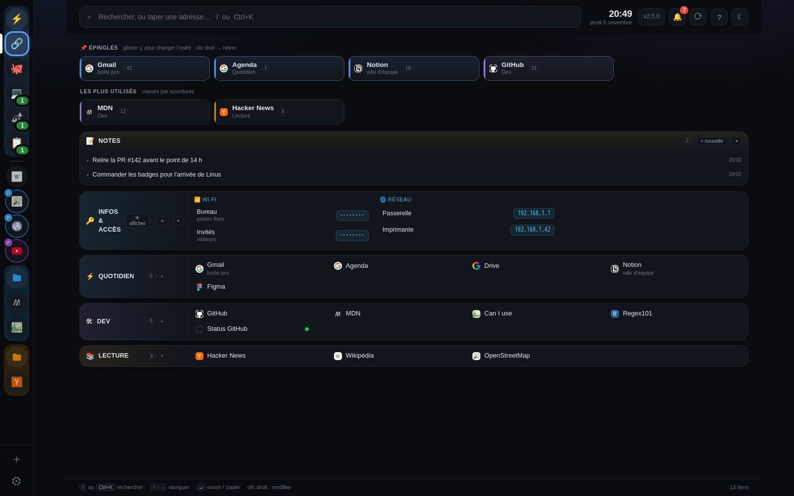

#### Comment faire

- **Modifier quoi que ce soit** : clic droit dessus (un lien, une catégorie, une info, une note).
- **Nouvelle catégorie** : clic droit sur une catégorie → *Nouvelle catégorie…*
- **Masquer une catégorie** : clic droit → *Masquer*. Un lien en bas de Raccourcis (« 2 catégories
  masquées — afficher ») les réaffiche.
- **Épingler un lien** : clic droit → *Épingler*. Glisse une tuile par sa poignée ⠿ pour la déplacer.
- **Copier une info** (Wi-Fi, IP…) : un clic. Une valeur secrète se copie sans s'afficher.
- **Replier** : la flèche d'une catégorie, de *Notes* ou d'*Infos*. homedash s'en souvient.

#### Bon à savoir

- « Les plus utilisés » se remplit tout seul, d'après tes clics.
- Un lien **surveillé** a un voyant : vert, le site répond ; rouge, il ne répond pas.

## 🗂 Mes sites

Tes sites (Gmail, Chat, Claude…) et fichiers dans la barre de gauche, à côté de homedash. Elle est là
même sans aucun site : son **＋** ajoute le premier.

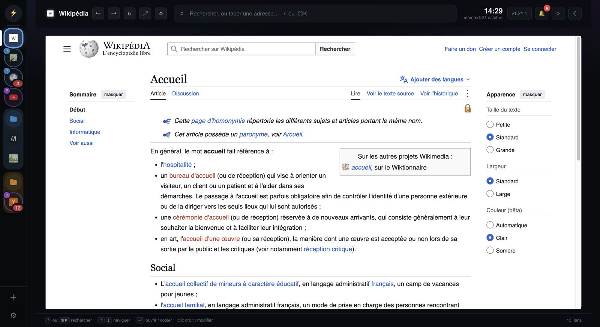

#### Comment faire

- **Ajouter** : ＋ en bas de la barre, puis une adresse ou un site courant.
- **Ouvrir** : clic sur l'icône. En haut : ← → ↻, ↗ (navigateur), partager (copie le lien), ⚙ (modifier).
  L'adresse s'affiche au survol du nom. **⚡** ramène à homedash. Ces boutons sont dans la barre du haut, à
  côté de la recherche, et le site prend toute la place qui reste, bord à bord, quelle que soit la disposition.
- **Mode focus** : ⤢ en haut à droite, ou ⌘⇧F (Ctrl+Maj+F), même en tapant dans le site : le site prend toute la
  fenêtre. La barre du haut revient quand la souris touche le bord haut (ou avec ⌘K), celle de gauche au bord gauche.
  ⤡ ou ⌘⇧F pour en sortir ; quitter le site en sort aussi. **Aussi dans une vue scindée** (même ouverte sur
  l'accueil) : les panneaux prennent toute la fenêtre (8 px seulement entre deux), avec un en-tête réduit (numéro, site, son, agrandir) ;
  la barre de la vue (Flux / Messagerie, Options, Fermer) revient avec la barre du haut quand la souris touche le bord haut.
  Fermer la vue sort du focus.
- **Disposition et taille** : clic droit sur une barre, hors d'une icône, puis *Disposition et taille…*, ou *Réglages → Barres
  et onglets*. Propre à chaque écran, appliqué tout de suite. D'abord **où sont les onglets**, et juste dessous **Masquer
  automatiquement** (la barre se cache et revient quand la souris passe au bord gauche, ou en haut de la page ; les sites
  qui ont des non-lus apparaissent alors à gauche de la cloche, les 3 plus chargés puis *+N*, un clic ouvre le site). Puis
  les options du mode choisi :
  - *Barre de gauche* : icônes, icônes et titres, titres, ou tuiles (le titre sous l'icône) sur 1 à 3 colonnes ; petit, normal
    ou grand. Un titre long est coupé, complet au survol. **‹** en bas réduit la barre aux icônes, **›** la redéplie.
  - *En haut* : plus de barre de gauche, tous les onglets en haut de la page, sur plusieurs rangées si besoin ; style
    (pastilles, par défaut, ou soulignés) et taille des onglets. Un dossier est un onglet : un clic montre ses sites. On
    revient à la barre de gauche par ce même choix.
- **Raccourcis, GitHub, Local… à un clic** : par défaut dans un dossier ⚡ en haut de la barre. Un clic sur ⚡ replie ou
  déplie le dossier ; replié, il montre le total des compteurs. Clic droit sur **⚡** → *En haut de la page* : ils passent
  dans la barre d'onglets du haut (un clic sur ⚡, puis l'onglet).
- **Containers Docker** (développeurs) : *Réglages → Mes sites → Docker*, proposé quand Docker tourne sur la machine, ajoute un dossier 🐳 dans la barre, avec une ligne par projet Compose
  ou container, reconnaissable à ses deux lettres et sa couleur. Un clic ouvre son premier port, un clic droit ses autres ports.
  Le dossier se glisse où tu veux. Ceux qui sont éteints restent visibles en plus fade, sans clic. Tu choisis lesquels ; homedash lit la liste et ne change rien.
- **Extensions de navigateur** (appli de bureau) : *Réglages → Mes sites → Extensions* → *Ajouter un dossier*, celui
  d'une extension non empaquetée (avec `manifest.json`). Elle tourne dans tous tes sites, tous comptes compris, sur
  cette machine seulement ; *↻ Recharger les sites ouverts* pour l'appliquer tout de suite. Ce qu'elle fait dans la
  page marche, et **⚙ Réglages** ouvre sa fenêtre (popup) ou sa page d'options : ses réglages valent pour tes sites
  sans compte à part (chaque compte garde les siens). Son icône, son clic droit et `storage.sync` non (elle doit se
  rabattre sur `storage.local`). N'ajoute que des extensions que tu connais : elles voient tout ce que tes sites affichent.
- **Tout le reste** : clic droit sur l'icône du site (copier le lien, dossier, compte, notifications, son, veille,
  modifier, supprimer).
- **Partager un onglet** : le bouton partager en haut (ou clic droit → *Copier le lien*) copie l'adresse
  de la page affichée, sans l'ouvrir dans le navigateur.
- **Ranger** : glisse une icône sur une autre pour créer un dossier. Glisse un dossier sur un site ou un autre dossier pour le placer devant, ou tout en bas de la barre pour le mettre à la fin.

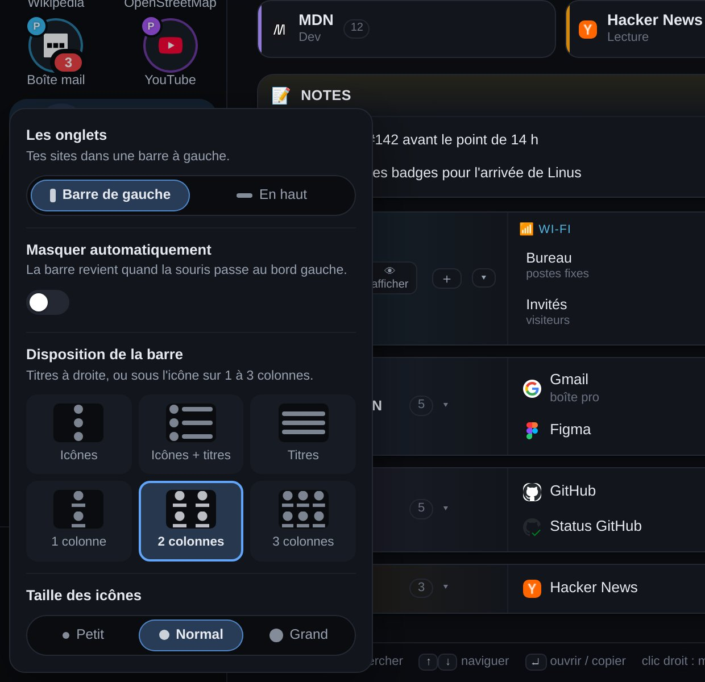

| Ajouter un site | Clic droit sur une icône |
| --- | --- |
| 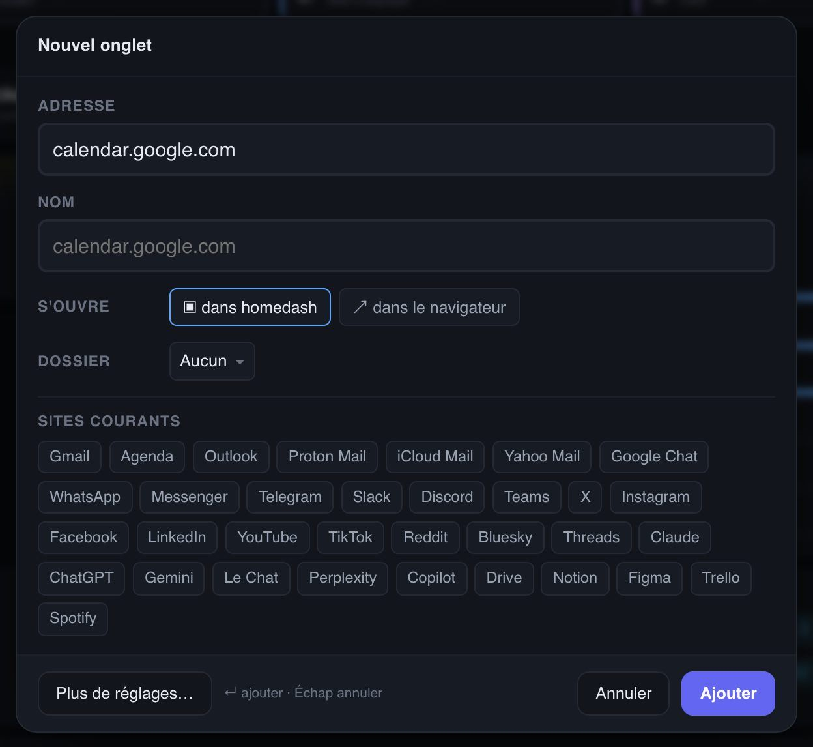 | 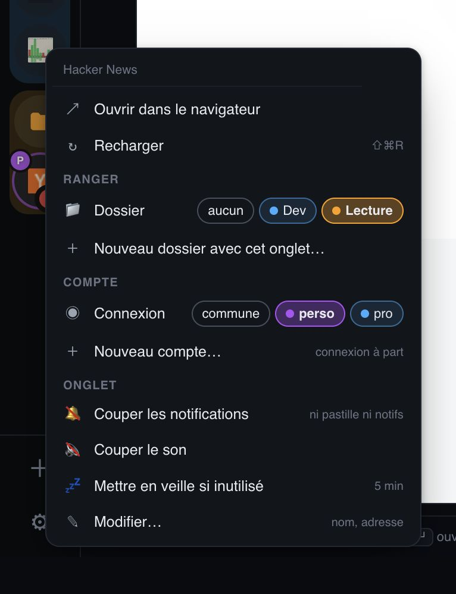 |

#### Bon à savoir

- Le **compteur rouge** compte les non-lus du site. Un onglet trop bavard : *Couper les notifications*.
- Le **compteur vert** de Local compte les branches déjà fusionnées encore sur ton disque ; celui de Basecamp
  ou Trello, tes tâches ou cartes en retard. Clic droit sur l'onglet : ce qu'il compte exactement, et *Masquer le
  compteur* : il revient dès que le nombre change.
- Le **compteur bleu** de ⚡ compte les onglets ouverts depuis homedash (liens cliqués), en haut de la page.
  Clic droit sur ⚡ → *Fermer les onglets ouverts depuis homedash*.
- **Comptes** : deux connexions pour un même site (Gmail « pro » et « perso »), *Nouveau compte…* Pour
  tout un dossier : clic droit sur le dossier → *Compte de tout le dossier* ; la lettre du compte ne
  s'affiche alors que sur les sites qui font exception.
- **Onglet temporaire** (contour pointillé) : un lien vers un site qui n'est pas dans ta barre l'ouvre en
  haut, là où tu es. Le petit chiffre en bas à gauche d'une icône compte les onglets ouverts dans ce
  site. Il se ferme au redémarrage ou après 3 h sans y aller ; clic droit → *Garder dans Mes sites* pour
  le conserver, ou *Fermer tous les onglets temporaires*.
- **⋯ au survol** d'un lien, d'une tuile ou d'une catégorie : le même menu que le clic droit.
- **Catalogue** (*Réglages → Mes sites*) : un clic ajoute un site avec son icône et un réglage recommandé
  (messageries chargées au démarrage, réseaux sociaux en veille, musique sans veille), et des raccourcis directs
  comme Instagram Direct. Tout se change ensuite dans la fiche du site. Pour les sites déjà là : ✨ *Configuration
  recommandée*, qui montre ce qui change avant d'appliquer.
- **Pause quand je n'y suis pas** (appli de bureau) : quand un site n'est plus affiché (tu es sur un autre site ou une
  autre page), ses vidéos et ses sons en lecture sont mis en pause, puis reprennent à ton retour (TikTok, Instagram et
  les autres sites de scroll ne jouent donc plus dans ton dos). Les lecteurs (YouTube, Spotify, Twitch…), les appels et
  les messageries du catalogue ne sont jamais coupés. Une pause faite à la main n'est jamais relancée. Réglable site par
  site : *Réglages → Mes sites → ▾ → Plus d'options → Pause quand je n'y suis pas* (« Non, joue en fond » pour une radio
  ou une web app perso).
- Un **fichier** de ton disque marche aussi (`~/Documents/procédure.pdf`) : lu, jamais modifié.
- Dans un navigateur, Gmail, Chat et la plupart des grands sites refusent de s'afficher dans une page :
  l'**appli de bureau** les affiche tous.

## 💻 Appli de bureau

homedash dans sa propre fenêtre, sur Mac et Windows. Elle n'ouvre aucun port ; tes données sont dans
`~/Library/Application Support/homedash/data` (Mac) ou `%APPDATA%\homedash\data` (Windows).

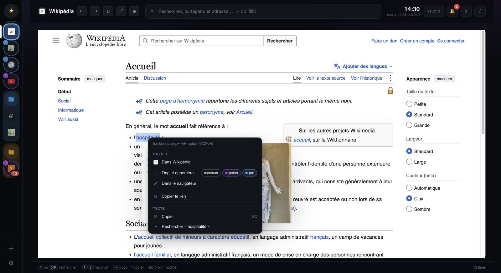

#### Ce qu'elle ajoute

- **Tous les sites s'affichent**, Gmail et Chat compris. Tu t'y connectes une fois, c'est gardé.
- **Non-lus** sur les icônes de la barre et sur l'icône de l'appli (Dock, barre des tâches).
- **Un site = un seul endroit** : un lien vers un de tes sites (Gmail, Chat, GitHub…) l'ouvre dans ce
  site, dans la barre de gauche, avec son compte ; une page déjà ouverte est simplement réaffichée. Un lien
  vers un autre site s'ouvre en onglet temporaire, en haut, là où tu es : à côté de *Raccourcis* depuis le
  dash, en haut du site depuis un site. ✕ ou clic molette pour fermer ; ⚡ ramène au dash, et recliqué,
  à *Raccourcis*.
- **Plutôt le navigateur ?** *Réglages → Mes sites → Liens qui ouvrent un nouvel onglet → Dans le
  navigateur*. Valable pour les liens du dash et ceux d'un site qui ouvrent un nouvel onglet (un lien qui
  change juste de page reste dans le site). Dans les deux cas, ⌘clic (Ctrl+clic sous Windows, ou ⇧clic)
  fait l'inverse, et le clic droit propose les deux.
- **Garder un onglet** : il se ferme au redémarrage ou après 3 h sans y aller, sauf *Garder dans Mes
  sites* (clic droit sur l'onglet).
- **Clic droit sur un lien** : *Dans <ton site>*, *Nouvel onglet temporaire* (avec le compte de ton
  choix) ou *Dans le navigateur* ; copier, rechercher.

#### Installer et mettre à jour

- **Installer** : voir le [README](README.md#installer) (une autorisation au premier lancement, une seule fois).
- **Mettre à jour** : *Aide → Vérifier les mises à jour*, ou le bouton des nouveautés. L'appli
  télécharge, vérifie, sauvegarde tes données, puis se remplace et se relance. Sous Windows, si
  l'installation échoue, homedash reste ouvert ou se rouvre, et te le dit.
- **✨ Quoi de neuf** : après une mise à jour qui apporte quelque chose de nouveau, une fenêtre le présente, une
  carte par nouveauté ; *Essayer* t'y emmène. Elle ne s'ouvre qu'une fois ; pour la revoir, clique le numéro de version
  en haut à droite.
- **homedash n'existe que dans l'appli** : elle n'ouvre aucun port, et http://localhost:7777 dans un
  navigateur ne montre rien. Pour l'ouvrir aussi dans un navigateur : coche *Réglages → Fonctionnalités →
  Accès depuis le navigateur* ; http://localhost:7777 marche alors, sur ta machine seulement, tant que
  l'appli tourne.

#### Raccourcis

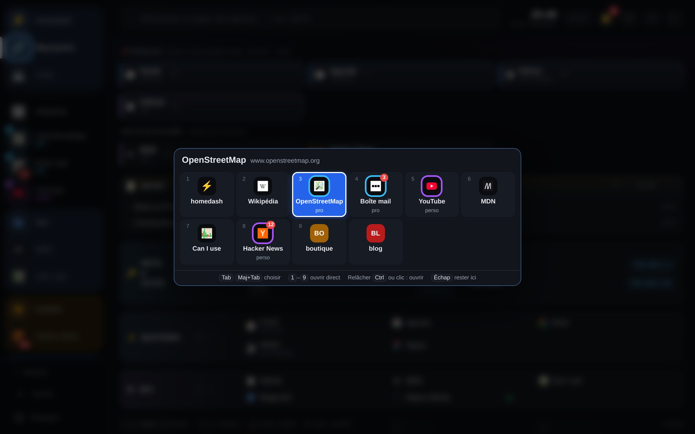

| Mac | Windows | Action |
| --- | --- | --- |
| `⌘R` | `Ctrl+R` | Recharger le site ouvert (sur un onglet de homedash : relire ses données) |
| `⇧⌘R` | `Ctrl+Maj+R` | Recharger tout homedash (tous les sites se rechargent) |
| `⌘[` `⌘]` | `Ctrl+[` `Ctrl+]` | Page précédente / suivante (aussi les boutons de la souris) |
| `Ctrl+Tab` | `Ctrl+Tab` | Revenir au site d'avant. `Ctrl` gardé appuyé : tes sites s'affichent en tuiles. `Tab` ou `Maj+Tab` pour choisir, relâcher `Ctrl` ou cliquer pour ouvrir, `1` à `9` pour ouvrir directement, `Échap` pour rester (⌘Tab et Alt+Tab restent ceux du système) |
| `⌘⇧F` | `Ctrl+Maj+F` | Mode focus : le site affiché (ou la vue scindée) prend toute la fenêtre, même quand tu tapes dans le site ; les barres reviennent au bord. Encore une fois pour en sortir |
| `⌘,` | `Ctrl+,` | Réglages |
| `⌘Q` | Clic droit sur l'icône près de l'horloge → *Quitter* | Quitter. Fermer la fenêtre la cache seulement : compteurs et cloche continuent |

#### Bon à savoir

- **Mémoire** : au démarrage, seuls les mails et messageries sont chargés, l'un après l'autre (leurs compteurs arrivent dans les premières secondes) ; les autres au premier clic.
  *Réglages → Mes sites* affiche ce que consomme chaque site : 💤 *Libérer* le décharge tout de suite, jusqu'au
  prochain clic. Clic droit → *Mettre en veille si inutilisé* libère un onglet après 5 min sans y aller.
- **Son** : 🔊 sur l'icône d'un onglet qui joue du son ; un clic le coupe.
- **Sans l'appli**, homedash s'installe aussi comme une page : ⊕ *Installer* dans Chrome, *Fichier →
  Ajouter au Dock* dans Safari.

## ◫ Vue scindée

*Appli de bureau.* Pour **doomscroller plusieurs flux en parallèle** (TikTok, X, Instagram) ou **suivre plusieurs
messageries** (Instagram et Discord) : **2 à 4 sites côte à côte dans un seul onglet**. homedash reste un dash avec
tes sites principaux, pas un navigateur : pas de barre d'adresse, pas de navigation libre dans les panneaux.

**Créer une vue** : *Ajouter* (＋ de la barre de gauche, ou clic droit sur la barre) → **Ajouter une vue scindée** : un
nom, une disposition (2 colonnes, 2 lignes, 3 colonnes, 1 grand et 2 petits, 2 par 2, 4 colonnes) et le site de chaque
panneau (avec le nom du compte quand un même site en a plusieurs : « X · pro », « X · perso » ; un compte déjà pris par
un autre panneau est grisé). La vue apparaît **dans la barre de gauche comme un site** : **glisse-la** où tu veux,
entre tes sites, dans ou hors d'un dossier. Un clic l'ouvre. Il n'y a pas de vue « jetable » : toute vue est
enregistrée, et se supprime au clic droit.

Les sites sont ceux de *Mes sites*, avec leur connexion. Une vue *Messagerie* affiche le **vrai site** (rien n'est rechargé, ses compteurs comptent dans celui de la vue). Une vue *Flux* ouvre des **copies** : la même connexion, mais une page à part (son historique, sa position) ; elles démarrent sur la page d'accueil du site, ne comptent ni dans le compteur ni dans l'Activité, et se ferment avec la vue (leur position est alors perdue ; chaque copie est une page de plus en mémoire). La composition d'une vue
est **fixe** (pas de sélecteur de site dans les panneaux) : pour la changer, clic droit sur la vue → **Modifier la vue…**
(sélecteurs et dispositions visibles, puis *Enregistrer* ou *Annuler*). **Glisse un séparateur** pour redimensionner :
les proportions sont gardées ; au clavier, `Tab` jusqu'au séparateur puis les flèches le déplacent de 2 %. **Double-clic sur le titre**
d'un panneau (ou `X` en mode Flux) l'agrandit. En fermant la vue (*Fermer*, `Échap` en mode Flux, ou en ouvrant une autre
page), chaque site retrouve sa place ; un site affiché ne se met pas en veille. **Lancer une recherche** (taper dans la barre
du haut) ferme aussi la vue : voulu, les résultats prennent la place.

L'en-tête d'un panneau montre son numéro, son site, *copie* (vue Flux), l'état du son (haut-parleur : le panneau a le son,
barré : son coupé à la main) et, en Flux, **En pause** pour un panneau sans le son. **ⓘ** ouvre l'aide (raccourcis, Maj,
molette) dans une bulle ; **Options** ouvre le menu des cases : les deux se ferment avec `Échap`, qui rend le focus au bouton.

Chaque vue a un **type** (*Flux* ou *Messagerie*), choisi à sa création (Ajouter → Ajouter une vue scindée). Le changer passe tous les panneaux en copies ou en vrais sites : depuis la barre de la vue, le temps de la vue ; dans *Modifier la vue…*, enregistré ; *Réglages → Vue scindée* ne sert qu'à pré-remplir une nouvelle vue :

| | Messagerie | Flux |
| --- | --- | --- |
| Pour | Suivre plusieurs messageries : Instagram et Discord côte à côte | Défiler plusieurs flux en parallèle (TikTok, X, Instagram…) |
| Panneaux | Le **vrai site** (ses notifications, ses compteurs, ses appels) | Des **copies** : une page à part avec ta connexion, son propre historique, sans toucher au site de la barre : défiler la tuile ne bouge jamais l'onglet du site. Toujours des copies, vues anciennes comprises |
| Son | **Tous les sons** : un appel Discord reste audible, jamais de pause | **Le panneau où tu agis** : le dernier geste gagne (survol, molette, touche de mixage, chiffre, clic) ; les autres sont coupés et leurs vidéos en pause, elles reprennent quand le panneau retrouve le son |
| Clavier | **Aucune touche interceptée** : tu tapes dans les sites comme d'habitude | Table de mixage et raccourcis, toujours actifs (tableau ci-dessous) |

Le type décide de tout. Il ne reste que **deux cases**, les mêmes dans les deux types (menu *Options* de la barre,
**valables le temps de la vue** : pour les garder, *Modifier la vue…*, clic droit sur la vue) : *Défilement
synchronisé* (**coché par défaut en Flux, décoché en Messagerie** ; changer de type remet ce défaut : faire défiler
n'importe quel panneau à la molette ou au trackpad fait défiler tous les autres ; `Maj` + molette fait l'inverse : un
seul panneau quand c'est coché, tous quand c'est décoché) et *Actions par site* (en Flux : `L` `B` `T` `C` ; grisée
en Messagerie, où elle est sans effet). Une vidéo que tu as mise en pause toi-même n'est jamais relancée ; le son
coupé à la main (clic droit sur un site) reste prioritaire. Une vue enregistrée avant cette version garde son type et
ces deux cases ; ses autres anciennes cases sont ignorées.

**Une vue dans la barre** : son icône ◫ porte un compteur (la somme de ceux de ses sites). Quand tu la fermes, seul le site
qui reste affiché reprend ses vidéos et son ; les sites garés restent en pause jusqu'à ce que tu les affiches. Le clic
droit propose *Modifier la vue…*, *Repartir du début* (vue Flux), *Renommer* et *Supprimer* (seule la vue disparaît,
jamais tes sites). Si tu supprimes un site de *Mes sites*, son panneau devient vide (« Site retiré ») et la vue reste. Un
onglet temporaire ou un container Docker n'entre pas dans une vue (homedash te le dit avant d'enregistrer ; son panneau
revient vide).

**Une vue Flux reprend où tu en étais** : chaque panneau rouvre la dernière page où tu étais (un reel, un post), si elle
est sur le même site ; sinon, ou après une page en erreur, il repart de l'accueil du site (la position exacte dans un fil
n'est pas gardée). *Repartir du début* oublie ces pages ; changer le site d'un panneau dans *Modifier la vue…* oublie la
sienne (échanger deux panneaux oublie les deux), passer la vue en Messagerie les oublie toutes. Ces adresses restent dans
tes réglages, sur ta machine, sans ce qui suit `#` ni les paramètres qui ressemblent à un jeton ou un code.

**Clavier** (mode Flux ; **en Messagerie, aucune de ces touches ne fait rien** ; jamais dans un champ de saisie) : les
touches sont lues **à leur place sur le clavier**, pas par la lettre qu'elles tapent : **pareil sur Mac et sur
Windows**, en AZERTY comme en QWERTY (le clavier est détecté tout seul ; s'il se trompe, *Réglages → Vue scindée*
corrige les lettres affichées). **`Maj` (⇧) maintenu = tous les panneaux d'un coup.** `Ctrl` et `⌘` ne sont jamais
pris (copier, coller, raccourcis du système), et un clic avec `Maj` dans un site reste au site. L'aide ⓘ de la barre
et *Réglages → Vue scindée* le rappellent.

| Touche | Effet |
| --- | --- |
| *Table de mixage* : `A`/`Q` `Z`/`S` `E`/`D` `R`/`F` (AZERTY), `Q`/`A` `W`/`S` `E`/`D` `R`/`F` (QWERTY) | Haut / bas des panneaux 1 à 4, d'une main : un seul panneau, qui prend le son. **`Maj` + touche** : tous les panneaux, dans le sens de la touche |
| `J` `K` ou `↓` `↑` | Défiler d'un cran (une carte sur TikTok, Reels) **le panneau sous la souris** (sans souris sur la grille : le panneau actif), qui prend le son. **`Maj`** : tous |
| `N` `P`, `Espace` `Maj+Espace` | Page suivante / précédente du panneau actif (`Maj` + `N` `P` : tous) |
| `&` `é` `"` `'` (AZERTY) ou `1` `2` `3` `4` (QWERTY), seuls | Panneau 1 à 4 : il devient actif et prend le son (pas dans un champ de saisie ; `Alt` + la même touche marche toujours) |
| `X` | Agrandir / restaurer le panneau actif (`Z` est « panneau 2 haut » en AZERTY) |
| `Échap` | Quitter l'agrandissement, puis la vue (un site qui s'en sert pour fermer sa fenêtre la garde pour lui) |
| `L` `B` `T` `C` | *Actions par site* : j'aime, enregistrer, repartager, commenter (ouvre le champ, n'envoie rien), sur X, TikTok et Instagram, dans la publication au centre du panneau ; « Action indisponible sur ce site » sinon. Pas de « Suivre » pour l'instant ; jamais avec `Maj` (pas de « J'aime » à tous) |
| Molette, trackpad | Avec *Défilement synchronisé* : tous les panneaux suivent ; `Maj` + molette fait l'inverse |

Chaque touche = une action de ta part : homedash ne boucle jamais, ne lit ni ne collecte rien des pages.

## 🔔 Notifications

La cloche, en haut à droite : ce qui s'est passé (CI, PRs, branches à nettoyer, Basecamp, Trello, nouvelle
version).

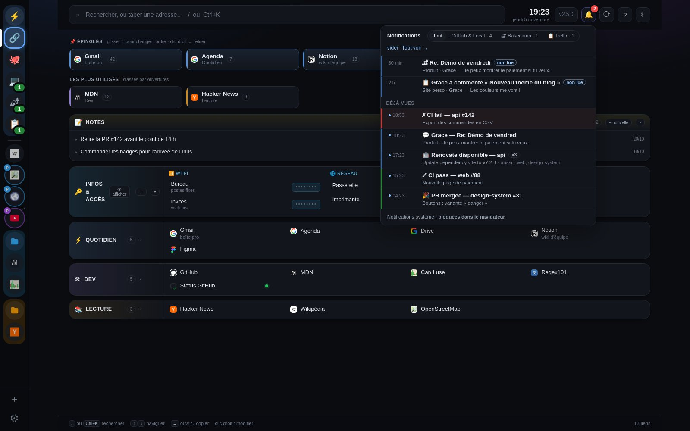

#### Comment faire

- **Voir** : clic sur la cloche ; *Tout voir* ouvre l'historique. Une seule liste, la plus récente en
  haut ; filtres *Tout*, *GitHub & Local*, *Basecamp*, *Trello* (ces deux derniers quand le service est connecté).
- **Notifs Basecamp** : les non lues en tête (« non lue »), puis celles déjà vues, qui **restent** une
  fois lues dans Basecamp : tu peux y revenir.
- **Tout actualiser** : ⟳ à côté de la cloche relit GitHub, Basecamp, Trello, tes dépôts, la cloche et les
  non-lus de tes sites (ceux en veille sont réveillés).
- **Notifications du système** : *activer* en bas de la cloche (coupées au départ).
- **Faire taire un onglet** : clic droit sur son icône → *Couper les notifications*.
- **Trop de bruit ?** *Réglages → Notifications → Ce qui compte dans la cloche* : pour chaque type (CI en échec,
  CI qui repasse au vert, PR mergées, Renovate, branches à nettoyer, Basecamp, Trello), *Compter* (le défaut),
  *Discret* (dans la liste, sans compteur ni notification) ou *Masqué*.
- **Le nombre sur l'icône de l'appli** : non-lus des sites, cloche, ou les deux (*Réglages →
  Notifications*).

#### Bon à savoir

- Ouvrir la cloche efface ses nouveautés. Une notif Basecamp ou Trello reste comptée tant qu'elle n'est
  pas lue dans Basecamp ou Trello.
- **🧹 Branche mergée** : annoncée une seule fois, en une ligne même si elle est dans plusieurs dépôts ;
  un clic ouvre l'onglet Local et sa commande.
- **🤖 Renovate** : une même version sur plusieurs dépôts ne fait qu'**une ligne** (« ×6 », les autres
  dépôts dessous), et ne compte qu'une fois.
- **Rien sur l'icône du Dock ?** macOS l'affiche seulement si *Pastilles de l'app* est activé pour
  homedash : *Réglages → Notifications → ouvrir les réglages de notifications du Mac*.

## 🐙 GitHub et 💻 Local

Ton code en ligne (GitHub) et sur ton disque (Local), côte à côte.

Un dépôt que GitHub ne trouve plus (supprimé, ou tes droits retirés) est retiré tout seul de la liste au bout de quelques minutes :
la cloche te le dit, et *Réglages → Sauvegardes* garde la liste d'avant.

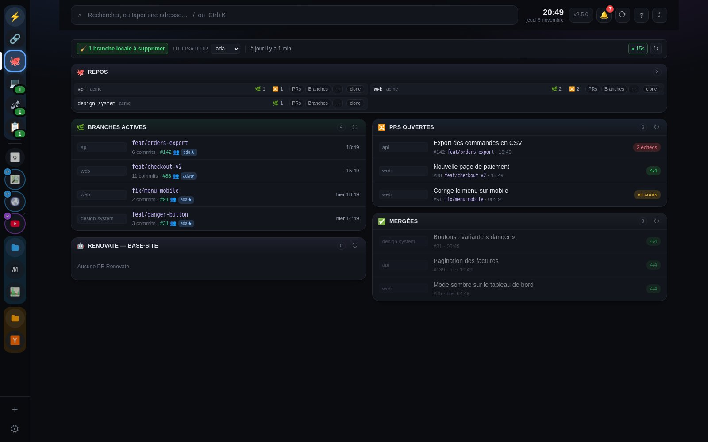

- **GitHub** (dès qu'un compte est connecté, rafraîchi toutes les 15 s) : 🌿 branches actives avec leur
  PR et leur CI, 🔀 PRs ouvertes (CI, revues, conflits), ✅ mergées (🧹 = la copie locale peut partir). Une branche présente
  dans plusieurs repos est regroupée sous 🔗 son nom : **↗ ouvrir les N** ouvre toutes ses PR d'un coup, un
  onglet chacune (⌘clic : l'inverse du réglage des liens, appli ou navigateur). Quand un workflow
  tourne sur un repo suivi, ⚙️ *En cours* apparaît en haut avec le détail de ses jobs, puis disparaît à la fin.
- **Local** : tes clones, branche par branche, avec un verdict.

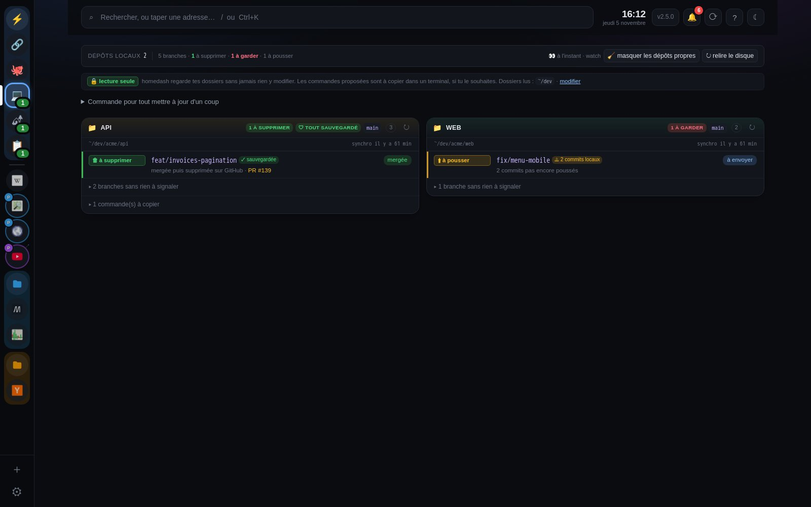

| Verdict | Ce que ça veut dire |
| --- | --- |
| 🗑 à supprimer | Son contenu existe ailleurs : sans risque |
| 🔍 à vérifier | Sans doute finie, mais une partie n'existe que là |
| ⚠ à garder | Des commits uniquement sur ton disque |
| 🔧 en cours | Travail actif |

#### Bon à savoir

- **Tes clones peuvent être n'importe où** : *Réglages → Local → ＋ Ajouter un dossier*, puis
  🏠 dossier personnel ou 💽 le disque (`C:` sous Windows, `/Volumes` sur Mac pour les disques externes).
  Tout est lu en lecture seule.
- **Rien n'est exécuté** : les commandes proposées (`git branch -d …`) sont à copier et lancer toi-même.
- **Branche courante pas à jour** : en retard sur sa version en ligne → `git pull` ; sur une autre
  branche que main/master, main a avancé → `git fetch origin && git merge origin/main`. Les deux à la
  fois : le pull d'abord.
- Plusieurs comptes GitHub : choisis lequel afficher en haut de l'onglet.

## 🏕 Basecamp

Tes tâches Basecamp sans ouvrir Basecamp. **Lecture seule** : homedash ne coche rien et ne poste que
les rapports que tu publies.

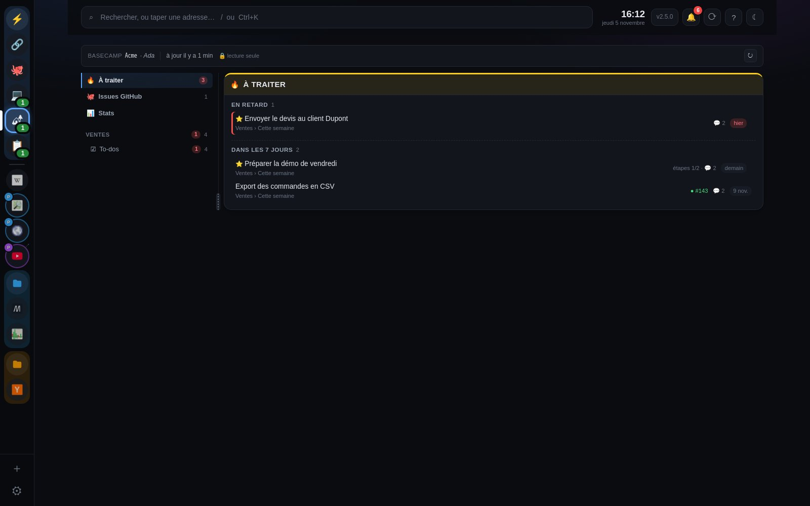

- **🔥 À traiter** : ce qui est en retard ou dû dans les 7 jours. À gauche, un projet : ses tableaux et to-dos.
- **📊 Stats** : qui a créé combien de tâches et de cartes, et combien sont faites (cochées, ou cartes dans la
  colonne Done). Période : 7 ou 30 jours, ce mois-ci, le mois dernier, 3 ou 12 mois, ou *Personnalisé* (du mois…
  au mois…). *Par personne* (un projet ou tous cumulés) ou *par projet* ; *📅 détail par mois* met une colonne par
  mois. Un clic sur un titre de colonne trie, un clic sur une ligne déroule ses tâches ; ⤢ passe en plein écran.
  Seulement les projets dont tu es membre : Basecamp ne montre pas les autres. La première lecture d'un an prend
  environ une minute, ensuite seulement ce qui a changé ; *Réglages → Basecamp → Stats en arrière-plan* les
  prépare petit à petit, puis les tient à jour toutes les 15 min (désactivé par défaut). « Mis à jour à … » dit de quand elles datent.
- **Se connecter** (une fois, pas besoin d'être admin) : pas-à-pas dans *Réglages → Basecamp*.
- **Lire une tâche** : un clic sur son titre (⌘ clic : Basecamp) : description, étapes, issues liées, échanges
  avec leurs captures.

#### D'une tâche à une issue GitHub, et retour

1. **Créer l'issue** : *🐙 Créer une issue* dans la tâche (ou clic droit), ou *🐙 issue* au survol d'un message
   pour partir de lui seul. Le formulaire s'ouvre à côté : coche ce qui part dans l'issue (description, messages ;
   *Tout inclure*, *Rien inclure* ; tout est coché au départ), ajoute tes précisions, relis l'*Aperçu*, puis
   **Créer sur GitHub** (⌘ Entrée).
   *Ouvrir le formulaire* passe plutôt par github.com.
   L'issue a une section par source : *🎯 Mon besoin* (tes précisions, qui priment), *Carte* (la description,
   reprise telle quelle) et *💬 Échanges* ; une section vide n'apparaît pas.
   Le travail touche plusieurs repos ? Coche-les dans *Autres repos concernés* : l'issue reste dans le repo choisi,
   les autres y sont cités (*🔗 Repos concernés*), et Claude Code fait une pull request dans chacun, puis un seul
   rapport. Rien n'est créé dans les autres repos. Les mentions y perdent leur `@`, pour
   ne notifier personne sur GitHub.
2. **La confier à Claude Code** : à la création, une commande est copiée (`cd ~/dev/api && claude '…'`) :
   colle-la dans un terminal. La consigne est dans l'issue : faire le travail, poster un rapport
   (`<!-- homedash:bc-report -->`), fermer l'issue.
3. **Publier le rapport** : la cloche sonne (*📤 Rapport prêt*). **📤 publier sur BC**, à côté de la
   tâche ou dans **🐙 Issues GitHub**, le poste en commentaire de la tâche, à ton nom, une seule fois.
   ✕ écarte une issue sans rien envoyer.

Dans **🐙 Issues GitHub** : *▶ prompt de départ* recopie la commande ; *📝 rapport final* donne un prompt
pour faire réécrire le rapport ; *afficher les terminées* et *rétablir* retrouvent les issues écartées.

**Repos où créer les issues** (*Réglages → Basecamp*, et pareil dans *Réglages → Trello*) : coche les
repos qui peuvent recevoir une issue depuis cet outil, par exemple les repos du travail pour Basecamp et
tes repos perso pour Trello. Seuls ceux-là sont proposés, et homedash refuse les autres. Aucun coché =
tous les repos suivis.

Le jeton GitHub doit pouvoir lire les issues, et les écrire pour *Créer sur GitHub* (*Issues : Read and
write* en fine-grained ; un jeton classic `repo` suffit).

## 📋 Trello

Les cartes ouvertes de tes tableaux Trello, dans les mêmes colonnes que sur Trello. **Lecture seule** :
homedash ne coche rien, ne déplace aucune carte, et ne poste que le rapport d'une issue, quand tu le
demandes. Les notifications ne sont jamais marquées lues. Les listes archivées ne sont pas affichées.

- **Se connecter** (une fois) : sur trello.com/power-ups/admin, crée une application *homedash*
  (« n'utilise pas les fonctionnalités Power-up », confidentielle, aucune URL à remplir), copie sa
  **clé API** dans *Réglages → Trello*, puis *Se connecter à Trello* : autorise, et colle le jeton
  affiché. Le jeton reste dans l'appli.
- L'onglet apparaît dès que la clé est enregistrée. À gauche : **🔥 À traiter** (tes cartes, échéance
  dépassée ou dans les 7 jours), **🐙 Issues GitHub**, puis un tableau par tableau. Un tableau montre
  toutes ses cartes visibles, pas seulement les tiennes. Un tableau se masque ; un nouveau tableau
  est montré.
- **Un clic sur une carte** l'ouvre (description, cases, échanges) ; ⌘ clic sur son titre : Trello. **🐙 Créer une
  issue** ouvre le formulaire à côté, comme pour Basecamp, dans un des repos choisis pour Trello (*Réglages → Trello*,
  *Repos où créer les issues*). Le rapport se publie en commentaire de la carte, une fois, après confirmation.
- Le tableau suit le thème clair ou sombre, avec étiquettes, échéances en couleur et photos de profil.
  ✕ écarte une issue sans rien envoyer.
- Le compteur de l'onglet compte tes cartes en retard. trello.com ne s'ouvre pas dans un onglet intégré
  de Mes sites : le site refuse ce cadre.

## 🔎 Recherche

`/` ou `⌘K` : tout retrouver, ouvrir une adresse, et agir sur un site sans passer par le clic droit : tape
« libérer discord », « recharger gmail », « couper le son de youtube »… Dans « Partout » seulement.

- **Un mot** : liens, onglets, repos, PRs, branches, infos, notes, pages déjà vues.
- **Chercher à un seul endroit** : clic sur la loupe, à gauche de la barre → *Raccourcis*, *Mes sites*,
  *GitHub & Local*, *Basecamp*, *Trello* ou *Le web*. La loupe s'allume tant que la recherche est limitée ;
  *Partout* revient à la recherche complète (elle l'est aussi à chaque rechargement).
- **Basecamp** (s'il est connecté) : tes tâches tout de suite, puis, un instant après ta frappe, tout
  Basecamp : to-dos, cartes, messages, commentaires, documents (sans les archivés). La carte à droite
  montre un extrait, l'échéance, l'auteur ; Entrée ouvre l'élément dans Basecamp. Pour une tâche ou
  un de ses commentaires : **💬 Voir la tâche** (ouverte sur l'échange trouvé), **🐙 Créer une
  issue** (ou *Issue sur cet échange*), et **Voir dans le dash** si elle t'est assignée (son tableau
  dans l'onglet Basecamp, la tâche mise en évidence).
- **Trello** (s'il est connecté) : tes cartes tout de suite, puis, un instant après ta frappe, cartes,
  tableaux et commentaires Trello. Entrée ouvre l'élément sur Trello. **💬 Voir la carte**, **🐙 Créer
  une issue**, et **Voir dans le dash** pour une de tes cartes.
- **Fautes de frappe** : les mots se cherchent dans n'importe quel ordre, une faute par mot tolérée
  (« shopping diag » trouve « Assistant Shoping interne (Diag) »). La recherche dans tout Basecamp,
  elle, ne les tolère pas.
- **Une adresse** (`exemple.com`, `localhost:3000`) : Entrée l'ouvre.
- **Un raccourci** en premier mot : `g` Google, `gh` GitHub, `yt` YouTube, `w` Wikipédia, `maps`, `tr`
  traduction, `mdn`.
- **Une action** : « réglages », « thème », « nouvelle catégorie », « temporaire »…

`↑` `↓` pour choisir, `↵` pour ouvrir ou copier, `Échap` pour effacer. `⌘S` enregistre les réglages.

## ⚙️ Réglages

Tout ce qui se règle, rangé par thème. **Le plus court : la recherche du haut** trouve chaque réglage
(tape « veille », « sauvegarde », « jeton »…). *Vue d'ensemble* montre d'un coup d'œil ce qui est branché et ce
qui manque. `⌘S` (ou le bouton du bas) enregistre ; la barre du bas signale ce qui ne l'est pas encore. Les
réglages rarement utiles sont repliés sous *Plus de réglages* ou *Avancé*. Tu quittes Réglages sans enregistrer ? homedash te le propose ; *Plus tard*
garde tes modifications en brouillon, retrouvées au retour.

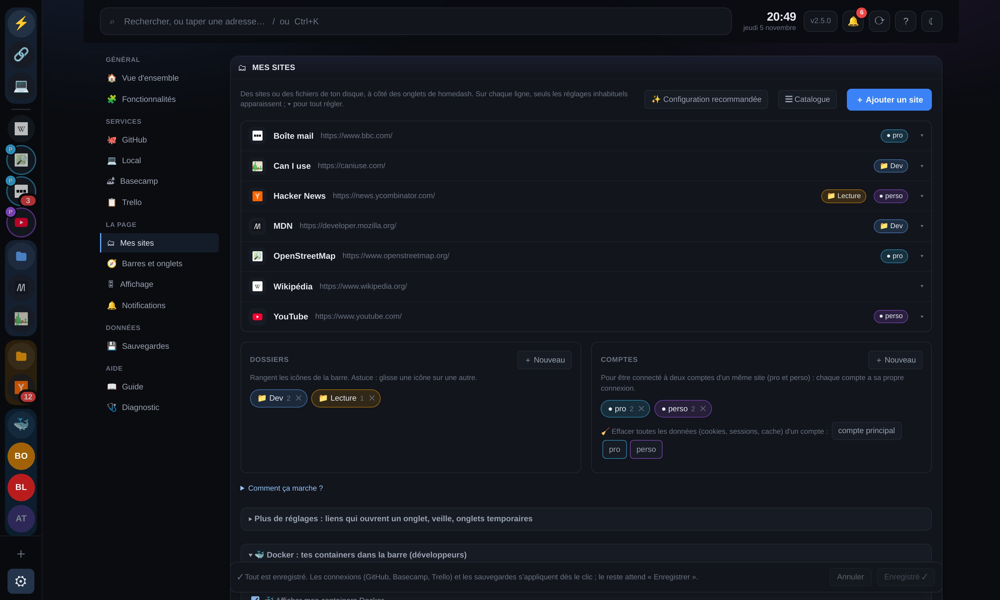

| Partie | Ce qu'on y fait |
| --- | --- |
| 🏠 Vue d'ensemble | Ce qui est branché, ce qui manque, la dernière sauvegarde ; un bouton vers chaque page |
| 🧩 Fonctionnalités | Couper GitHub, Local, Basecamp ou Trello si tu ne t'en sers pas ; accès depuis le navigateur (appli) |
| 🐙 GitHub | Pour le compte choisi en haut, en sous-onglets : *Compte* (jeton), *Repos suivis*, *Équipe*, *Ce que montre l'onglet* (Renovate sous *Avancé*) ; ＋ Compte pour un autre compte GitHub |
| 💻 Local | Les dossiers où chercher tes clones |
| 🏕 Basecamp | La connexion, les repos où créer les issues, les stats en arrière-plan |
| 📋 Trello | La clé d'API et le jeton, les repos où créer les issues |
| 🗂 Mes sites | Tes sites (une ligne chacun, ▾ pour tous ses réglages), dossiers, comptes ; repliés : où s'ouvrent les liens, onglets temporaires gardés, veille, Docker, extensions (appli) ; dans ▾ de chaque site : pause quand je n'y suis pas (appli) |
| 🧭 Barres et onglets | Barre de gauche ou onglets en haut, disposition, style et taille des onglets, masquage automatique, place de Raccourcis/GitHub/Local (⚡) |
| 🎛 Affichage | Ce qui s'affiche (horloge, tuiles…), largeur de la page ; repliés : densité de Raccourcis, colonnes GitHub / Local, tuiles, test des voyants |
| ◫ Vue scindée | Ce qui pré-remplit une nouvelle vue (Flux / Messagerie, défilement synchronisé, actions par site) ; les lettres affichées du clavier (automatique, AZERTY, QWERTY) |
| 🔔 Notifications | Ce qui compte dans la cloche (par type : compter, discret, masqué), notifications du bureau, compteur sur l'icône de l'appli |
| 💾 Sauvegardes | Les 5 dernières à restaurer, *Voir tout* pour faire le ménage ; export complet pour une autre machine |
| 📖 Aide | Ce guide, et *Diagnostic* : journal d'erreurs et journal de performance. le numéro de version, en haut : le changelog complet et **✨ Quoi de neuf** |

**Couper une fonctionnalité** (🧩 Fonctionnalités) : décochée, elle disparaît de la page (onglet,
recherche, cartes de l'accueil, ses parties de Réglages, ses notifications dans la cloche et
l'historique, même passées) et homedash ne lit plus le service. Rien n'est
effacé : jeton, connexion et réglages sont gardés, et la recocher remet tout en place. Le choix vaut pour
ton homedash seulement.

## 💾 Sauvegardes

homedash sauvegarde tes liens, réglages et notes tout seul : chaque jour, et avant chaque mise à jour.

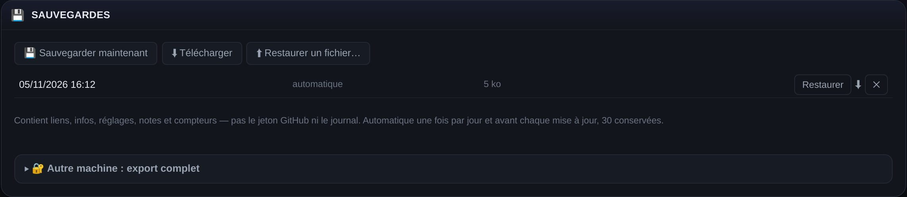

- **Revenir en arrière** : *restaurer* sur une ligne. L'état actuel est sauvegardé juste avant.
- **Faire le ménage** : coche des lignes (ou *tout*, *les automatiques*, *plus de 7 jours*), puis
  *supprimer la sélection*.
- **Changer de machine** (un Mac et un PC, par exemple) : *Export complet*, avec un mot de passe. Le
  fichier `.homedash` emporte tout, jetons GitHub, Basecamp et Trello et connexions de tes sites compris,
  chiffré. Sur l'autre machine : *importer un export complet…*, le mot de passe, puis *aperçu* montre ce
  qu'il contient avant de rien changer. Certains sites (Google, Microsoft…) redemandent quand même la
  connexion sur une nouvelle machine.
- **Juste tes réglages** : *télécharger*, puis *restaurer un fichier…*. Ce fichier-là ne contient pas
  les jetons : recolle-les ensuite.

## 🆘 En cas de souci

| Ce que tu vois | Quoi faire |
| --- | --- |
| « Connexion à homedash… » | homedash redémarre (mise à jour, réveil) : la page revient toute seule. Si ça dure, quitte et relance l'appli |
| « La mise à jour n'a pas été installée » (Windows) | Tes données n'ont pas changé. Réessaie, ou installe la nouvelle version à la main depuis la page des versions. Si ça recommence, *Aide → Signaler un problème* en joignant le fichier `update.log` indiqué dans le message |
| « homedash n'a pas pu démarrer » | Le serveur de l'appli s'est arrêté : quitte et relance homedash. Si ça recommence, *Aide → Signaler un problème* |
| http://localhost:7777 ne montre rien dans le navigateur | Normal : coche *Réglages → Fonctionnalités → Accès depuis le navigateur*, l'appli ouverte |
| Accès navigateur : « le port 7777 est déjà pris » | Un autre programme l'utilise (un ancien homedash ?) : ferme-le |
| « Tes réglages ne se lisent plus » | Le fichier a été abîmé (souvent une modification à la main) : *Revenir à la dernière sauvegarde* |
| Pas d'onglet GitHub | Aucun jeton : *Réglages → GitHub → Compte*, le pas-à-pas « Comment créer un jeton » y est ouvert |
| Un repo n'est pas proposé | Repo d'un collègue où tu es collaborateur : onglet *Partagés avec toi*. Sinon le jeton n'y a pas accès : ajoute-le dans *Repository access* du jeton, sur GitHub |
| Onglet Local vide | Ajoute un dossier dans *Réglages → Local* (dossier personnel, ou 💽 ailleurs sur le disque) |
| Un compteur ne bouge pas | L'onglet est peut-être en veille : clique dessus pour le recharger |
| Des lettres au lieu des icônes | *Réglages → Affichage → Icônes des sites* doit être coché |
| Un site boude (captcha refusé, page qui tourne en boucle) | Clic droit sur son icône → *Effacer les données de ce site*, puis reconnecte-toi. Sinon ↗ l'ouvre dans ton navigateur |
| Rien sur l'icône du Dock | *Pastilles de l'app* désactivé dans macOS : voir *Notifications* ci-dessus |

Autre chose ? Ouvre une **[issue sur GitHub](https://github.com/lepetitpaco/homedash/issues/new)** :
ce que tu faisais, ce que tu attendais, ce qui s'est passé, et ta version (en haut à droite). *Réglages
→ Aide → Diagnostic → Copier pour une issue* donne le détail technique à coller dedans.
