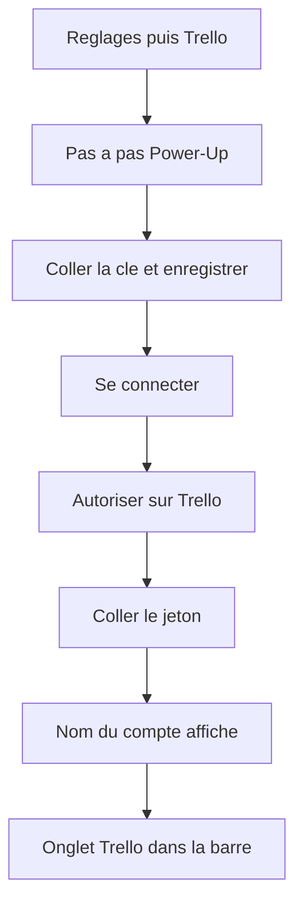
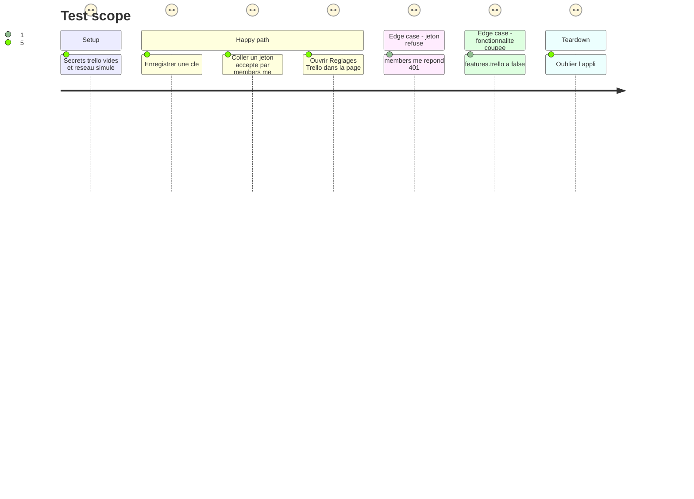

# Instruction: Connexion Trello

## Architecture projection

> Tree of the final files. ✅ create · ✏️ modify · ❌ delete

```txt
.
├── backend/
│   ├── trello.py          ✅ secrets, statut, URL d'autorisation, vérification du jeton
│   ├── server.py          ✏️ routes /api/trello/auth|app|authorize|token et health
│   └── store.py           ✏️ features inclut trello
├── src/
│   ├── types.ts           ✏️ Feature et config.trello facultatif
│   ├── lib/
│   │   ├── trello.ts      ✅ appels de connexion
│   │   └── config.ts      ✏️ feature trello, absente = active
│   ├── hooks/useTabs.ts   ✏️ id d'onglet trello
│   ├── components/
│   │   ├── Tabs.tsx       ✏️ TabId trello
│   │   ├── SetTrello.tsx  ✅ réglage de connexion
│   │   ├── SettingsPage.tsx ✏️ entrée Connexions et Fonctionnalités
│   │   ├── SetupCard.tsx  ✏️ pas « Connecte Trello » tant que la clé n'est pas là
│   │   └── App.tsx        ✏️ feature, onglet dès que la clé est enregistrée, santé
│   └── styles/            (rien)
├── tests/
│   ├── test_trello.py        ✅ clé, jeton, 401, statut sans secret
│   └── test_server_config.py ✏️ feature coupée appelle trello.set_enabled
├── ARCHITECTURE.md        ✏️ routes de connexion et health
└── GUIDE.md               ✏️ pas-à-pas Réglages → Trello
```

## User Journey



## Test Scope



## Wireframe

```txt
┌────────────────────────────────────────────────┐
│ (1) Réglages                                   │
├──────────────┬─────────────────────────────────┤
│ (2) Nav      │ (3) Titre de la carte           │
│              │ (4) Bandeau                     │
│              │ (5) Bloc compte ou bouton       │
│              │ (6) Champ jeton                 │
│              │ (7) Pas à pas repliable         │
│              │ (8) Champ clé                   │
└──────────────┴─────────────────────────────────┘
```

1. Page Réglages déjà existante.
2. Nav Connexions : une entrée Trello à côté de Basecamp.
3. Carte du même gabarit que les autres connexions.
4. Bandeau qui dit ce qui est lu et ce qui ne l'est pas.
5. Compte nommé une fois le jeton accepté, sinon le bouton qui ouvre Trello.
6. Champ où coller le jeton, vide après validation.
7. Les étapes pour créer le Power-Up et la clé, une fois.
8. Champ clé : vide signifie garder celle déjà enregistrée.

## Tasks to do

### `1)` Secret et module

> La clé et le jeton restent dans `data/secrets.json`, clé `trello`, mode 600. N'écrire ce code qu'après le oui explicite : la vague touche les réglages, l'accueil, la cloche, la recherche, GitHub, Mes sites (trello.com hors iframe) et les données. Aucune phase ne change le comportement de Basecamp.

1. Créer `backend/trello.py` sur le modèle de `basecamp.py` : `_open` unique, `_secret` / `_save_secret`, `configured` (clé présente), `connected` (jeton présent), `set_enabled`, `active`, `status`.
2. `status` ne renvoie jamais la clé ni le jeton : `configured`, `connected`, `has_key`, `name`, `username`, `error`.
3. Enregistrer la clé, déconnecter (jette le jeton, garde la clé), oublier (efface tout). Chaque changement vide les caches, encore vides à ce stade.
4. `authorize_url` construit `https://trello.com/1/authorize` avec `expiration=never`, `scope=read,write`, `response_type=token`, `name=homedash` et la clé stockée. Pas de `return_url`, pas de scope `account`.
5. Recevoir le jeton collé : `GET /1/members/me` avec l'en-tête `Authorization: OAuth oauth_consumer_key="…", oauth_token="…"`. 200 : garder `token`, `fullName`, `username`. 401 : ne rien écrire, erreur lisible. Aucun `?key=` ni `?token=` dans l'URL.

### `2)` Routes

> Mêmes contrôles que le reste : `Handler._refused()`, corps JSON.

1. `GET /api/trello/auth` → `status`.
2. `PUT /api/trello/app` enregistre la clé. `DELETE` oublie tout.
3. `POST /api/trello/authorize` → `{"url": …}` seulement si la clé est là.
4. `POST /api/trello/token` reçoit `{"token": …}`, vérifie, répond `status`. `DELETE` déconnecte.
5. `GET /api/health` ajoute `trello` (connecté ou non), sans retirer `basecamp`.
6. Au chargement de la config, `trello.set_enabled(store.feature_on(cfg, "trello"))`, à côté de l'appel Basecamp.

### `3)` Page Réglages

> Le jeton saisi part au serveur et disparaît du champ. Même ignore gestionnaires de mots de passe que GitHub.

1. `SetTrello` : bandeau lecture seule (cartes assignées et notifs non lues ; rien n'est coché, rien n'est marqué lu, aucun commentaire à ce stade).
2. Pas-à-pas : `https://trello.com/power-ups/admin`, Power-Up perso, onglet API key, coller la clé, Enregistrer, Se connecter, autoriser, coller le jeton affiché par Trello, Valider. Dire où révoquer : compte Trello → Applications.
3. Erreurs via `shown('Trello', e)`, jamais de nom de fichier ni de code HTTP brut à l'écran.
4. `SettingsPage` : entrée Connexions et ligne Fonctionnalités (onglet, cloche, recherche). `SetupCard` : un pas « Connecte Trello » qui ouvre ce réglage, fait quand `health.trello` est vrai.
5. `Feature` gagne `'trello'`. Absent dans une config ancienne = actif (`featureOn`). `store.FEATURES` et `config.ts` suivent. Pas de migration : la clé `trello` de la config n'existe pas encore.

### `4)` Onglet coquille

> Comme Basecamp : l'onglet n'apparaît qu'une fois la clé enregistrée, et seulement si la fonctionnalité est active.

1. `TabId` et `useTabs` connaissent `trello` (`?tab=trello`, titre de la fenêtre).
2. Barre : juste après Basecamp. Pastille absente tant qu'il n'y a pas de cartes.
3. Vue minimale : connecté → écran d'attente sans inventer de cartes ; clé enregistrée mais jeton absent → renvoi vers Réglages. Pas de sondage dans cette phase.

### `5)` Tests et doc

> Réseau simulé, comme `test_basecamp.py`. Pas de `CHANGELOG.md`.

1. `test_trello.py` : URL d'autorisation sans `account` et sans `return_url` ; statut sans clé ni jeton ; 401 ne stocke rien ; oublier vide le secret ; en-tête Authorization et aucune query `token`.
2. `test_server_config.py` : `features.trello: false` coupe `trello._on`, le retirer le rallume. Le cas Basecamp existant reste vert.
3. `ARCHITECTURE.md` : les routes de cette phase et le champ health. `GUIDE.md` : la connexion, dans Réglages et une amorce de section Trello.

## Test acceptance criteria

| Task | Acceptance criteria              |
| ---- | -------------------------------- |
| 1... | Une réponse de statut ne contient ni la clé ni le jeton, et le fichier de secrets n'est pas dans la config servie au navigateur. |
| 1... | L'URL ouverte pour autoriser demande `read,write` et `never`, et ne demande pas `account`. |
| 2... | Un jeton refusé par Trello laisse l'écran déconnecté, avec une phrase lisible. |
| 3... | Déconnecter garde la clé ; oublier retire la clé, le jeton et l'onglet. |
| 4... | Une config sans clé `trello` ni `features.trello` se charge comme avant, avec la fonctionnalité active et sans onglet tant que la clé n'est pas enregistrée. |
| 4... | Couper Trello dans Fonctionnalités retire l'onglet et le pas de démarrage. Basecamp, GitHub et Local ne bougent pas. |
| 5... | Les tests Basecamp et le typecheck passent encore. |
