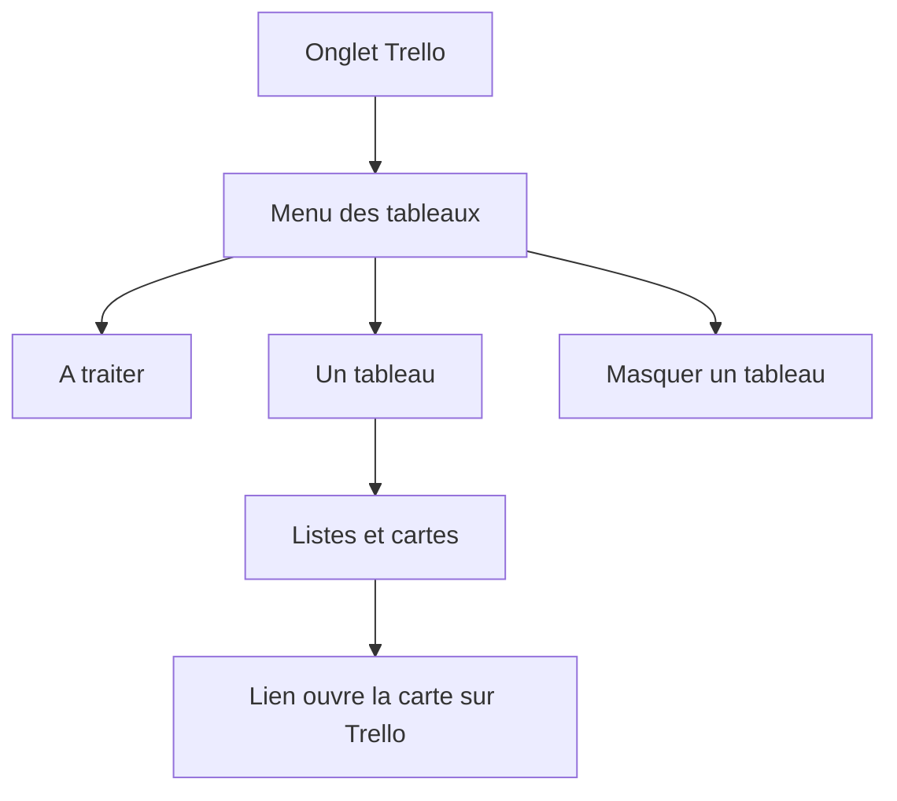
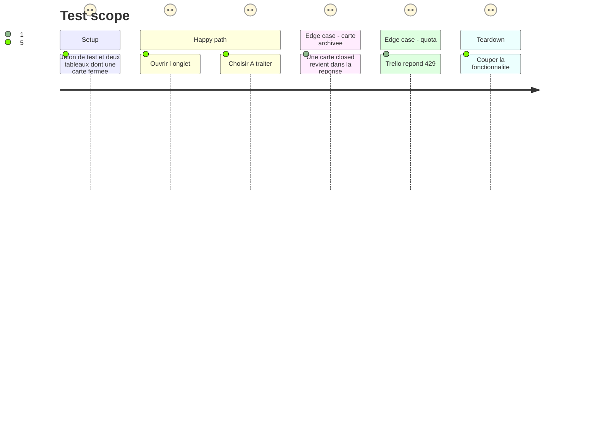

# Instruction: Mes cartes

## Architecture projection

> Tree of the final files. ✅ create · ✏️ modify · ❌ delete

```txt
.
├── backend/
│   ├── trello.py       ✏️ lecture des cartes ouvertes, boucle 60 s, payload
│   ├── server.py       ✏️ GET /api/trello et POST /api/trello/refresh
│   ├── store.py        ✏️ valide trello.hidden
│   └── perflog.py      ✏️ seuil lent pour l'op trello
├── src/
│   ├── types.ts        ✏️ basecamp.hidden a son jumeau trello.hidden
│   ├── lib/trello.ts   ✏️ types, useTrello, échéances
│   ├── components/
│   │   ├── TrelloView.tsx  ✅ tableaux, listes, à traiter, masquer
│   │   ├── App.tsx         ✏️ monte la vue, pastille de retard, tout actualiser
│   │   └── TopBar.tsx      ✏️ le libellé de tout actualiser cite Trello
│   └── styles/
│       ├── trello.css  ✅ mise en page tr-*
│       └── index.css   ✏️ import après basecamp.css
├── tests/
│   ├── test_trello.py  ✏️ normalize, cartes fermées, amorçage, 429
│   └── test_store.py   ✏️ trello.hidden
├── ARCHITECTURE.md     ✏️ les deux routes de lecture
└── GUIDE.md            ✏️ l'onglet : à traiter, tableaux, masquer
```

## User Journey



## Test Scope



## Wireframe

```txt
┌──────────────────────────────────────────────────────────┐
│ (1) Barre : Raccourcis · GitHub · Local · Basecamp · Trello │
├────────────────┬─────────────────────────────────────────┤
│ (2) Menu       │ (3) Titre du tableau et lien            │
│  À traiter     │ ┌────────────┐ ┌────────────┐           │
│  Tableau A     │ │ (4) Liste  │ │ (4) Liste  │           │
│  Tableau B     │ │ (5) Carte  │ │ (5) Carte  │           │
│                │ └────────────┘ └────────────┘           │
│ (6) Masquer    │                                         │
└────────────────┴─────────────────────────────────────────┘
```

1. L'onglet Trello suit Basecamp.
2. Menu : À traiter, puis un tableau par nom, ordre alphabétique stable.
3. En-tête du tableau choisi, avec son lien Trello.
4. Listes dans l'ordre `pos` de Trello. Une liste sans carte assignée n'est pas là.
5. Carte : titre, échéance, pastilles commentaires et cases. Le titre ouvre Trello.
6. Action pour masquer ce tableau. Les tableaux masqués se réaffichent depuis le menu.

## Tasks to do

### `1)` Lecture

> Un cycle = un GET cartes. Pas un appel par carte.

1. `GET /1/members/me/cards` avec `filter=open`, champs utiles (`name`, `url`, `shortUrl`, `shortLink`, `due`, `dueComplete`, `closed`, `pos`, `idBoard`, `idList`, `badges`, `labels`), et `board` / `list` imbriqués (`name`, `url` ou `shortUrl`, `pos` pour la liste).
2. Jeter toute carte `closed`. Garder l'id de tableau, le nom, le lien, l'id de liste, le nom, `pos`, l'échéance, `dueComplete`, `badges.comments`, `badges.checkItems`, `badges.checkItemsChecked`.
3. Boucle démon de 60 s, `start()` à côté de `basecamp.start()`. `kickoff` si `active()`. 429 : `retry_at` et message lisible, pas de rafale. 401 : erreur « jeton à refaire », pas de nouvel essai en boucle.
4. `perflog.timed("trello", …)` et un seuil dans `SLOW`, sans changer celui de `basecamp`.
5. `GET /api/trello` et `POST /api/trello/refresh` comme Basecamp. Payload : compte, `updated_at`, `building`, `error`, `every`, cartes, `loaded`. Fonctionnalité coupée → listes vides et pas de lecture.
6. Premier passage : remplir le cache, aucun événement. Le diff de la cloche est la phase 3 ; prévoir la liste « déjà vue » sans émettre.

### `2)` Regroupement à l'écran

> Même geste que Basecamp : menu à gauche, contenu à droite, largeur du menu retenue dans le navigateur sous une clé `homedash:tr-nav-w`.

1. `useTrello` : poll léger, `sameOr`, arrêt si la page est cachée pour l'affichage, le serveur continue de lire. Erreurs via `shown`.
2. `TrelloView` : tableaux alphabétiques, listes par `pos`, cartes par échéance puis `pos`. Échéance en retard, aujourd'hui, sous 7 jours, au-delà. `dueComplete` n'est jamais « à traiter ».
3. À traiter en tête du menu : en retard ou dû dans les 7 jours. Pastille de l'onglet = nombre en retard.
4. `config.trello.hidden` : liste de textes, absente = tout montrer. `validate_config` refuse autre chose, comme `basecamp.hidden`. Masquer écrit la config une fois, sous le verrou habituel. Une config sans `trello` reste valide.
5. Feuille `trello.css`, classes `tr-*`, importée après `basecamp.css`. Ne pas réutiliser les classes `bc-*` : un ajustement Trello ne doit pas déplacer Basecamp.
6. Tout actualiser relance aussi ce `kickoff`. Le titre du bouton le dit.

### `3)` Tests et doc

1. Normalize : carte fermée absente ; tableau et liste repris du JSON imbriqué ; échéance et compteurs de badges.
2. `kickoff` pendant qu'une lecture tourne n'en lance pas une deuxième.
3. 429 ne lance pas un second appel immédiat. `test_store` : `trello.hidden` valide ou refusé, et le cas `basecamp.hidden` inchangé.
4. GUIDE : À traiter, un tableau, masquer. ARCHITECTURE : les deux routes.

## Test acceptance criteria

| Task | Acceptance criteria              |
| ---- | -------------------------------- |
| 1... | Une lecture de cycle n'appelle pas Trello une fois par carte. |
| 1... | Une carte archivée n'apparaît ni dans un tableau ni dans À traiter. |
| 2... | À traiter ne montre que les cartes ouvertes en retard ou dues dans les 7 jours, et ignore une échéance déjà accomplie. |
| 2... | Masquer un tableau le retire de l'onglet et le laisse masqué après rechargement. Les autres tableaux, et les projets Basecamp masqués, ne changent pas. |
| 2... | Le menu ne change pas un tableau de place d'une lecture à l'autre si les noms n'ont pas changé. |
| 3... | Un 429 affiche une phrase lisible et laisse les cartes déjà chargées. |
