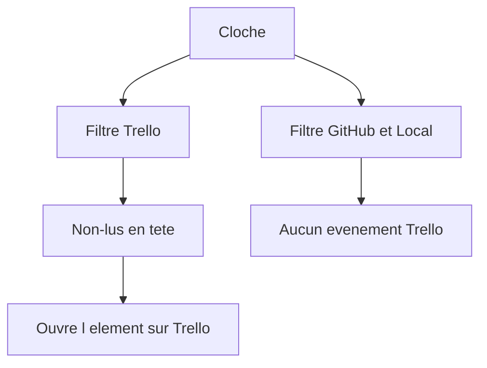
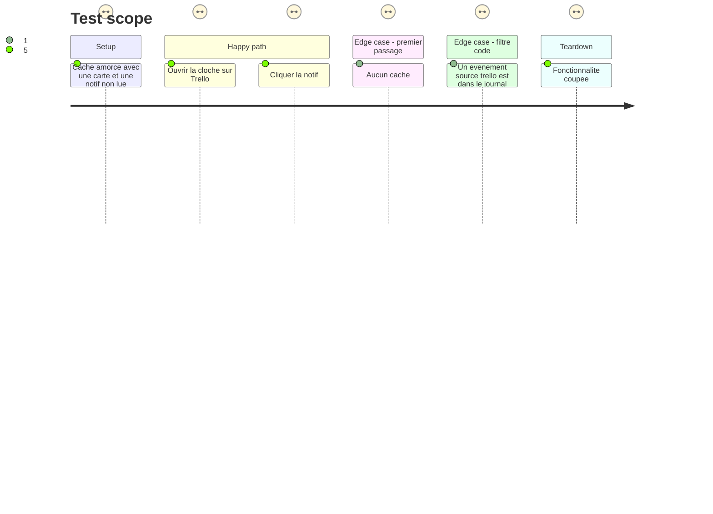

# Instruction: Cloche Trello

## Architecture projection

> Tree of the final files. ✅ create · ✏️ modify · ❌ delete

```txt
.
├── backend/trello.py          ✏️ notifs non lues, diff nouvelles cartes et notifs
├── src/
│   ├── lib/
│   │   ├── events.ts          ✏️ EventSource gagne trello
│   │   ├── trello.ts          ✏️ type des non-lus
│   │   └── notifications.ts   ✏️ titres groupés tr-notif, tr-task
│   └── components/
│       ├── EventBell.tsx     ✏️ filtre Trello, non-lus en tête
│       ├── EventFeed.tsx     ✏️ filtre du journal
│       └── App.tsx           ✏️ source trello coupée avec la fonctionnalité, clic notif
├── tests/test_trello.py      ✏️ amorçage, nouvelle carte, notif déjà vue
└── GUIDE.md                   ✏️ filtres de la cloche et du journal
```

## User Journey



## Test Scope



## Wireframe

```txt
┌──────────────────────────────────────────┐
│ (1) Cloche et pastille                   │
├──────────────────────────────────────────┤
│ (2) Filtres                              │
│ (3) Non-lus Trello                       │
│ (4) Journal                              │
│ (5) Lien vers l'onglet                   │
└──────────────────────────────────────────┘
```

1. La cloche actuelle. La pastille compte aussi les non-lus Trello.
2. Une pastille de filtre en plus : Tout, GitHub & Local, Basecamp, Trello.
3. Notifs encore non lues dans Trello, au-dessus du journal, comme Basecamp.
4. Le journal filtré. Une notif déjà listée en (3) n'y est pas répétée.
5. Raccourci vers l'onglet Trello quand le filtre Trello est choisi.

## Tasks to do

### `1)` Ce qui sonne

> `trello.py` décide du diff et appelle `events.event` / `events.record`. `events.py` ne gagne pas de règle Trello.

1. Second GET du cycle : `/1/members/me/notifications?read_filter=unread`, avec le créateur et `display` si l'API le rend. Jamais de PUT, jamais de `POST /notifications/all/read`.
2. Normaliser : id, titre lisible (phrase `display` sinon type + nom de carte), url de la carte, tableau, extrait, auteur, `ts`. Trier du plus récent.
3. Amorçage : une section (`cards` ou `unreads`) absente du déjà-vu ne produit rien. Ensuite, carte dont l'id est nouveau → `tr-task`, `source` `trello`, tag `tr:task:{id}`. Notif dont le couple id + ts est nouveau → `tr-notif`, tag `tr:notif:{id}`.
4. Couper la fonctionnalité vide le déjà-vu, comme Basecamp, pour qu'un rallumage ne déverse pas tout.
5. Le payload `/api/trello` inclut `unreads`.

### `2)` Affichage

> Le filtre GitHub & Local ne devient pas « tout sauf Basecamp ».

1. `EventSource` accepte `'trello'`.
2. Cloche : filtre Trello. Non-lus vivants en tête si le filtre n'est pas GitHub & Local. Pastille = non-lus du journal + non-lus Basecamp + non-lus Trello. Ouvrir la cloche marque le journal comme vu ; un non-lu Trello reste compté tant qu'il l'est dans Trello, comme Basecamp. Le journal « code » exclut `source` `basecamp` et `source` `trello`. Le compteur de fraîcheur code aussi. Tout montre les trois. La ligne de journal d'une notif encore non lue ne double pas la ligne du haut (tag `tr:notif:`).
3. Journal (`EventFeed`) : un filtre Trello, `sources: ['trello']`. GitHub & Local reste `github` et `local` seulement.
4. `notifications.ts` : titres groupés pour `tr-task` et `tr-notif`. Un clic sur `tr-task` ouvre l'onglet Trello ; une notif ouvre son url. Ne pas modifier les titres `bc-*`.
5. `eventsOff` inclut `trello` quand la fonctionnalité est coupée, pour que d'anciens événements ne sonnent plus.

### `3)` Tests et doc

1. Première lecture : zéro événement malgré des cartes et des notifs.
2. Seconde lecture : une carte nouvelle et une notif nouvelle donnent deux événements, les bons `kind` et `source`. Une notif au même id et au même ts n'en donne pas.
3. Aucun appel simulé n'est un POST ou un PUT vers les notifications.
4. GUIDE : filtres de la cloche et du journal, non-lus qui restent tant qu'ils le sont dans Trello.

## Test acceptance criteria

| Task | Acceptance criteria              |
| ---- | -------------------------------- |
| 1... | La première lecture après connexion ne remplit pas le journal. |
| 1... | Une notif qui repasse avec le même horodatage ne sonne pas une deuxième fois. |
| 1... | Aucune requête de ce cycle n'est une écriture vers les notifications Trello. |
| 2... | La pastille additionne le journal non vu, les non-lus Basecamp et les non-lus Trello. Ouvrir la cloche retire le neuf du journal ; un non-lu Trello y reste tant que Trello le dit non lu. |
| 2... | Le filtre GitHub & Local ne montre pas un événement Trello ni un événement Basecamp. |
| 2... | Le filtre Basecamp ne montre pas un événement Trello. |
| 2... | Trello coupé : ses événements ne comptent plus dans la pastille ni dans une notification système. |
