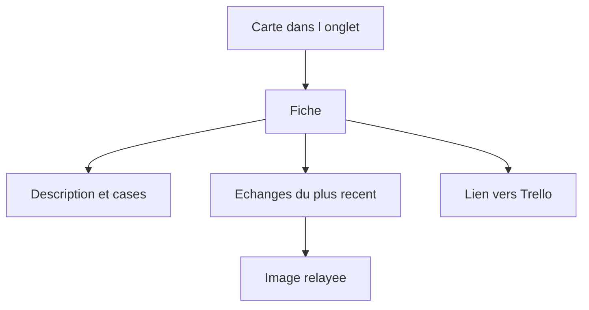
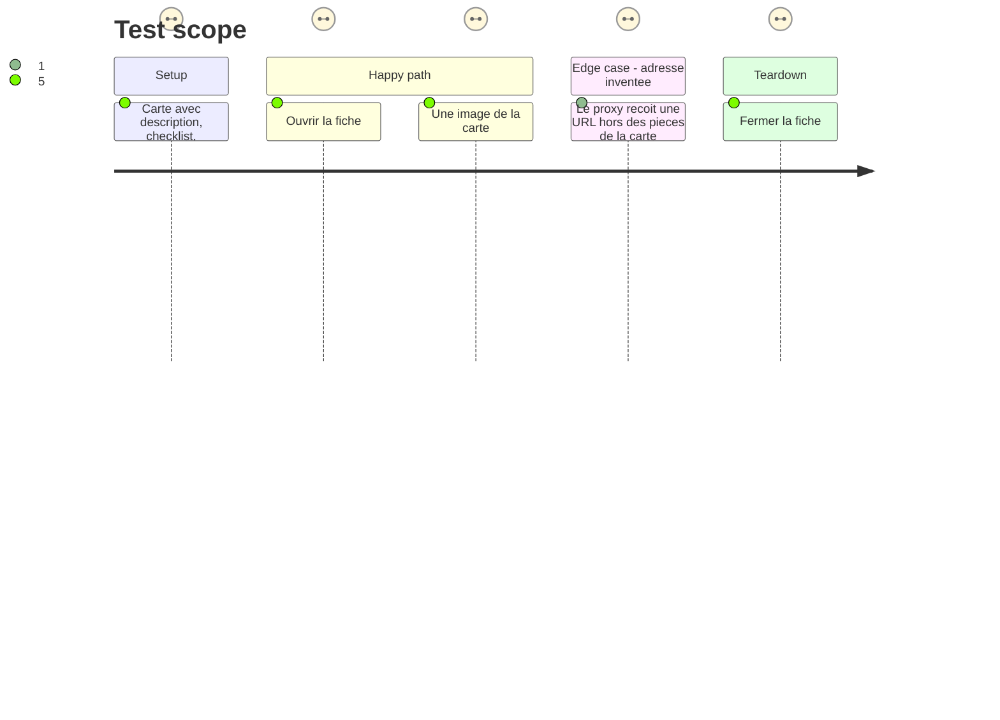

# Instruction: Fiche d'une carte

## Architecture projection

> Tree of the final files. ✅ create · ✏️ modify · ❌ delete

```txt
.
├── backend/
│   ├── trello.py            ✏️ lecture d'une carte, proxy image
│   └── server.py            ✏️ GET /api/trello/card et /api/trello/file
├── src/
│   ├── lib/trello.ts        ✏️ appel fiche
│   ├── components/
│   │   ├── TrCardHost.tsx   ✅ fiche : description, cases, échanges, images
│   │   ├── TrelloView.tsx   ✏️ ouvre la fiche au survol et au clic droit
│   │   └── App.tsx          ✏️ monte l'hôte, menu de la carte
│   └── styles/trello.css    ✏️ la fiche
├── tests/test_trello.py     ✏️ texte, commentaires, images refusées
├── ARCHITECTURE.md          ✏️ les deux routes
└── GUIDE.md                 ✏️ lire une carte sans ouvrir Trello
```

## User Journey



## Test Scope



## Wireframe

```txt
┌────────────────────────────────────────────┐
│ (1) Titre, tableau, liste, lien            │
│ (2) Description                            │
│ (3) Checklists                             │
│ (4) Échanges                               │
│     ┌──────────────────────────────────┐   │
│     │ (5) Un échange, image comprise   │   │
│     └──────────────────────────────────┘   │
└────────────────────────────────────────────┘
```

1. En-tête : nom de la carte, où elle est, lien pour l'ouvrir sur Trello.
2. Description en markdown.
3. Checklists : cases cochées et non cochées, sans pouvoir les cocher ici.
4. Commentaires, le plus récent en haut.
5. Un commentaire, et une image jointe affichée dans la fiche.

## Tasks to do

### `1)` Lecture à la demande

> Pas dans le cycle de 60 s. Un GET quand la fiche s'ouvre.

1. `GET /1/cards/{id}` avec `checklists=all`, `actions=commentCard`, `actions_limit` borné, `attachments=true`, champs de pièce (`name`, `url`, `mimeType`). L'id accepté est le `shortLink` d'une carte déjà servie par le payload, ou celui d'une URL `https://trello.com/c/{shortLink}`.
2. Réponse : `text` (description markdown), cases (nom, état), `comments` (id, auteur, date, texte), `images` (nom → URL Trello). Pas de HTML arbitraire réinjecté.
3. `GET /api/trello/file?url=` ne télécharge que si l'URL est une pièce que le serveur vient de lire pour ce compte, type image sûr, SVG exclu. Le jeton reste dans l'en-tête côté serveur. Toute autre adresse : refus, zéro requête.
4. Routes sous `_refused()`. Erreur lisible si la carte n'est plus accessible.

### `2)` Fiche

> Composant neuf. `TaskHost` et ses textes Basecamp ne changent pas.

1. `TrCardHost`, une seule instance montée dans `App`, sur le même principe que `TaskHost` (portail sur `document.body`).
2. Depuis une carte : bouton au survol et clic droit « Voir la carte et ses échanges ». La fiche s'ouvre dessus.
3. Les images passent par `/api/trello/file`. Le reste de la description est du markdown déjà prévu pour les liens.
4. Rien n'est cochable. Fermer la fiche ne relit pas tout Trello.

### `3)` Tests et doc

1. Une carte fixture devient description, une case cochée, un commentaire.
2. Une URL qui n'est pas dans `images` ne déclenche pas `_open`. Un SVG non plus.
3. GUIDE : ouvrir la fiche. ARCHITECTURE : les deux routes. Pas d'entrée CHANGELOG.

## Test acceptance criteria

| Task | Acceptance criteria              |
| ---- | -------------------------------- |
| 1... | Ouvrir la fiche ne multiplie pas le sondage de 60 s. |
| 1... | Le proxy ne contacte pas une adresse fournie par la page qui ne soit pas une image de cette carte. |
| 2... | La fiche montre la description, les cases et les commentaires, le plus récent en premier, et n'offre pas de cocher une case. |
| 2... | La fiche d'une tâche Basecamp s'ouvre encore comme avant. |
| 3... | Une image SVG ou une URL étrangère ne s'affiche pas. |
