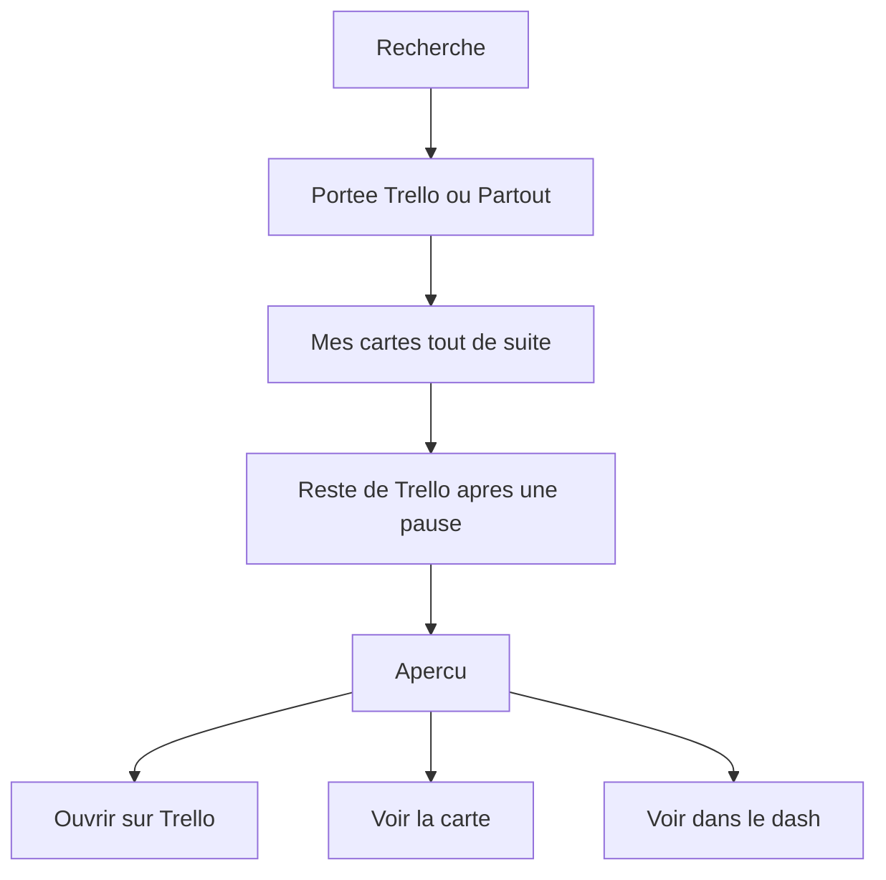
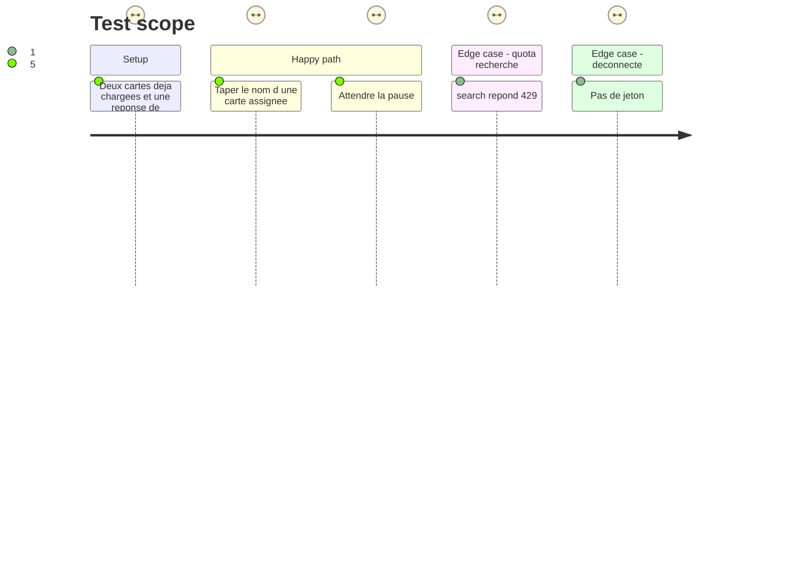

# Instruction: Recherche Trello

## Architecture projection

> Tree of the final files. ✅ create · ✏️ modify · ❌ delete

```txt
.
├── backend/
│   ├── trello.py     ✏️ GET /1/search, cache une minute
│   └── server.py     ✏️ GET /api/trello/search
├── src/
│   ├── lib/trello.ts              ✏️ useTrSearch
│   ├── hooks/useSearch.ts         ✏️ portée trello, kind tr, rang
│   └── components/
│       ├── SearchResults.tsx     ✏️ Hit tr et sa ligne
│       ├── SearchPreview.tsx     ✏️ aperçu, voir la carte, voir dans le dash
│       └── App.tsx               ✏️ brancher les actions de l'aperçu
├── tests/test_trello.py           ✏️ cache, déconnecté, 429
├── ARCHITECTURE.md                ✏️ la route
└── GUIDE.md                       ✏️ portée Trello dans la recherche
```

## User Journey



## Test Scope



## Wireframe

```txt
┌─────────────────────────────────────────────┐
│ (1) Champ de recherche                      │
│ (2) Portées, dont Trello                    │
├──────────────────────┬──────────────────────┤
│ (3) Liste            │ (4) Aperçu           │
│  carte assignée      │  extrait, échéance   │
│  autre résultat      │  (5) Actions         │
└──────────────────────┴──────────────────────┘
```

1. La barre de recherche actuelle.
2. Une portée Trello à côté de Basecamp. Partout l'inclut.
3. D'abord les cartes déjà chargées, puis le reste.
4. Aperçu : extrait, échéance, auteur, tableau.
5. Actions : ouvrir sur Trello, voir la fiche, voir dans le dash si la carte est assignée.

## Tasks to do

### `1)` Recherche serveur

> Le quota de `/1/search` est plus strict que le reste. On ne l'appelle pas à chaque frappe, et on garde la réponse.

1. `GET /1/search` avec `query`, `modelTypes=cards,boards,actions`, limites basses (au plus 20 cartes). Pas de recherche de membres.
2. Normaliser comme un résultat Basecamp : id, type, titre, url, tableau, parent (liste), extrait, échéance, auteur, date. Une carte assignée déjà montrée par la page n'a pas à être dédupliquée ici : la page le fait.
3. Cache une minute, au plus 20 requêtes gardées, clé en minuscules. Déconnecté ou fonctionnalité coupée : liste vide, aucun appel.
4. 429 : ne pas réessayer tout de suite, rendre une erreur que la page journalise sans effacer la recherche locale.
5. `GET /api/trello/search?q=`.

### `2)` Barre de recherche

> Même endroits qu'une source nouvelle : `Hit`, `rank`, ligne, aperçu, `SEARCH_SCOPES`.

1. Kind `tr`. Portée `trello`. Partout l'inclut quand Trello est connecté.
2. Cartes du payload cherchées tout de suite, avec la tolérance de frappe déjà utilisée pour les tâches Basecamp. La recherche serveur, elle, après la même pause que Basecamp, sans tolérance de frappe.
3. Aperçu : extrait, échéance, auteur. Entrée ouvre l'URL Trello. « Voir la carte » ouvre `TrCardHost` (un commentaire ouvre la fiche dessus). « Voir dans le dash » seulement si la carte est dans mes cartes : onglet Trello, tableau, carte mise en évidence quelques secondes.
4. Ne pas modifier le kind `bc` ni la portée Basecamp.

### `3)` Tests et doc

1. Deux recherches identiques dans la minute : un seul `_open`.
2. Sans jeton : pas d'appel, liste vide.
3. 429 : pas de boucle.
4. GUIDE : la portée, mes cartes tout de suite, le reste après la frappe, l'aperçu. ARCHITECTURE : la route.

## Test acceptance criteria

| Task | Acceptance criteria              |
| ---- | -------------------------------- |
| 1... | Taper ne déclenche pas un appel Trello à chaque lettre, et la même requête dans la minute n'en déclenche qu'un. |
| 2... | Une carte qui m'est assignée est trouvable avant la réponse du réseau. |
| 2... | Depuis un résultat, on peut ouvrir Trello, la fiche, et le tableau dans l'onglet si la carte m'est assignée. |
| 2... | La portée Basecamp et les résultats `bc` se comportent comme avant. |
| 3... | Trello déconnecté ou coupé : la recherche ne l'appelle pas. |
