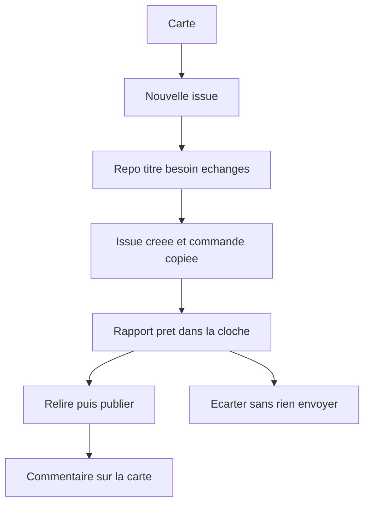
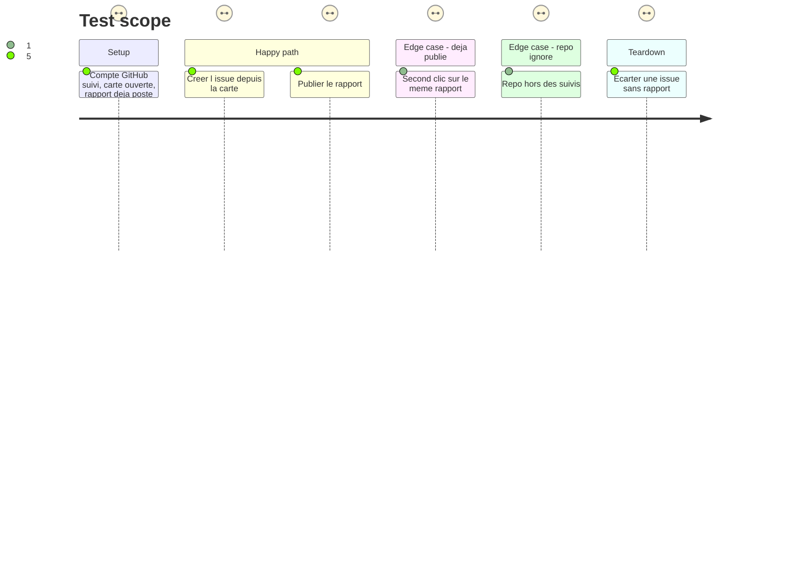

# Instruction: Issue GitHub et rapport

## Architecture projection

> Tree of the final files. ✅ create · ✏️ modify · ❌ delete

```txt
.
├── backend/
│   ├── github.py        ✏️ marqueurs tr à côté des marqueurs bc, liste séparée
│   ├── trello.py        ✏️ publish_report et dismiss
│   ├── server.py        ✏️ POST /api/trello/report et /dismiss
│   └── store.py         ✏️ nom du fichier tr_posted.json
├── src/
│   ├── lib/
│   │   ├── trIssues.ts      ✅ corps d'issue, prompts, publication
│   │   ├── notifications.ts ✏️ titre tr-report
│   │   └── customTabs.ts    ✏️ trello.com dans NO_EMBED
│   └── components/
│       ├── TrIssueHost.tsx  ✅ fenêtre nouvelle issue
│       ├── TrCardHost.tsx   ✏️ bouton issue sur un échange
│       ├── TrelloView.tsx   ✏️ issues liées, publier, écarter, prompts
│       ├── SearchPreview.tsx ✏️ créer une issue depuis un résultat
│       └── App.tsx          ✏️ menus, clic droit invité, rapport prêt
├── tests/
│   ├── test_tr_issues.py  ✅ scan, création, rapport, repo non suivi
│   └── test_trello.py     ✏️ un seul POST commentaire, une fois par rapport
├── ARCHITECTURE.md        ✏️ routes report et dismiss
└── GUIDE.md               ✏️ le parcours carte, issue, rapport
```

## User Journey



## Test Scope



## Wireframe

```txt
┌─────────────────────────────────────────────┐
│ (1) Repo retenu pour ce tableau             │
│ (2) Titre                                   │
│ (3) Besoin                                  │
│ (4) Échanges, une case chacun               │
│ (5) Créer · formulaire GitHub               │
└─────────────────────────────────────────────┘

┌─────────────────────────────────────────────┐
│ (6) Liste Issues de l'onglet                │
│     rapport à relire                        │
│     (7) Publier · écarter · prompts         │
└─────────────────────────────────────────────┘
```

1. Choix du repo suivi. Celui déjà retenu pour ce tableau est présélectionné.
2. Titre, repris de la carte, modifiable.
3. Besoin : description et cases. Une image devient un lien vers la carte.
4. Commentaires de la fiche, cases à cocher. Les plus récents cochés d'avance, tout ou aucun.
5. Créer avec le jeton homedash, ou ouvrir le formulaire GitHub prérempli.
6. Vue Issues de l'onglet : issues liées, ouvertes puis terminées sur demande.
7. Publier (confirmation), écarter, recopier le prompt de départ, prompt du rapport final.

## Tasks to do

### `1)` Lien issue ↔ carte

> `fetch_bc_issues`, `BC_LINK`, `BC_REPORT` et `bc_issues()` ne changent pas de comportement. `test_bc_issues.py` reste vert sans être réécrit.

1. Marqueur dans le corps : `<!-- homedash:tr https://trello.com/c/{shortLink} -->`. Marqueur de rapport, en tête du commentaire GitHub : `<!-- homedash:tr-report -->`.
2. Dans `github.py`, une liste `_data["tr_issues"]` et un scan jumeau de `fetch_bc_issues` (mêmes repos suivis, mêmes 100 issues récentes, pas les PR). `create_issue` ajoute à cette liste seulement si le corps porte le marqueur `tr`. Le chemin `bc` actuel reste tel quel.
3. Nouveau rapport (id de commentaire différent) → événement `tr-report`, `source` `trello`, pas `bc-report`.
4. `POST /api/github/issue` existe déjà : la page envoie titre et corps, le serveur refuse un repo non suivi. Ne pas élargir cette écriture.

### `2)` Publier ou écarter

> La page ne fournit que le repo et le numéro. Le texte et la carte viennent de ce que le serveur a lu.

1. `data/tr_posted.json` via `store.write`, même forme que `bc_posted.json`. Pas dans les sauvegardes (config, notes, usage seulement), pas dans `config.json`.
2. `publish_report` : seule écriture vers Trello, `POST /1/cards/{shortLink}/actions/comments`. Texte = corps markdown du rapport, tronqué pour rester dans 16 384 caractères, plus une ligne qui cite l'issue. Pas le HTML GitHub. Un rapport déjà publié : renvoyer le lien stocké, zéro POST.
3. `dismiss` / `undo` : écrit seulement `tr_posted.json`. Une issue fermée sans rapport est écartée d'office, comme Basecamp.
4. `POST /api/trello/report` et `/api/trello/dismiss`. Confirmation par `confirmDialog` avant publication, qui dit que le commentaire part sur la carte au nom du compte connecté. Pas de `window.confirm`. Échec d'envoi : `errlog.record`, comme le rapport Basecamp, et phrase lisible à l'écran.
5. Jeton sans scope `write` : phrase lisible, rien d'affiché comme publié.

### `3)` Fenêtres

> `IssueHost` n'est pas réutilisé : il appelle Basecamp et `bcKey`.

1. `trIssues.ts` : corps, 5 commentaires récents cochés, tout / aucun, repo retenu par id de tableau dans `homedash:tr-issue-repo` (pas la clé Basecamp), commande `claude` si le repo est cloné dans Local, sinon le prompt seul, prompt de rapport final.
2. `TrIssueHost` : le fil de la fenêtre Basecamp (repo, titre, besoin, cases, créer, formulaire, navigateur si l'appli de bureau). À la création, la commande est copiée si `navigator.clipboard` existe.
3. Sur la carte et dans la fiche : créer une issue ; sur un échange, l'échange devient le besoin. Vue Issues dans le menu de l'onglet. Boutons publier, publié (lien), écarter, rétablir, prompt de départ, prompt de rapport final.
4. Recherche : « Créer une issue » et « Issue sur cet échange » sur un résultat `tr`, à côté des actions de la phase 5.
5. Clic droit sur un lien `https://trello.com/c/{shortLink}` dans un site de l'appli : même entrée de menu que pour une tâche Basecamp. `bcKey` ne reconnaît pas ces URL.
6. `trello.com` rejoint `NO_EMBED`, comme `basecamp.com` : un onglet perso vers Trello ne tente pas une iframe vide.
7. Clic sur `tr-report` dans la cloche ouvre la vue Issues de l'onglet Trello. Titre groupé dans `notifications.ts`.

### `4)` Tests et doc

1. `test_tr_issues.py` : le scan associe l'issue à la carte ; une PR est ignorée ; `create_issue` sur un repo non suivi ne poste pas ; un rapport nouveau émet `tr-report` et pas `bc-report` ; une issue `homedash:bc` reste dans la liste Basecamp seule.
2. `test_trello.py` : un POST commentaire, une fois ; le second appel ne poste pas ; dismiss ne poste pas ; le texte dépasse pas la limite ; l'URL de carte est bien un `shortLink` servi, pas une URL libre.
3. GUIDE : le parcours en quatre temps (créer, donner à Claude Code, publier, écarter), le jeton GitHub Issues en écriture pour créer. ARCHITECTURE : report et dismiss. Pas de `CHANGELOG.md` ni de tag : la version unique de la vague se pose à la fusion.

## Test acceptance criteria

| Task | Acceptance criteria              |
| ---- | -------------------------------- |
| 1... | Une issue Basecamp existante reste liée à sa tâche, et une issue Trello n'apparaît pas dans l'onglet Basecamp. |
| 1... | Créer une issue sur un repo non suivi échoue sans appel d'écriture à GitHub. |
| 2... | Publier envoie un seul commentaire, rédigé par le serveur, et un second clic sur le même rapport n'en envoie pas un autre. |
| 2... | Écarter n'envoie rien à Trello. La carte n'est pas déplacée, cochée, ni archivée. |
| 3... | Après création, la commande à coller est dans le presse-papiers quand le navigateur l'autorise, et l'issue est visible sur la carte sans attendre le prochain sondage GitHub. |
| 3... | Le filtre et les tâches Basecamp de la cloche sont inchangés. Un lien Trello dans un site de l'appli propose de créer l'issue ; un lien Basecamp aussi, comme avant. |
| 4... | Les tests `test_bc_issues` passent sans modification de leurs assertions. |
