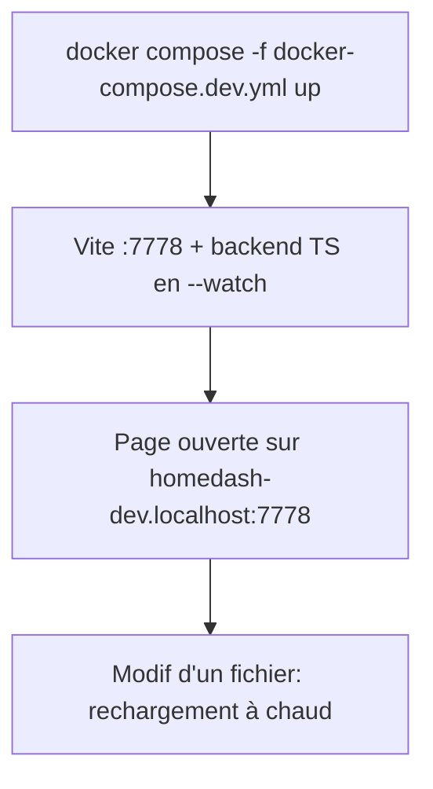
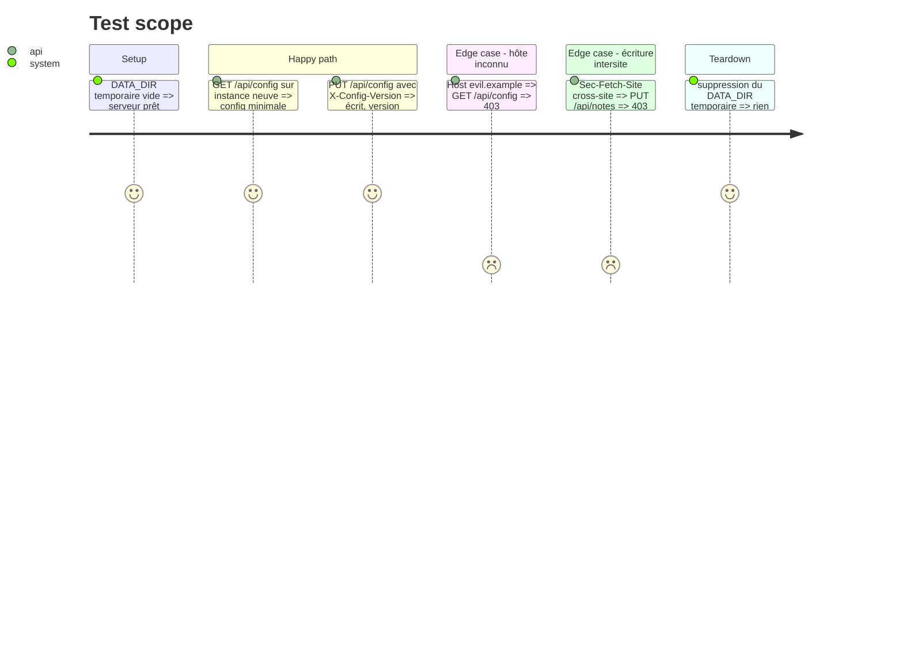

# Instruction: Socle TypeScript du serveur et environnement de dev

## Architecture projection

```txt
.
├── server/                       ✅ backend TypeScript (Node stdlib)
│   ├── main.ts                   ✅ démarrage (ex server.main) + transport http
│   ├── app.ts                    ✅ handle(req) → res : routage de toute l'API (ex Handler)
│   ├── http.ts                   ✅ transport node:http (Host/Origin, corps, taille max)
│   ├── store.ts backup.ts errlog.ts events.ts updates.ts
│   │   perflog.ts perfreport.ts favicons.ts localfile.ts   ✅ portages 1:1
│   └── tsconfig.json             ✅ build vers dist-server/
├── tests-ts/                     ✅ Vitest (portage des tests Python correspondants)
├── docker-compose.dev.yml        ✅ dev sur :7778 (homedash-dev.localhost)
├── vite.config.ts                ✏️ proxy /api vers le backend de dev
├── package.json                  ✏️ scripts server:dev, server:build, test ; vitest en devDependency
└── .gitignore / .dockerignore    ✏️ dist-server/
```

## User Journey



## Test Scope



## Tasks to do

### `1)` Cœur transport-indépendant

> `handle({method, path, query, headers, body}) → {status, headers, body}` reprenant toutes les routes de server.py.

1. Porter les routes une à une, mêmes codes et mêmes corps JSON.
2. Contrôles `refused()` paramétrés par la liste d'hôtes du transport.
3. Les routes des modules des phases 2-3 renvoient provisoirement l'état « désactivé ».

### `2)` Modules sans réseau

> store, backup, errlog, events, updates, perflog, perfreport, favicons, localfile, mêmes formats.

1. Écritures atomiques (tmp + rename), secrets en 600.
2. Tests Vitest portés depuis tests/test_{store,errlog,perflog,perfreport,favicons,localfile,updates,server_config}.py.

### `3)` Environnement de dev

> Docker sur :7778, rechargement à chaud.

1. Compose de dev : node:22, `npm ci`, backend `node --watch`, Vite proxy `/api`.
2. `HOMEDASH_HOSTS=homedash-dev.localhost`, data = `./data`.

## Test acceptance criteria

| Task | Acceptance criteria |
| ---- | ------------------- |
| 1 | Toute requête au mauvais Host ou écriture intersite est refusée (403) ; routes inconnues 404 |
| 2 | Les tests Vitest portés passent ; un data/ v1 copié se relit sans modification |
| 3 | La page s'ouvre sur :7778 et un changement de fichier se voit sans reconstruire |
