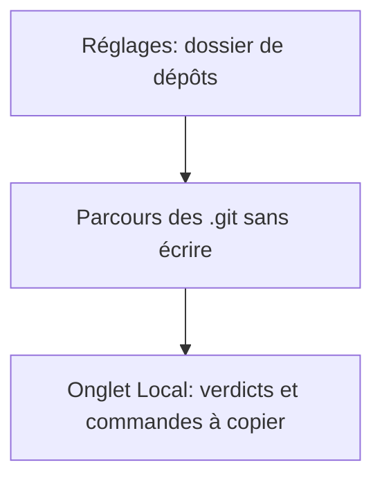
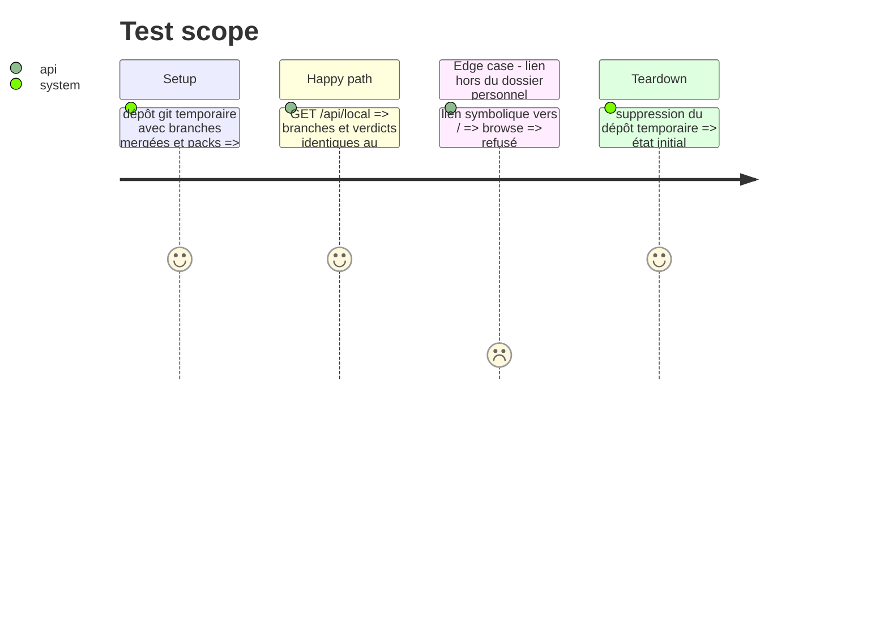

# Instruction: Onglet Local en TypeScript (lecture seule absolue)

## Architecture projection

```txt
.
├── server/
│   ├── gitread.ts     ✅ lecture des .git (refs, packed-refs, objets libres, packs ofs/ref delta) en lecture seule
│   ├── localgit.ts    ✅ verdicts, safety, commandes à copier, surveillance stat, browse/roots/resolve
│   └── app.ts         ✏️ routes /api/local*
└── tests-ts/
    ├── gitread.test.ts   ✅ validé contre git (dépôts temporaires)
    └── localgit.test.ts  ✅ portage de tests/test_localgit.py
```

## User Journey



## Test Scope



## Tasks to do

### `1)` gitread

> Mêmes sorties que gitread.py ; fichiers ouverts en lecture seulement, aucun sous-processus.

1. refs, packed-refs, HEAD, objets libres (zlib), packs + index v2, deltas ofs et ref.
2. Tests validés contre `git` dans un conteneur.

### `2)` localgit

> Verdicts (`state`, `safety`, `action`), SAFE_LEVELS, `_commands()` filtre `delete`, surveillance.

1. Chemins réels (plus de /host) : `resolve()` traduit `~/…`, chemins de disque ; `realpath` limité au dossier personnel et au disque.
2. Tests portés.

## Test acceptance criteria

| Task | Acceptance criteria |
| ---- | ------------------- |
| 1 | Les objets lus égalent ceux de `git cat-file` sur un clone frais (packs) |
| 2 | Jamais de suppression proposée pour la branche courante, une protégée, ou un niveau hors SAFE_LEVELS |
