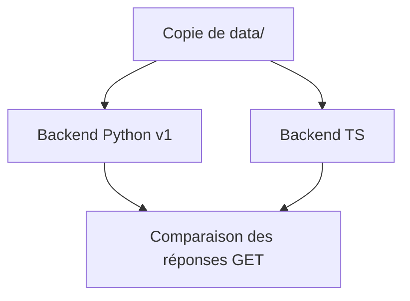
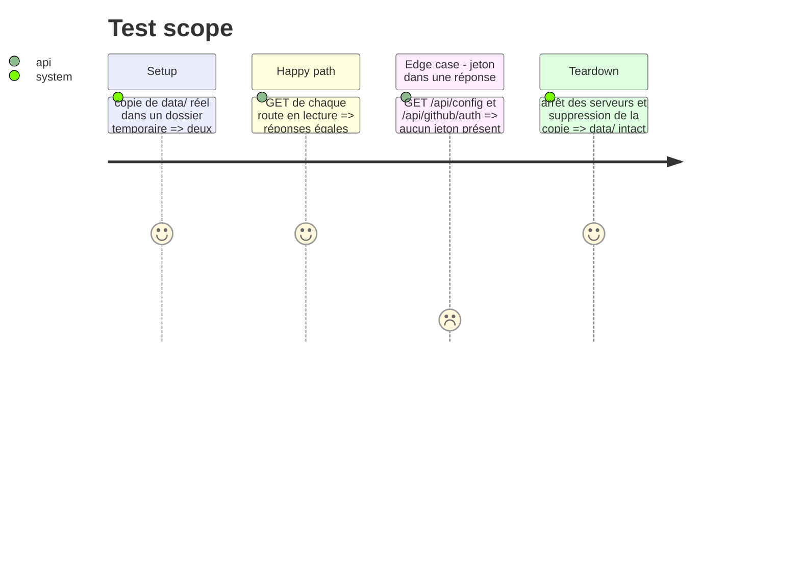

# Instruction: GitHub, comptes, Basecamp en TypeScript, parité, retrait du Python

## Architecture projection

```txt
.
├── server/
│   ├── github.ts      ✅ données d'un compte, cache ETag, create_issue (seule écriture GitHub)
│   ├── accounts.ts    ✅ une instance github par compte, migrate(), secrets, boucle 3 min
│   ├── basecamp.ts    ✅ OAuth, lecture GET, publish_report (seule écriture)
│   └── app.ts         ✏️ routes /api/github*, /api/basecamp*
├── tests-ts/          ✅ accounts, basecamp, bc_issues portés
├── scripts/parity.mjs ✅ lance Python (v1) et TS sur une copie de data/, compare les GET
├── backend/           ❌ supprimé une fois la parité atteinte
├── tests/             ❌ supprimé (remplacé par tests-ts/)
├── Dockerfile         ❌ plus d'image Python
└── docker-compose.yml ❌ remplacé par docker-compose.dev.yml
```

## User Journey



## Test Scope



## Tasks to do

### `1)` github + accounts

> Portage fidèle : ETag, attribution des branches, amorçage du journal, un état par compte.

1. Classe `GitHubAccount` (au lieu du module rechargé par compte).
2. `migrate()` idempotente, tests portés.

### `2)` basecamp

> Lecture GET seule, Launchpad pour le jeton, `publishReport()` unique écriture, une fois.

1. Tests portés (aucun appel réseau : fetch simulé).

### `3)` Parité puis retrait

> Script de comparaison, puis suppression du Python.

1. `scripts/parity.mjs` : réponses normalisées, écarts listés.
2. Retirer backend/, tests/, Dockerfile, docker-compose.yml une fois sans écart.

## Test acceptance criteria

| Task | Acceptance criteria |
| ---- | ------------------- |
| 1 | Un `config.json` v1 se charge, comptes et repos identiques ; aucun jeton dans une réponse |
| 2 | Aucune requête autre que GET vers Basecamp hors échange de jeton et publication du rapport |
| 3 | Le script ne signale aucun écart sur les données de Paco (hors champs temporels) |
