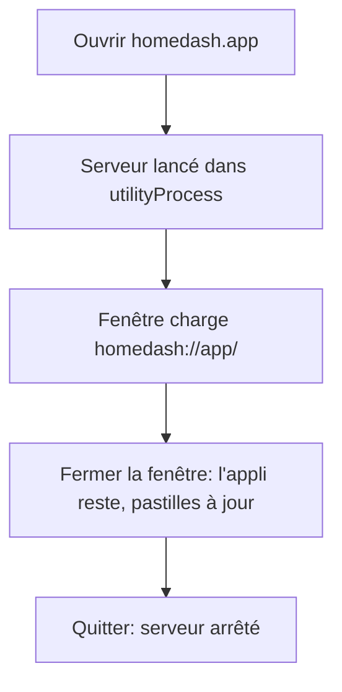
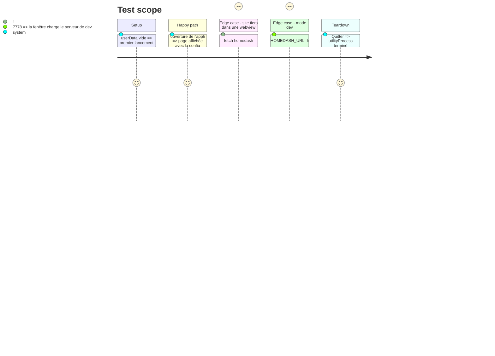

# Instruction: Appli Electron autonome, sans port

## Architecture projection

```txt
.
├── desktop/
│   ├── main.js          ✏️ lance le serveur (utilityProcess), protocole homedash://, tray Windows, données, mode dev
│   ├── server-host.js   ✅ côté utilityProcess : reçoit les requêtes par parentPort, appelle handle()
│   ├── basecamp-auth.js ✅ fenêtre d'autorisation, interception de https://<domaine>/oauth
│   ├── preload.js       ✏️ features : app-server, basecamp-auth, browser-access, full-export
│   └── package.json     ✏️ version 2.0.0, electron-builder
├── server/app.ts        ✏️ réglage « accès navigateur » (http 127.0.0.1:7777 démarré à la demande)
└── src/components/      ✏️ Réglages : accès navigateur, connexion Basecamp en un clic dans l'appli
```

## User Journey



## Test Scope



## Tasks to do

### `1)` Serveur embarqué

> utilityProcess + transport par messages ; redémarrage et message lisible en cas de plantage.

1. `protocol.registerSchemesAsPrivileged` (standard, secure, fetch, cors, stream) ; `protocol.handle('homedash')` sur la session par défaut.
2. Sessions des webviews : seul `GET /api/file` est servi.
3. `DATA_DIR = <userData>/data`, `PUBLIC_DIR` = front embarqué. Front et serveur chargés depuis un dossier désigné (embarqué par défaut) : prépare les mises à jour légères (2.1).

### `2)` Windows en arrière-plan

> Tray : clic = fenêtre, menu Ouvrir / Quitter ; fermer cache la fenêtre.

### `3)` Basecamp en un clic

> Fenêtre d'autorisation, `will-redirect`/`will-navigate` vers la `redirect_uri` interceptés, code échangé ; le collage reste possible.

### `4)` Mode dev et accès navigateur

> `HOMEDASH_URL` charge une adresse http ; réglage « Accès depuis le navigateur » (défaut : non) ouvre 127.0.0.1:7777.

### `5)` Raccourcis de rechargement (#63)

> `⌘R`/`Ctrl+R` recharge l'onglet en cours (onglet natif : ses données seulement), `⇧⌘R`/`Ctrl+Maj+R` tout homedash ; nouvelle entrée `features` (`reload-swap`) pour le libellé ; GUIDE et commentaires.

### `6)` Ancien nom du dépôt (#64)

> `lepetitpaco/homedash` partout (openRepo, CHANGELOG, author) ; nouvel identifiant d'appli `com.lepetitpaco.homedash` (décision de Paco : la 2.0 se réinstalle de toute façon ; le nom `homedash` est gardé, donc le dossier userData et les connexions des sites aussi).

## Test acceptance criteria

| Task | Acceptance criteria |
| ---- | ------------------- |
| 1 | Sans réglage, aucun port n'écoute ; notifications et presse-papier disponibles ; Mes sites affiche un fichier local |
| 2 | Sous Windows, fermer la fenêtre laisse l'icône près de l'horloge et les pastilles continuent |
| 3 | Autoriser dans Basecamp connecte sans rien copier |
| 5 | ⌘R sur un site ne recharge que lui ; sur un onglet natif aucune webview n'est remontée ; ⇧⌘R recharge tout |
| 6 | Plus aucune occurrence de `davidgennaoui/homedash` ; identifiant `com.lepetitpaco.homedash` (Mac et Windows) |
| 4 | Réglage activé : http://localhost:7777 s'ouvre dans un navigateur ; désactivé : port libéré |
