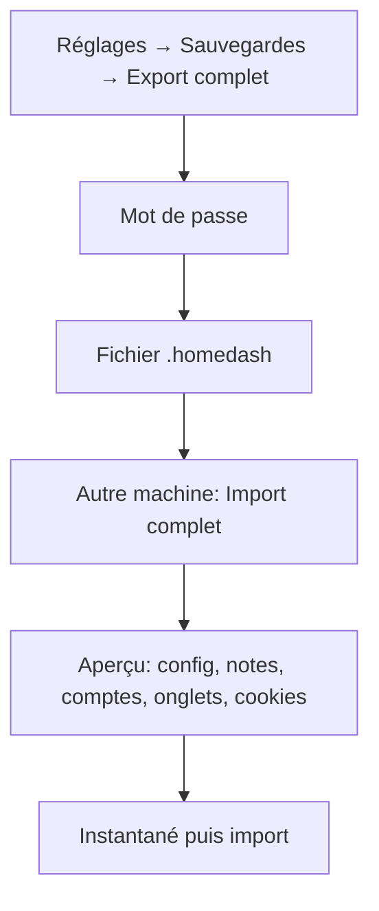
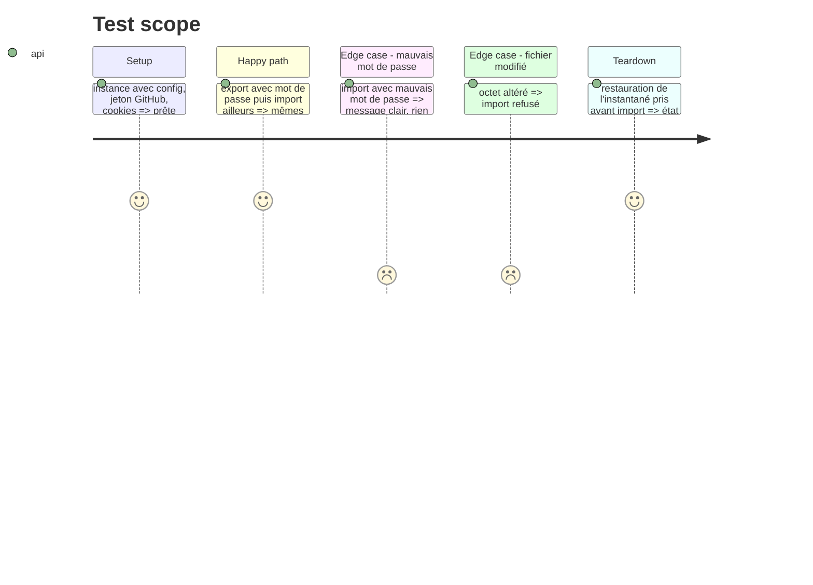

# Instruction: Export/import complet chiffré et reprise des données

## Architecture projection

```txt
.
├── server/fullexport.ts      ✅ paquet .homedash : scrypt + AES-256-GCM, contenu, aperçu, import (instantané avant)
├── desktop/main.js           ✏️ cookies des partitions persist:homedash-tabs-* (lecture / réécriture), reprise au 1er lancement
├── src/components/SetBackup* ✏️ « Export complet » / « Import complet » (mot de passe, aperçu, avertissement connexions)
└── tests-ts/fullexport.test.ts ✅
```

## User Journey



## Test Scope



## Wireframe

```txt
┌ Sauvegardes ─────────────────────────────────────┐
│ [1] Export simple (sans jetons)   [Télécharger]   │
│ [2] Export complet (chiffré)  mot de passe [____] │
│                                   [Exporter]      │
│ [3] Import complet  [Choisir un fichier]          │
│     mot de passe [____]   [Aperçu]                │
│ [4] Aperçu : réglages ✓ notes ✓ 2 comptes GitHub  │
│     Basecamp ✓ 12 sites, cookies de 4 connexions  │
│     ⚠ certains sites redemanderont la connexion   │
│                         [Annuler] [Importer]      │
└───────────────────────────────────────────────────┘
```

1. inchangé ; 2. nouveau, mot de passe obligatoire ; 3. choix + mot de passe ; 4. aperçu avant toute écriture.

## Tasks to do

### `1)` Format .homedash

> `{homedash_full:1, kdf:scrypt, salt, iv, tag, data}` ; contenu = bundle + secrets + cookies.

### `2)` Interface et cookies

> Cookies lus/écrits par l'appli (absente = export sans cookies, dit à l'écran).

### `3)` Reprise au premier lancement

> `<userData>/data` absent : proposer de copier le data/ Docker (dossier choisi ou détecté), ou d'importer un .homedash ; copie seulement.

## Test acceptance criteria

| Task | Acceptance criteria |
| ---- | ------------------- |
| 1 | Un fichier exporté ne contient aucun jeton en clair ; mauvais mot de passe = refus sans écriture |
| 2 | L'aperçu liste ce qui sera importé ; rien n'est écrit avant « Importer » ; instantané pris avant |
| 3 | Les données Docker copiées sont lues par l'appli ; le dossier d'origine est intact |
