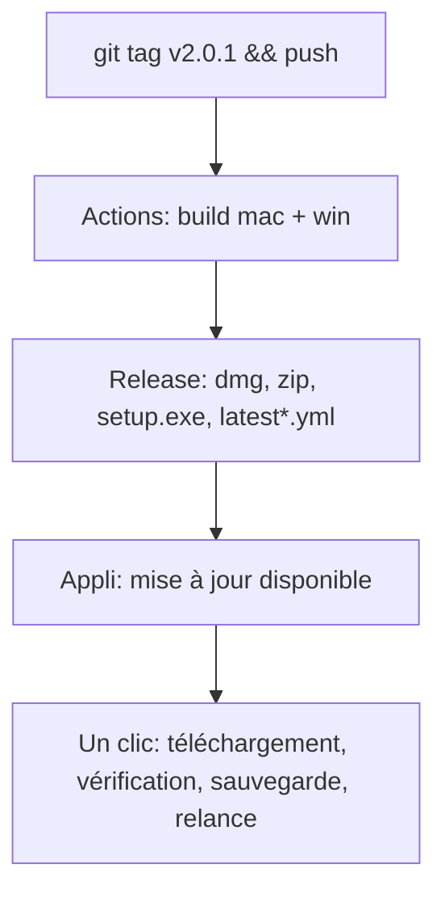
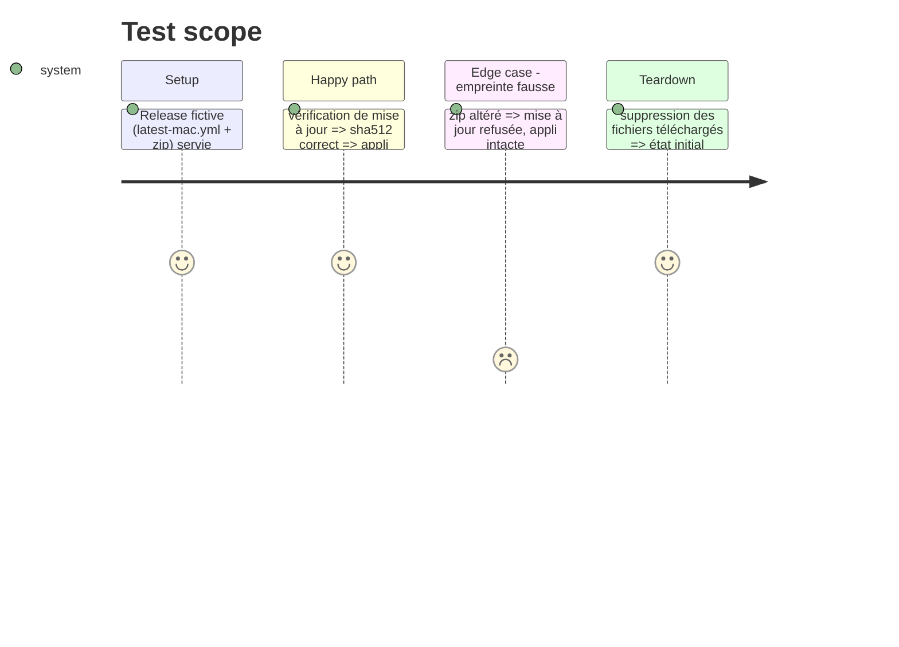

# Instruction: Releases GitHub et mise à jour

## Architecture projection

```txt
.
├── .github/workflows/release.yml  ✅ tag vX.Y.Z → build front + serveur → electron-builder mac (arm64, x64) + win → Release
├── desktop/electron-builder.yml   ✅ dmg + zip (mac), nsis (win), publish github, extraResources (public, server, CHANGELOG, GUIDE)
├── desktop/updater.js             ✏️ Windows: electron-updater ; Mac: zip + sha512 de latest-mac.yml + swapAndRelaunch ; sauvegarde avant
├── server/updates.ts              ✏️ version disponible = dernière Release (sans jeton si dépôt public, jeton sinon)
├── desktop/build-local.sh         ✏️ construit l'appli autonome localement (dépannage)
└── desktop/build-windows.*, installer.nsi, windows-build.sh  ❌ remplacés par electron-builder
```

## User Journey



## Test Scope



## Tasks to do

### `1)` Workflow

> Permissions `contents: write` seulement ; actions figées par SHA ; matrice macos-latest / windows-latest.

### `2)` Mise à jour

> Annonce par `updates.ts` (CHANGELOG de la Release) ; installation par l'appli ; `data/` sauvegardé avant.

### `3)` Plus tard (2.1, hors 2.0.0) : mises à jour légères

> Paquet front + serveur (quelques Mo) téléchargé, vérifié, rangé dans les données de l'appli, version minimale de coquille, retour à la version embarquée s'il ne démarre pas. Décidé avec Paco le 2026-10-29 : utile vu la cadence de versions, mais après une mise à jour complète solide.

## Test acceptance criteria

| Task | Acceptance criteria |
| ---- | ------------------- |
| 1 | Un tag produit une Release avec .dmg, .zip (arm64, x64), setup.exe et latest*.yml |
| 2 | Empreinte fausse = refus ; empreinte juste = nouvelle version lancée, données sauvegardées avant |
