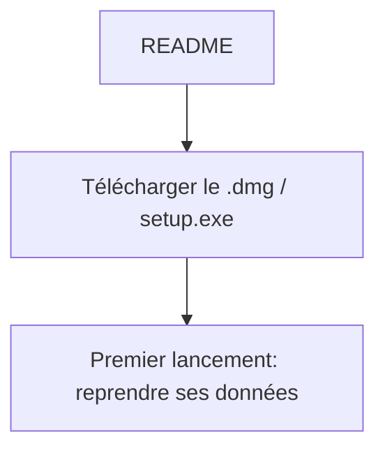
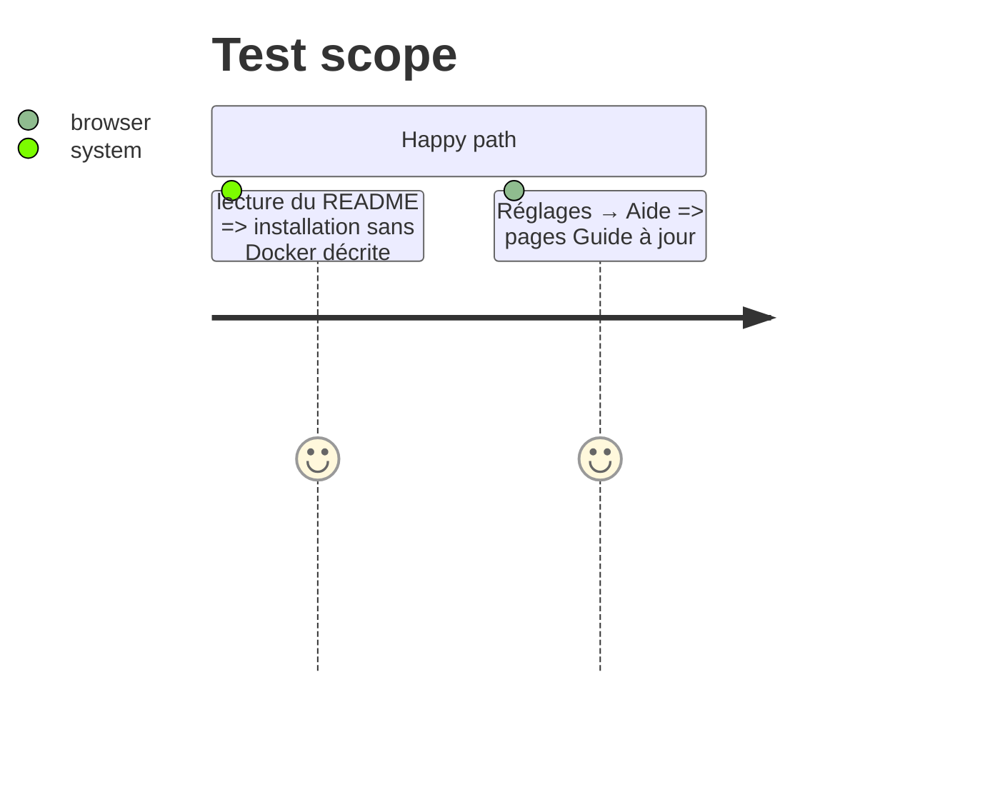

# Instruction: Docs et version 2.0.0

## Architecture projection

```txt
.
├── README.md        ✏️ installer depuis les Releases ; dev en Docker
├── GUIDE.md         ✏️ Aide → mise à jour, export complet, accès navigateur
├── CLAUDE.md        ✏️ règles : serveur TS, protocole, plus de Docker utilisateur, pièges
├── ARCHITECTURE.md  ✏️ server/, desktop/, transports
├── AGENTS.md / .cursor/rules ✏️ renvois à jour
└── CHANGELOG.md     ✏️ entrée 2.0.0 (action requise : installer l'appli une fois)
```

## User Journey



## Test Scope



## Tasks to do

### `1)` Docs

> Tout ce qui décrit Docker/Python comme mode d'utilisation passe en mode dev.

### `2)` CHANGELOG 2.0.0

> Entrée en tête, `Appli de bureau : 2.0.0`, action requise décrite.

## Test acceptance criteria

| Task | Acceptance criteria |
| ---- | ------------------- |
| 1 | Aucune doc ne demande Docker ou Python pour utiliser homedash |
| 2 | La version affichée par la page est 2.0.0 |
