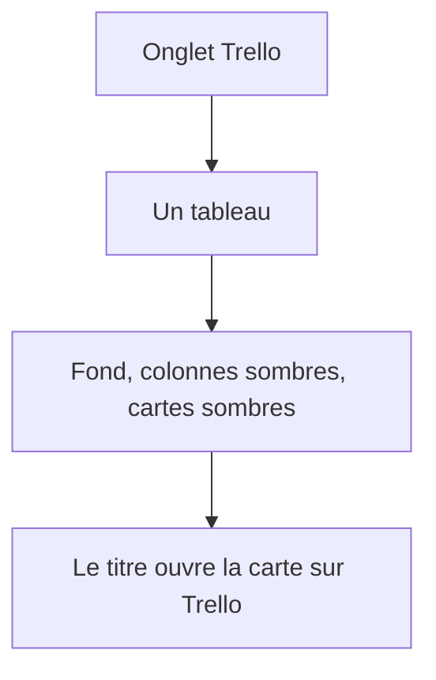
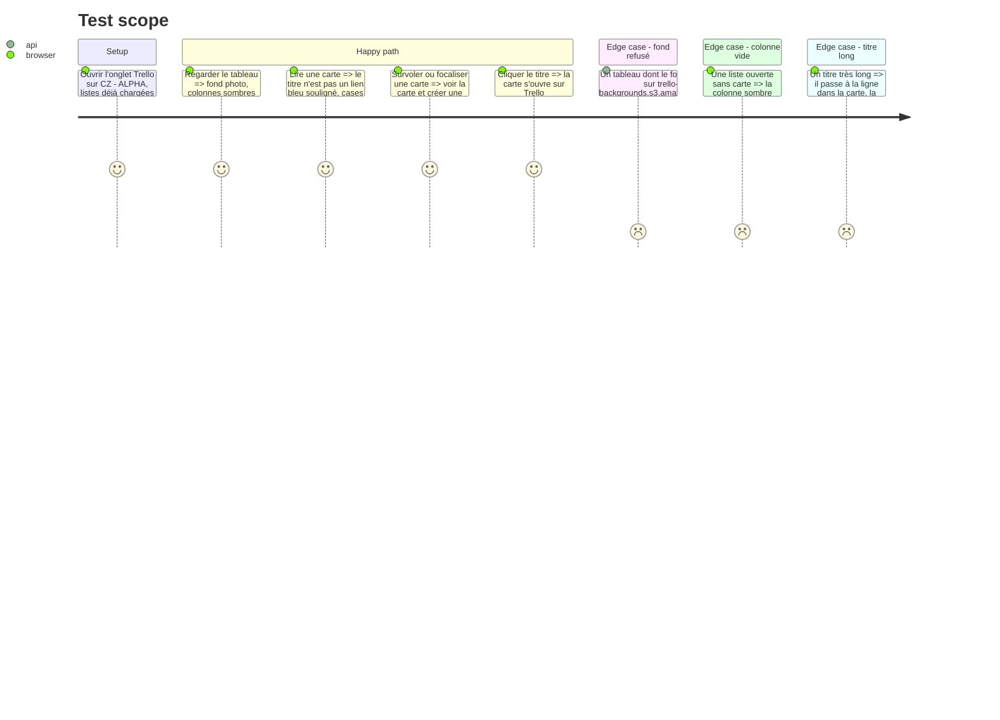

# Instruction: Le tableau comme sur la capture Trello

## Architecture projection

> Tree of the final files. ✅ create · ✏️ modify · ❌ delete

```txt
.
├── ✏️ backend/trello.py
├── ✏️ tests/test_trello.py
├── ✏️ src/components/TrelloView.tsx
├── ✏️ src/lib/trello.ts
└── ✏️ src/styles/trello.css
```

## User Journey



## Test Scope



## Wireframe

```txt
┌──────────────────────────────────────────────────────────────┐
│ (1) nom du tableau · actualiser · masquer                     │
├──────────────┬───────────────────────────────────────────────┤
│ (2)          │ (3) fond du tableau                            │
│ À traiter    │ ┌──────────┐ ┌──────────┐ ┌──────────┐        │
│ Issues       │ │ (4) tête │ │ (4)      │ │ (4)      │   →    │
│ tableaux     │ │ (5) carte│ │ (5)      │ │ (5)      │        │
│              │ │ (6) pied │ │ (6)      │ │          │        │
│              │ └──────────┘ └──────────┘ └──────────┘        │
└──────────────┴───────────────────────────────────────────────┘
```

1. En-tête homedash : nom du tableau, actualiser, masquer. Hors du fond Trello.
2. Navigation des tableaux. Elle ne défile pas avec les colonnes.
3. Fond : l'image du tableau, sinon un aplat sombre. Les colonnes y sont posées, dans l'ordre `pos`.
4. Tête de colonne : nom de la liste et nombre de cartes.
5. Carte : pavé sombre, titre clair.
6. Pied de carte : cases, commentaires, échéance, « toi ».

## Tasks to do

### `1)` Fond du tableau

> Le fond de la capture est celui du tableau, sans faire sortir le jeton.

1. Sur la lecture de tableau déjà faite, garder l'image de fond et sa luminosité. Rien d'autre des préférences.
2. Ne retenir l'adresse que si elle est `https` et son hôte `trello-backgrounds.s3.amazonaws.com`. Sinon aucun fond.
3. La page pose cette adresse en fond, sans passer par le proxy qui envoie le jeton.
4. Tester : un hôte autre est ignoré et n'apparaît pas dans la réponse.

### `2)` Colonnes et cartes

> La liste de liens bleus devient le tableau de la capture.

1. Garder le tri des listes et des cartes par `pos`.
2. La rangée occupe la place entre la barre du haut et le pied de page. Les colonnes défilent horizontalement, une colonne trop haute défile seule. Le pied de page reste visible. Les autres onglets ne changent pas.
3. Colonne : largeur fixe, fond sombre translucide, coins arrondis, nom et compte. Liste vide conservée. Pas de menu « … », pas de « Ajouter une carte ».
4. Carte : fond sombre, titre clair sans soulignement, lien vers `c.url`, titre qui revient à la ligne. Cases, commentaires, échéance et « toi » en pied de carte.
5. 💬 et 🐙＋ au survol ou au focus clavier, sans décaler la carte.
6. Retard et carte mise en évidence restent marqués avec `--sig-bad` et `--sig-info`.

## Test acceptance criteria

| Task | Acceptance criteria              |
| ---- | -------------------------------- |
| 1 | CZ - ALPHA montre son image de fond. Une adresse de fond sur un autre hôte ne figure pas dans la réponse, et le tableau reste sur un aplat sombre. Le jeton n'est pas envoyé pour charger l'image. |
| 2 | Les colonnes sont des panneaux sombres dans l'ordre Trello, avec le nom et le nombre de cartes. Les cartes sont des pavés sombres au texte clair, pas des liens bleus. Le titre ouvre Trello. Un titre long reste dans la colonne. Le pied de carte montre cases, commentaires, échéance et « toi ». Voir la carte et créer une issue apparaissent au survol et au focus. Une liste vide reste une colonne, sans ajout ni déplacement. Défiler les colonnes laisse la navigation et le pied de page en place. |
