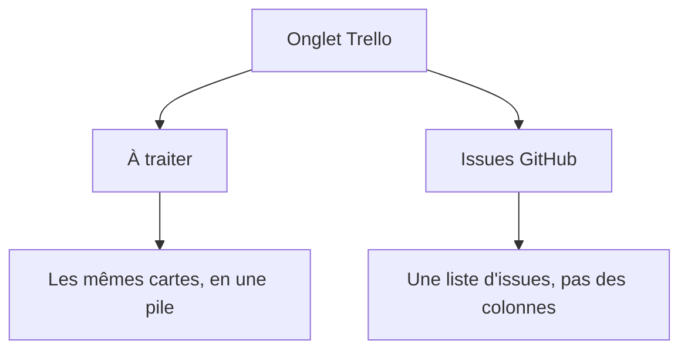
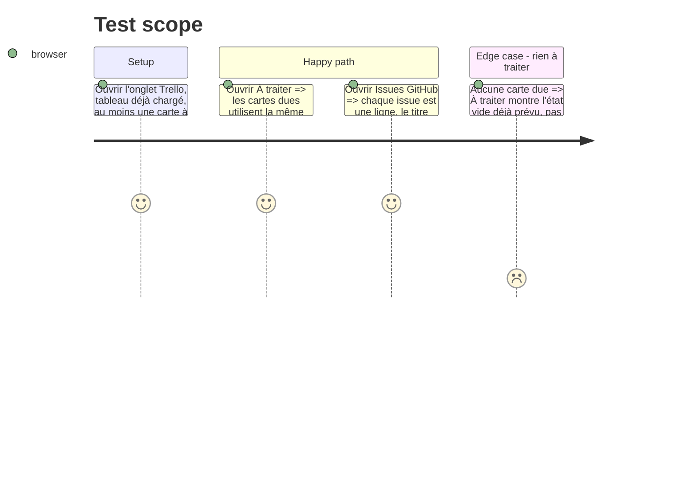

# Instruction: À traiter et les issues, au même langage

## Architecture projection

> Tree of the final files. ✅ create · ✏️ modify · ❌ delete

```txt
.
├── ✏️ src/components/TrelloView.tsx
└── ✏️ src/styles/trello.css
```

## User Journey



## Test Scope



## Wireframe

```txt
┌──────────────────────────────────────────────┐
│ (1) À traiter                                 │
├──────────────┬───────────────────────────────┤
│ (2) nav      │ (3) pile                      │
│              │ ┌───────────────────────────┐ │
│              │ │ (4) carte                 │ │
│              │ └───────────────────────────┘ │
│              │ ┌───────────────────────────┐ │
│              │ │ (4) carte                 │ │
│              │ └───────────────────────────┘ │
└──────────────┴───────────────────────────────┘
```

```txt
┌──────────────────────────────────────────────┐
│ (1) Issues                                    │
├──────────────┬───────────────────────────────┤
│ (2) nav      │ (5) ligne d'issue             │
│              │ (5) ligne d'issue             │
│              │ (6) terminées                 │
└──────────────┴───────────────────────────────┘
```

1. En-tête de la vue : À traiter, ou les issues.
2. La même navigation que sur un tableau.
3. Pile : les cartes dues, les unes sous les autres, pas en colonnes de listes.
4. La carte définie pour le tableau.
5. Ligne d'issue : dépôt, numéro, titre, actions déjà là.
6. Les issues terminées, repliées comme aujourd'hui.

## Tasks to do

### `1)` À traiter

> Les cartes dues reprennent la carte sombre du tableau, sans devenir un second tableau.

1. Réutiliser le bloc carte de la phase 1, dans une seule pile.
2. Garder le tri par échéance. Ne pas afficher « toi » : tout est déjà à soi.
3. L'état vide reste le message actuel, pas une colonne.

### `2)` Issues

> La liste d'issues n'hérite pas du chrome d'une carte de tableau, et perd le lien bleu par défaut.

1. Séparer la classe de la ligne d'issue de celle de la carte de tableau.
2. Titre en `--text`, sans soulignement. Les actions (prompt, publier, écarter, rétablir) restent visibles, pas au survol.

## Test acceptance criteria

| Task | Acceptance criteria              |
| ---- | -------------------------------- |
| 1 | À traiter montre les cartes dues comme les pavés sombres du tableau, en une pile triée par échéance. Sans carte due, le message vide actuel s'affiche, pas une colonne. |
| 2 | Une issue se lit en ligne, titre dans la couleur du texte, en thème clair et sombre. Prompt, publier, écarter et rétablir restent affichés sans survol. La ligne ne reprend pas le fond ni la largeur d'une colonne de tableau. |
