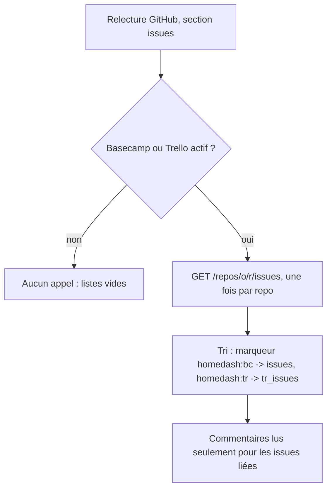
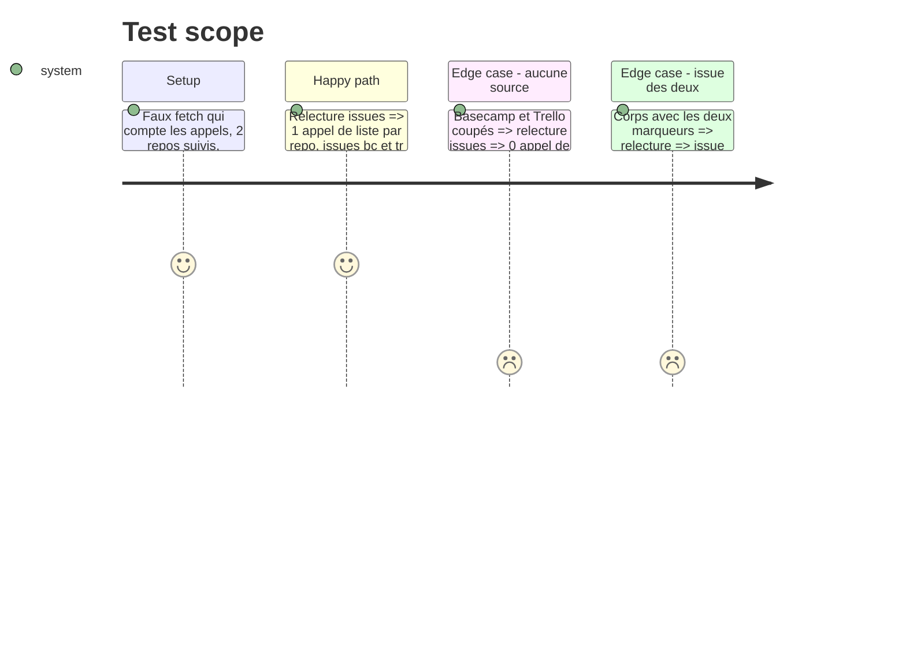

# Instruction: GitHub, une seule lecture des issues

## Architecture projection

> Tree of the final files. ✅ create · ✏️ modify · ❌ delete

```txt
.
├── server/
│   ├── github.ts        ✏️ fetchLinkedIssues() remplace fetchBcIssues + fetchTrIssues ; sauté si aucune source active
│   ├── accounts.ts      ✏️ setIssueSources() : dit aux comptes si Basecamp / Trello sont actifs
│   └── app.ts           ✏️ loadSections() et connexions appellent setIssueSources()
└── tests-ts/
    └── trello.test.ts   ✏️ un seul appel par repo ; aucun appel sans source active
```

## User Journey



## Test Scope



## Tasks to do

### `1)` Une seule liste par repo

> Lire les issues de chaque repo une fois, puis trier par marqueur.

1. Dans `github.ts`, fusionner `fetchBcIssues` et `fetchTrIssues` en `fetchLinkedIssues(tok)` qui renvoie `[bc, tr]`.
2. Garder `BC_LINK`, `TR_LINK`, `bcReport`, `trReport` ; lire les commentaires une fois par issue, chercher les deux rapports.
3. `jobs.issues` appelle `fetchLinkedIssues` ; le reste du code (`data.issues`, `data.tr_issues`, événements) inchangé.

### `2)` Pas d'appel sans source

> Un utilisateur sans Basecamp ni Trello ne paie aucun appel d'issues.

1. `accounts.setIssueSources({ basecamp, trello })` garde l'état ; chaque compte le lit.
2. `app.loadSections()` l'appelle avec `featureOn && connected()` ; aussi après connexion / déconnexion Basecamp et Trello.
3. Section `issues` sans source : listes vides, aucun appel.

### `3)` Tests

1. Cas du Test Scope dans `tests-ts/trello.test.ts` (ou `bcissues.test.ts` selon où vit le faux fetch GitHub).
2. Typecheck et tests au vert.

## Test acceptance criteria

| Task | Acceptance criteria                                                                       |
| ---- | ----------------------------------------------------------------------------------------- |
| 1    | Une relecture fait un seul appel de liste d'issues par repo suivi                          |
| 1    | Les issues Basecamp et Trello apparaissent comme avant dans leurs onglets                  |
| 2    | Basecamp et Trello coupés ou non connectés : aucun appel de liste d'issues                 |
| 3    | Les 192 tests existants et les nouveaux passent, typecheck OK                              |
