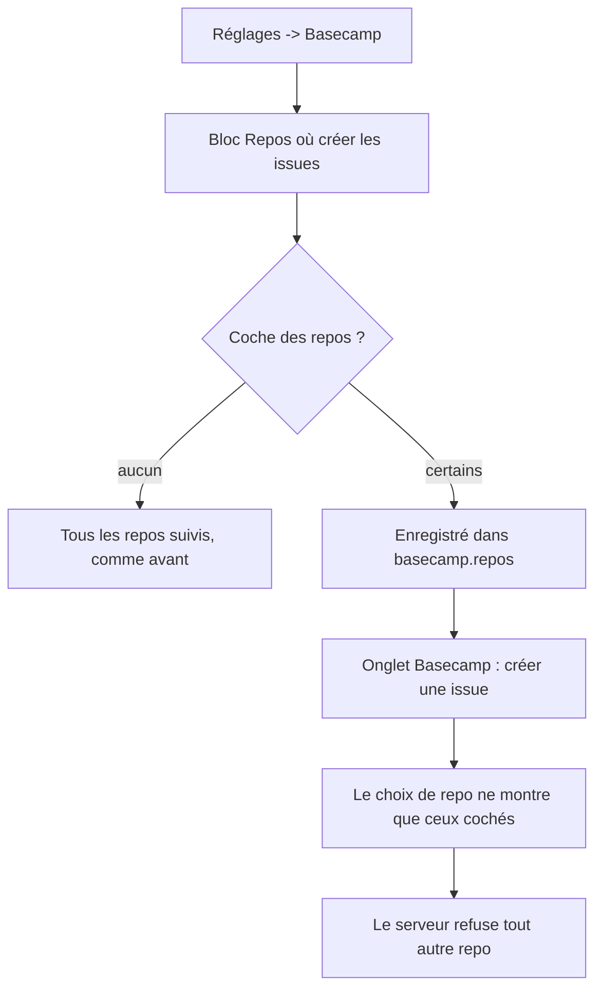
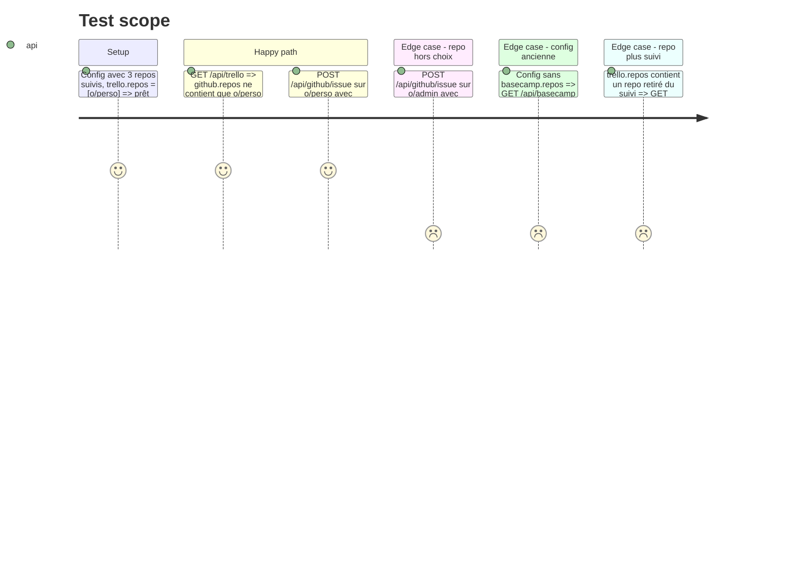

# Instruction: Repos par outil (Basecamp / Trello, #26)

## Architecture projection

> Tree of the final files. ✅ create · ✏️ modify · ❌ delete

```txt
.
├── server/
│   ├── store.ts           ✏️ validateConfig : basecamp.repos et trello.repos = listes de textes
│   ├── accounts.ts        ✏️ bcIssues() / trIssues() ne proposent que les repos choisis
│   └── app.ts             ✏️ /api/github/issue refuse un repo hors du choix de l'outil (marqueur du corps)
├── src/
│   ├── types.ts           ✏️ Config.basecamp.repos?, Config.trello.repos?
│   ├── components/
│   │   ├── SetToolRepos.tsx  ✅ cases à cocher des repos suivis, « Tous » par défaut
│   │   └── SettingsPage.tsx  ✏️ le bloc dans les cartes Basecamp et Trello (brouillon de config)
├── tests-ts/
│   └── trello.test.ts     ✏️ filtre, refus serveur, config sans la clé
└── GUIDE.md               ✏️ « Repos où créer les issues »
```

## User Journey



## Test Scope



## Wireframe

```txt
┌ 📋 Trello ───────────────────────────────────────────┐
│ Connecté : Paul (@paul)            [Se déconnecter]   │
│                                                       │
│ Repos où créer les issues                             │
│ Aucun coché = tous les repos suivis.                  │
│ [x] perso/homedash      [x] perso/notes               │
│ [ ] boite/admin         [ ] boite/base-site           │
└───────────────────────────────────────────────────────┘
```

## Tasks to do

### `1)` Format et validation

> Deux clés facultatives, sans migration.

1. `types.ts` : `basecamp.repos?: string[]`, `trello.repos?: string[]` (`propriétaire/repo`), absent ou vide = tous.
2. `store.validateConfig` : listes de textes si présentes.

### `2)` Serveur

> Le choix vaut pour la page et pour l'écriture.

1. `accounts.bcIssues()` / `trIssues()` filtrent `repos` sur la config lue (repos suivis ∩ choix).
2. `/api/github/issue` : corps avec `homedash:bc` → repo dans le choix Basecamp ; `homedash:tr` → choix Trello ; sinon 422 lisible.

### `3)` Réglages

> Choix dans la page, pas de fichier à éditer.

1. `SetToolRepos` : cases à cocher (pas de contrôle système), repos suivis de tous les comptes.
2. Placé dans les cartes Basecamp et Trello de `SettingsPage`, branché sur le brouillon (`setDraft`), enregistré comme le reste.
3. Rien coché = clé retirée.

### `4)` Tests et guide

1. Cas du Test Scope.
2. `GUIDE.md` : la section Basecamp / Trello explique le choix.

## Test acceptance criteria

| Task | Acceptance criteria                                                                  |
| ---- | ------------------------------------------------------------------------------------ |
| 1    | Une config sans les clés se charge et se valide sans changement                       |
| 2    | La fenêtre « Créer l'issue » d'un outil ne propose que ses repos cochés              |
| 2    | Une création vers un repo hors choix est refusée par le serveur avec une phrase lisible |
| 3    | Cocher / décocher dans Réglages s'enregistre et se retrouve après rechargement        |
| 3    | Rien coché : tous les repos suivis sont proposés, comme avant                         |
| 4    | GUIDE.md décrit le réglage                                                            |
