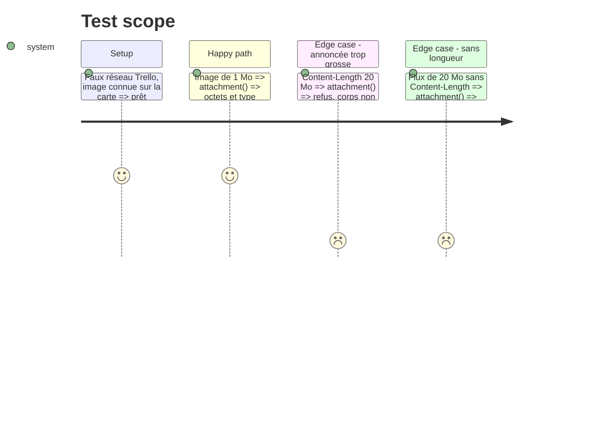

# Instruction: Retouches, images plafonnées et règles à jour

## Architecture projection

> Tree of the final files. ✅ create · ✏️ modify · ❌ delete

```txt
.
├── server/
│   └── trello.ts          ✏️ image : refus sur Content-Length, lecture coupée au plafond
├── tests-ts/
│   └── trello.test.ts     ✏️ image trop grosse refusée sans tout lire
├── CLAUDE.md              ✏️ règle 4 : createIssue depuis Basecamp et Trello ; repos par outil
└── ARCHITECTURE.md        ✏️ /api/github/issue et clés basecamp.repos / trello.repos
```

## User Journey

```mermaid
flowchart TD
  A[Fiche de carte : image jointe] --> B[/api/trello/file]
  B --> C{Content-Length > 15 Mo ?}
  C -- oui --> D[Refus, rien lu]
  C -- non --> E[Lecture par morceaux, coupée au plafond]
  E --> F[Image affichée]
```

## Test Scope



## Tasks to do

### `1)` Plafond pendant la lecture

> Ne jamais charger plus que 15 Mo en mémoire.

1. Dans `call()` (mode `raw`) : refuser si `content-length` dépasse `ATTACH_MAX`.
2. Lire `res.body` par morceaux, arrêter et annuler au-delà du plafond.
3. Tests du Test Scope.

### `2)` Règles et architecture à jour

1. `CLAUDE.md` règle 4 : « `GitHubAccount.createIssue()` (onglets Basecamp et Trello, à la demande, repos suivis et choisis pour l'outil) ».
2. `ARCHITECTURE.md` : routes et clés de config nouvelles.

## Test acceptance criteria

| Task | Acceptance criteria                                                  |
| ---- | -------------------------------------------------------------------- |
| 1    | Une image de plus de 15 Mo est refusée sans être lue en entier         |
| 1    | Une image normale s'affiche comme avant                               |
| 2    | CLAUDE.md et ARCHITECTURE.md décrivent Trello et les repos par outil  |
