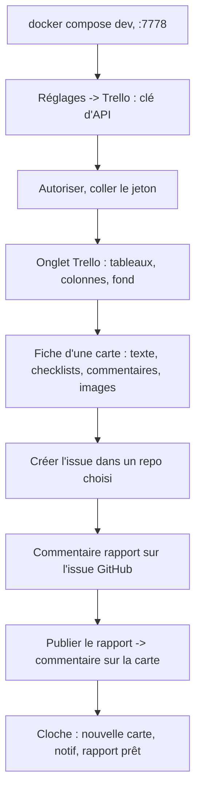
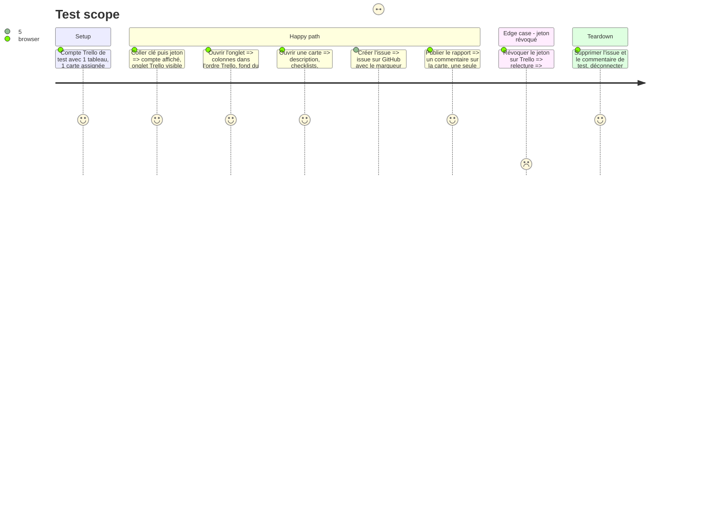

# Instruction: Essai guidé sur un vrai compte Trello

## Architecture projection

> Tree of the final files. ✅ create · ✏️ modify · ❌ delete

```txt
.
├── server/
│   └── trello.ts          ✏️ seulement si l'essai le montre (pièces jointes : api.trello.com, redirection S3 sans jeton)
├── tests-ts/
│   └── trello.test.ts     ✏️ un test par correction faite ici
└── aidd_docs/tasks/2026_10/2026_10_30_trello-finish/
    └── essai.md           ✅ ce qui a été essayé, vu, corrigé
```

## User Journey



## Test Scope



## Tasks to do

### `1)` Préparer

> Un environnement de dev, un compte et un repo de test.

1. `docker compose -f docker-compose.dev.yml up -d`, page sur `homedash-dev.localhost:7778` (données dans `data-dev/`).
2. Toi : un tableau Trello de test, une carte assignée avec une image jointe, un repo de test suivi.

### `2)` Parcours guidé

> Je te donne chaque étape ; tu me dis ce que tu vois.

1. Les étapes du Test Scope, une par une.
2. Je relève le journal d'erreurs (Réglages → Aide) à chaque étape.

### `3)` Corriger ce que l'essai montre

1. Pièces jointes : si refus, passer `trello.com/1/` en `api.trello.com/1/` ; si redirection S3, la suivre **sans** l'en-tête Authorization.
2. Un test par correction, typecheck et tests au vert.
3. `essai.md` : étapes, résultat, corrections.

## Test acceptance criteria

| Task | Acceptance criteria                                                        |
| ---- | -------------------------------------------------------------------------- |
| 1    | La page de dev tourne, Trello visible dans Réglages                         |
| 2    | Chaque étape du parcours donne le résultat attendu sur le vrai compte       |
| 3    | Les images jointes s'affichent, le jeton ne part que vers un hôte Trello    |
| 3    | Le rapport n'est publié qu'une fois, même après deux clics                  |
