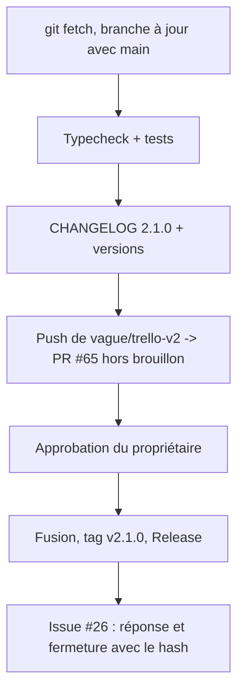
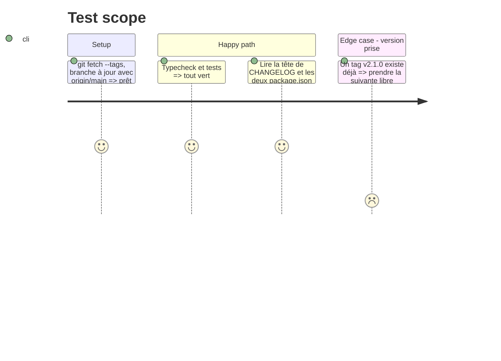

# Instruction: Livraison 2.1.0

## Architecture projection

> Tree of the final files. ✅ create · ✏️ modify · ❌ delete

```txt
.
├── CHANGELOG.md            ✏️ ## 2.1.0 — puces pour l'utilisateur (Trello, repos par outil)
├── package.json            ✏️ version 2.1.0
├── desktop/package.json    ✏️ version 2.1.0 (le workflow de Release l'exige)
└── GUIDE.md                ✏️ relu une dernière fois
```

## User Journey



## Test Scope



## Tasks to do

### `1)` Synchroniser et vérifier

1. `git fetch --tags`, fusion de `origin/main` dans la branche.
2. Typecheck et tests (commande Docker du CLAUDE.md).

### `2)` Version

1. Entrée `## 2.1.0 — AAAA-MM-JJ` en tête de `CHANGELOG.md`, puces pour l'utilisateur.
2. `package.json` et `desktop/package.json` en 2.1.0.

### `3)` Publier (avec ton accord à chaque étape)

1. Push de `vague/trello-v2` (branche de la PR de lepetitpaco) ; PR #65 hors brouillon, description à jour.
2. Après approbation et fusion : tag `v2.1.0`, `git push --follow-tags`.
3. Issue #26 : besoin, solution, version 2.1.0 ; fermée avec le hash de fusion.

## Test acceptance criteria

| Task | Acceptance criteria                                                   |
| ---- | --------------------------------------------------------------------- |
| 1    | Typecheck et tests verts sur la branche à jour                         |
| 2    | CHANGELOG, package.json et desktop/package.json disent 2.1.0           |
| 3    | La PR #65 est prête à relire ; #26 documentée et fermée après fusion   |
