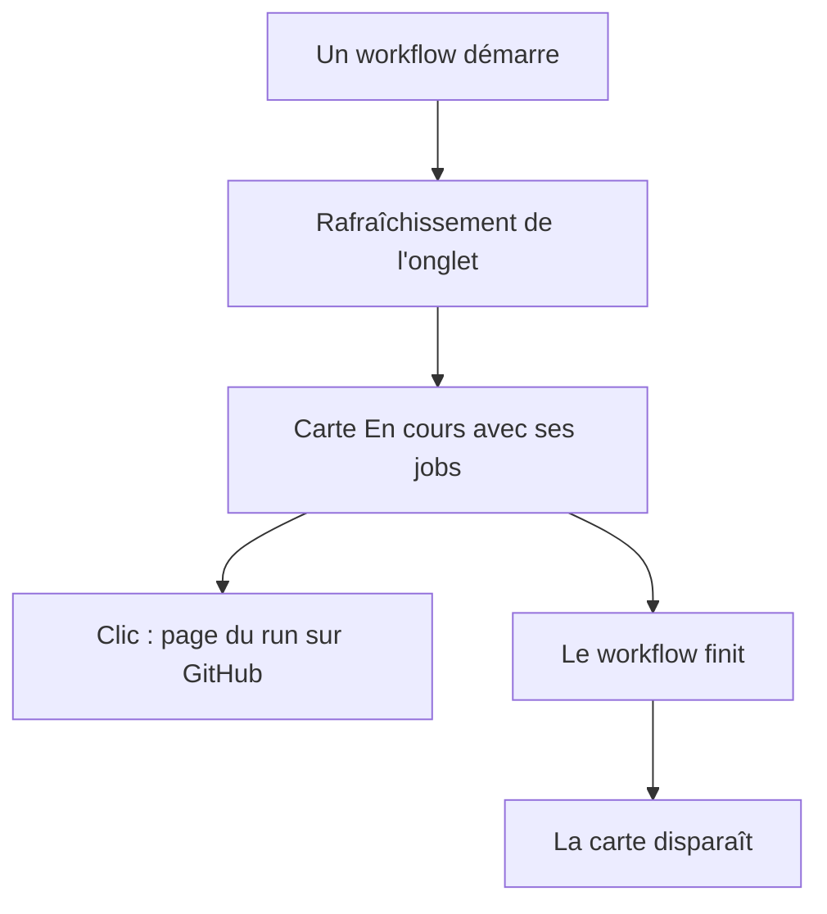
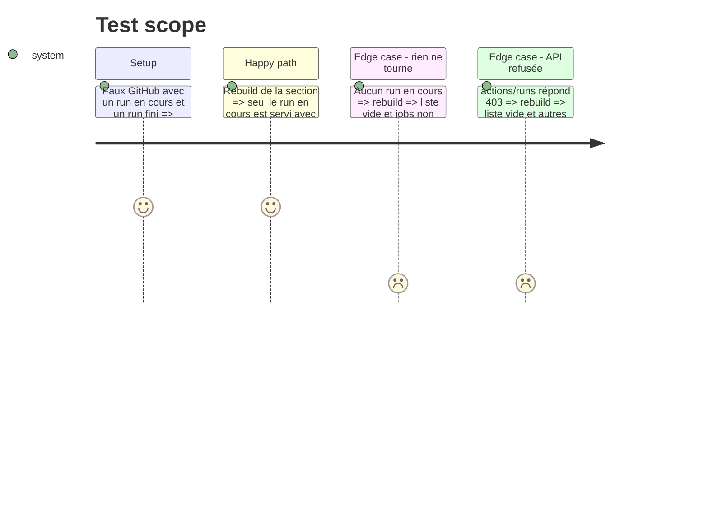

# Instruction: Carte « En cours »

## Architecture projection

```txt
.
├── server/github.ts              ✏️ section `running`, fetchRunning(), runningRun()
├── src/lib/ghboard.ts            ✏️ type Run, GithubData.running
├── src/components/GhRunning.tsx  ✅ la carte
├── src/components/GithubView.tsx ✏️ carte en tête, seulement si un run tourne
├── src/styles/github.css         ✏️ liste des jobs
├── tests-ts/accounts.test.ts     ✏️ tests de la section
├── GUIDE.md                      ✏️ la carte
├── PRIVACY.md                    ✏️ workflows lus sur GitHub
└── CHANGELOG-dev.md              ✏️ entrée de la branche
```

## User Journey



## Test Scope



## Wireframe

```txt
┌ ⚙️ En cours ───────────────────── 1 ┐
│ homedash  release          4 ✓ 2 ⟳ │
│           main · Merge PR #93       │
│   ✓ version                         │
│   ⟳ build (macos-latest, dist:mac)  │
└─────────────────────────────────────┘
```

## Tasks to do

### `1)` Serveur

> Servir les runs en cours par compte.

1. Ajouter `running` à `SECTIONS` et à `Data`.
2. `runningRun()` : un run et ses jobs vers l'objet servi, avec `ciSummary`.
3. `fetchRunning()` : `actions/runs`, filtre sur les statuts non terminés, `jobs` des seuls runs retenus.

### `2)` Carte

> Afficher sans bruit.

1. `GhRunning` : une ligne par run, jobs en dessous, compteurs.
2. Rendu en tête de `GithubView`, seulement si la liste n'est pas vide.

### `3)` Doc

> Dire ce qui change.

1. `GUIDE.md`, `PRIVACY.md`, `CHANGELOG-dev.md`.

## Test acceptance criteria

| Task | Acceptance criteria |
| ---- | ------------------- |
| 1    | Un run terminé n'est jamais servi ; ses jobs ne sont pas demandés |
| 1    | Une réponse refusée donne une liste vide sans casser les autres sections |
| 1    | Aucun événement de cloche n'est produit |
| 2    | Sans run en cours, la carte n'existe pas dans la page |
| 2    | Chaque job montre son état et mène à sa page GitHub |
