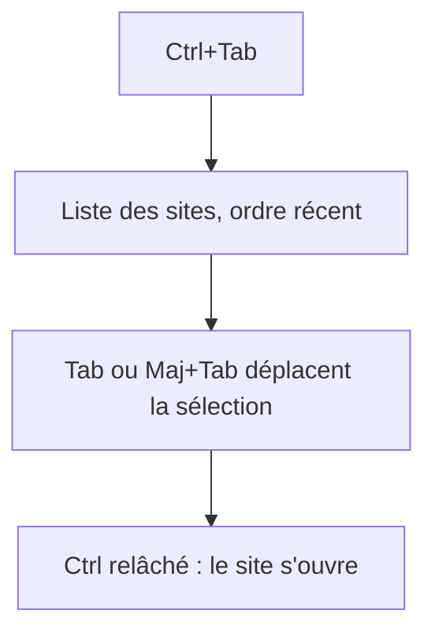
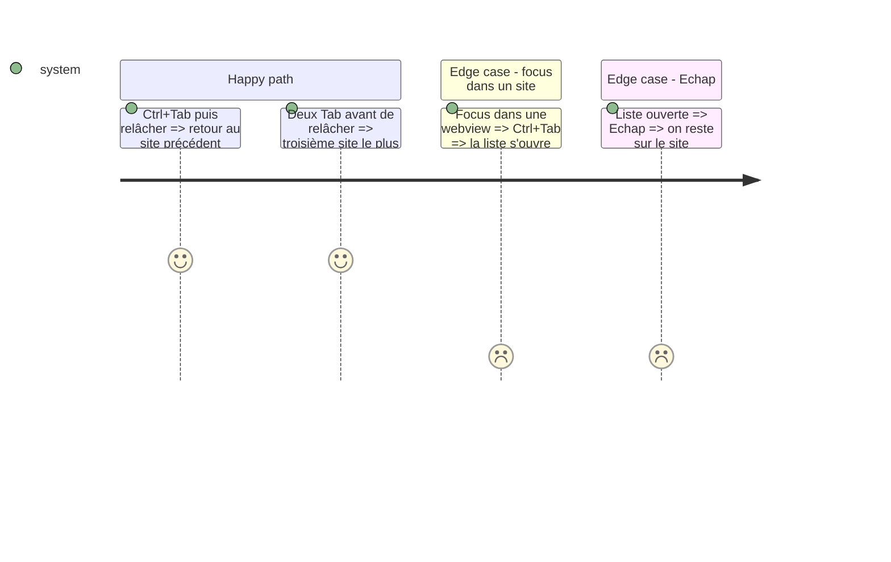

# Instruction: changer de site au clavier (#102)

## Architecture projection

```txt
desktop/main.js              ✏️ intercepte Ctrl+Tab et le relâchement de Ctrl
desktop/preload.js           ✏️ mot `site-switcher`, abonnement onSiteSwitch
src/lib/desktop.ts           ✏️ type du pont
src/lib/siteSwitch.ts        ✅ ordre récent et pas suivant, purs
src/components/SiteSwitcher.tsx ✅ liste à l'écran
src/styles/rail.css          ✏️ style de la liste
src/App.tsx                  ✏️ branchement
tests-ts/siteswitch.test.ts  ✅ tests
GUIDE.md, CHANGELOG-dev.md   ✏️ doc
```

## User Journey



## Test Scope



## Tasks to do

### `1)` Logique pure

1. Ordre récent, sites absents retirés, nouveaux ajoutés à la fin.

### `2)` Coquille et page

1. `before-input-event` sur la fenêtre et chaque webview.
2. Liste affichée, ouverture au relâchement, annulation par Échap ou perte de focus.

## Test acceptance criteria

| Task | Acceptance criteria |
| ---- | ------------------- |
| 1 | Les tests de `siteSwitch` passent. |
| 2 | Ctrl+Tab change de site, y compris le focus dans un site, dans l'appli de dev. |
