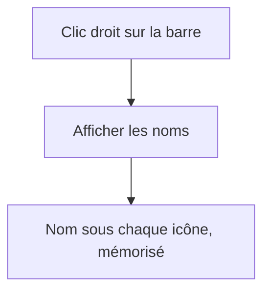
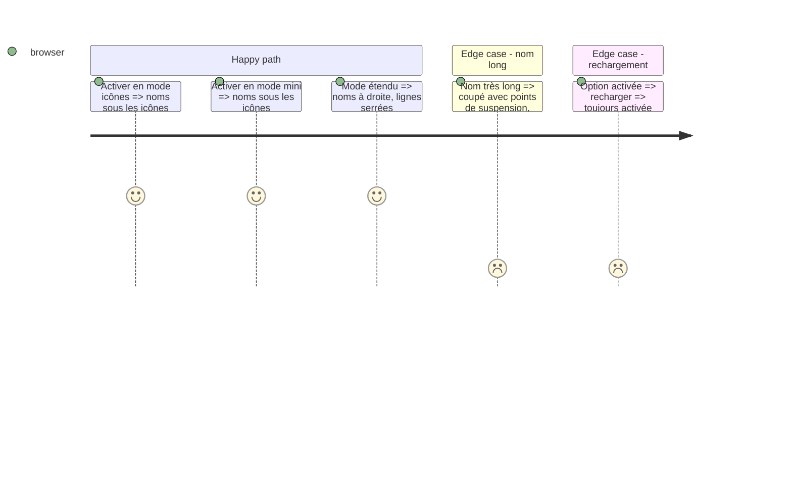

# Instruction: afficher les noms dans la barre (#103)

## Architecture projection

```txt
src/components/Rail.tsx  ✏️ noms selon l'option
src/styles/rail.css      ✏️ lignes serrées en étendu, noms sous l'icône
src/App.tsx              ✏️ préférence mémorisée, entrée du menu, largeurs
GUIDE.md, CHANGELOG-dev.md ✏️ doc
```

## User Journey



## Test Scope



## Wireframe

```txt
┌────────┐  ┌──────────────┐
│  (o)   │  │ (o) Gmail    │
│ Gmail  │  │ (o) GitHub   │
│  (o)   │  │ (o) Trello   │
│ Github │  └──────────────┘
└────────┘
```

## Tasks to do

### `1)` Option et affichage

1. Préférence locale désactivée par défaut, entrée dans le menu de la barre.
2. Noms sous l'icône en modes icônes et mini, ligne serrée en mode étendu.

## Test acceptance criteria

| Task | Acceptance criteria |
| ---- | ------------------- |
| 1 | Les parcours ci-dessus sont vérifiés dans la page, sans débordement. |
