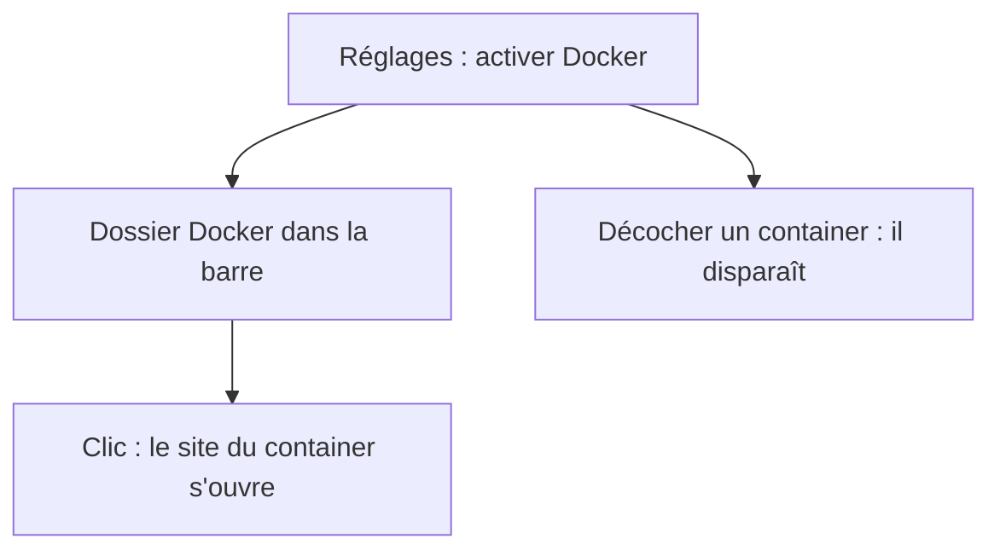
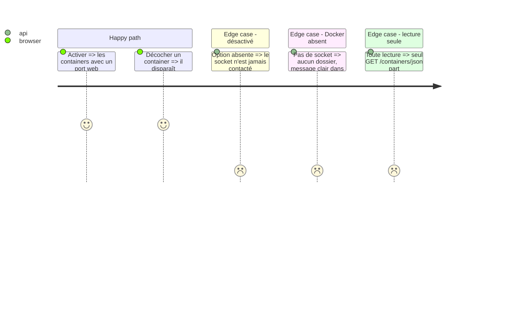

# Instruction: liens vers les containers Docker (#104)

## Architecture projection

```txt
server/docker.ts             ✅ lecture seule du socket
server/app.ts                ✏️ route GET /api/docker
src/lib/docker.ts            ✅ sondage et sites calculés
src/components/SetDocker.tsx ✅ réglages
src/components/SettingsPage.tsx ✏️ section
src/components/Rail.tsx      ✏️ dossier Docker
src/App.tsx                  ✏️ branchement
src/types.ts                 ✏️ config.docker
docker-compose.dev.yml       ✏️ socket monté pour le dev
tests-ts/docker.test.ts      ✅ tests
ARCHITECTURE.md, GUIDE.md, PRIVACY.md, CHANGELOG-dev.md ✏️ doc
```

## User Journey



## Test Scope



## Tasks to do

### `1)` Serveur

1. Trouver le socket, GET fixe, délai court, réponse limitée, liens déduits.

### `2)` Page

1. Réglage désactivé par défaut, choix des containers, dossier dans la barre.

## Test acceptance criteria

| Task | Acceptance criteria |
| ---- | ------------------- |
| 1 | Sans activation, aucun accès au socket ; une seule requête GET possible. |
| 2 | Le dossier suit les vrais containers et n'écrit aucun site dans la config. |
