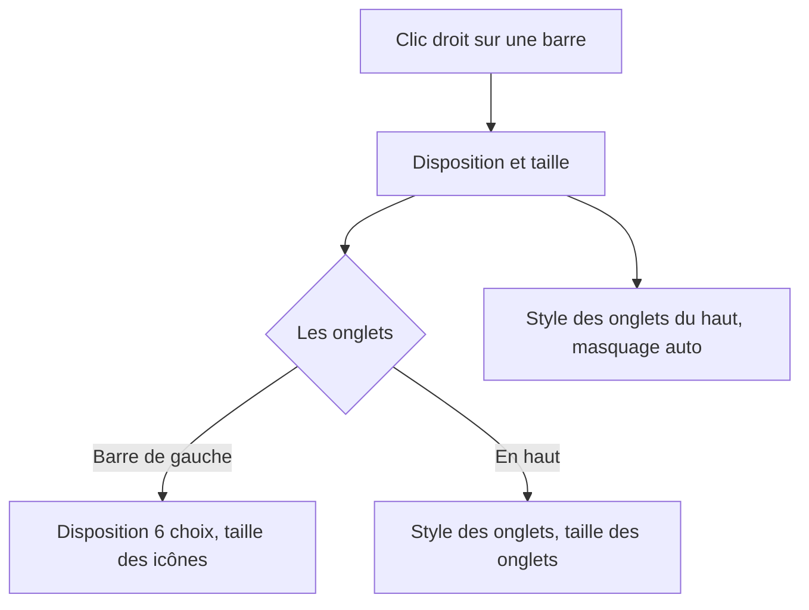
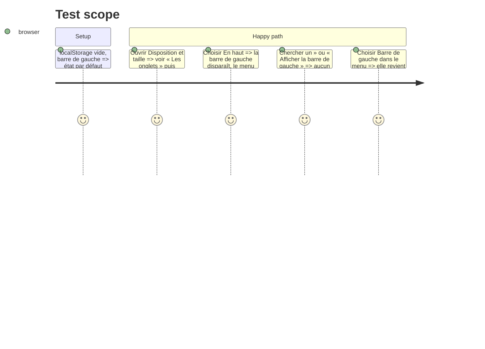

# Instruction: Formulaire des barres clarifié

## Architecture projection

```txt
.
├── src/components/BarLayoutForm.tsx     ✅ les choix : où sont les onglets, puis les options du mode, masquage auto
├── src/components/RailLayoutPicker.tsx  ✏️ simple fenêtre flottante autour du formulaire
├── src/App.tsx                          ✏️ un objet `bars` (valeurs + setters) ; plus de » ni « Afficher la barre de gauche »
└── src/styles/rail.css                  ✏️ styles du formulaire hors de la fenêtre flottante ; » retiré
```

## User Journey



## Test Scope



## Wireframe

```txt
┌ Disposition et taille ─────────────┐
│ [1] Les onglets                    │
│     (▮ Barre de gauche) (▬ En haut) │
│ [2] Options du mode choisi          │
│     gauche : 6 dispositions, taille │
│     haut   : —                      │
│ [3] Onglets du haut : style, taille │
│ [4] ☐ Masquer automatiquement       │
└────────────────────────────────────┘
1 deux grands choix · 2 seulement le mode actif · 3 pastilles/soulignés + taille · 4 case
```

## Tasks to do

### `1)` Formulaire

1. `BarLayoutForm` : section « Les onglets » (deux choix), puis disposition et taille d'icônes si barre de gauche, puis « Onglets du haut » (style, taille), puis la case.
2. `RailLayoutPicker` n'est plus que la fenêtre flottante (placement, fermeture).

### `2)` Plus de retour accidentel

1. Retirer le bouton » et l'entrée « Afficher la barre de gauche ».

## Test acceptance criteria

| Task | Acceptance criteria |
| ---- | ------------------- |
| 1 | Le menu montre d'abord « Les onglets » ; les options de l'autre mode n'apparaissent pas |
| 2 | Sans barre de gauche, aucun bouton ni entrée de menu ne la fait revenir hors du choix de disposition |
