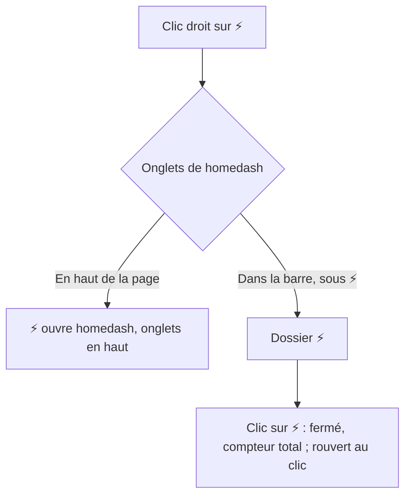
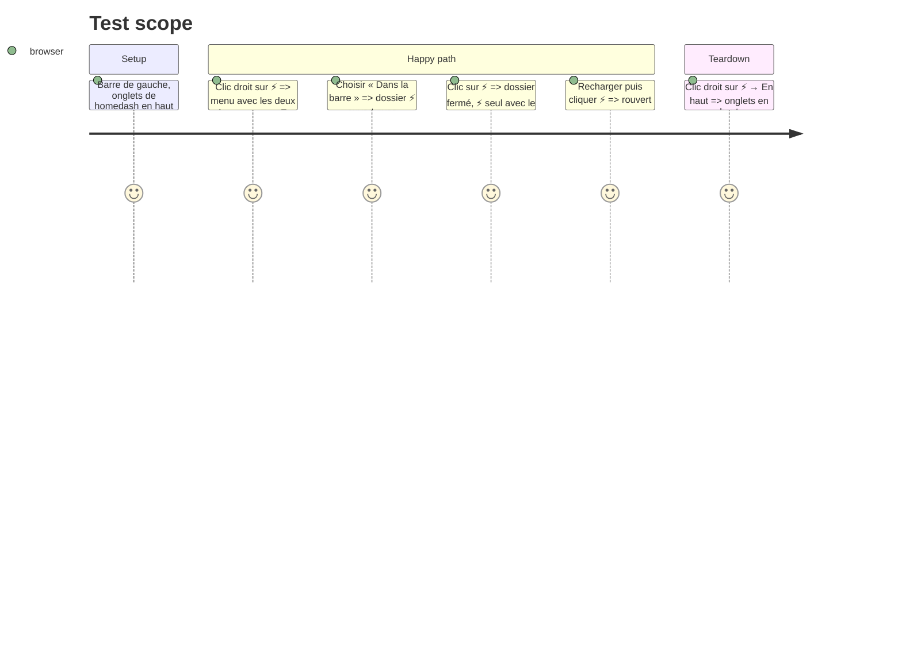

# Instruction: ⚡ — clic droit et repli

## Architecture projection

```txt
.
├── src/components/Rail.tsx  ✏️ clic droit sur ⚡ → `onHomeMenu` ; en dossier, clic sur ⚡ ouvre/ferme
└── src/App.tsx              ✏️ menu ⚡ : onglets de homedash en haut / dans la barre (✓ sur l'actuel), Disposition et taille…
```

## User Journey



## Test Scope



## Tasks to do

### `1)` Menu ⚡

1. `onContextMenu` sur ⚡ (les deux modes) ; App ouvre un menu titré « homedash ».

### `2)` Repli

1. En dossier, clic sur ⚡ = `toggle('⚡')` (même mémoire que les autres dossiers) ; fermé : badge total, actif si un onglet de homedash est affiché.

## Test acceptance criteria

| Task | Acceptance criteria |
| ---- | ------------------- |
| 1 | Le clic droit sur ⚡ change la place des onglets de homedash, l'actuelle cochée |
| 2 | En dossier, ⚡ s'ouvre et se ferme au clic, et le reste après rechargement |
