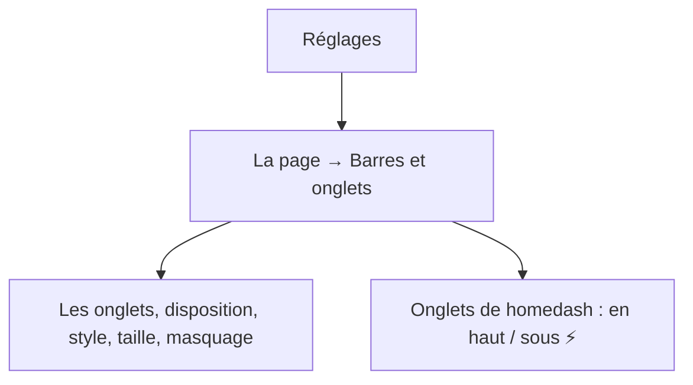
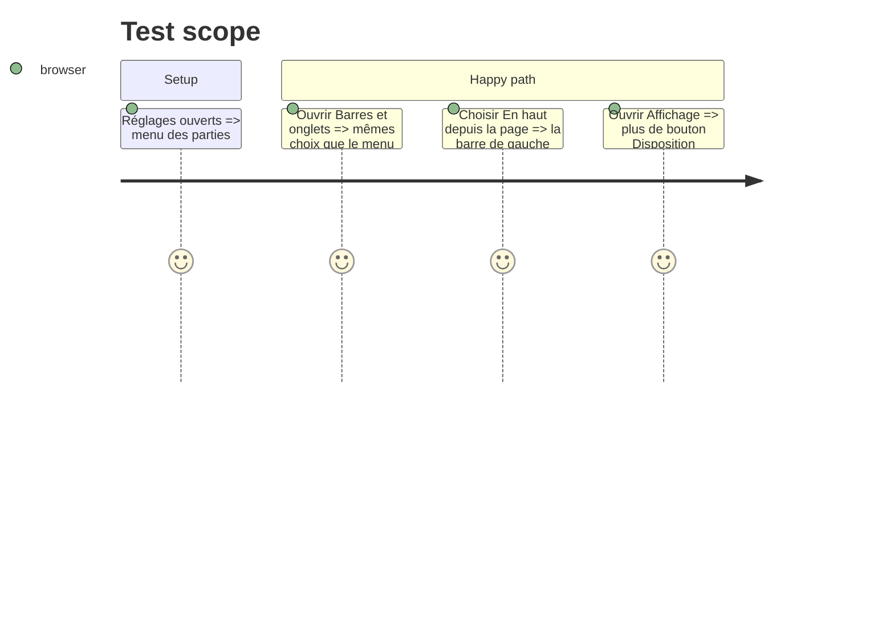

# Instruction: Page Réglages « Barres et onglets »

## Architecture projection

```txt
.
├── src/components/SettingsPage.tsx  ✏️ section `set-bars` (La page) : formulaire en ligne + place des onglets de homedash ; bloc-bouton retiré d'Affichage
├── src/App.tsx                      ✏️ passe `bars` aux Réglages
├── GUIDE.md                         ✏️ clic droit sur ⚡, repli, page Réglages, plus de »
└── CHANGELOG-dev.md                 ✏️ la branche
```

## User Journey



## Test Scope



## Wireframe

```txt
┌ Réglages ───────────┬ Barres et onglets ───────────────────┐
│ LA PAGE             │ [1] note : propre à cet écran, direct │
│  Mes sites          │ [2] Les onglets + options du mode     │
│  Docker             │ [3] Onglets de homedash (⚡)           │
│ >Barres et onglets  │     (En haut de la page) (Sous ⚡)     │
│  Affichage          │                                       │
│  Notifications      │                                       │
└─────────────────────┴───────────────────────────────────────┘
1 rappel · 2 BarLayoutForm · 3 deux choix
```

## Tasks to do

### `1)` Page

1. Section `set-bars` entre Docker et Affichage ; blocs : formulaire, place des onglets de homedash.
2. Retirer le bloc-bouton d'Affichage.

### `2)` Doc

1. GUIDE et CHANGELOG-dev.

## Test acceptance criteria

| Task | Acceptance criteria |
| ---- | ------------------- |
| 1 | La page applique chaque choix immédiatement ; Affichage n'a plus le bouton |
| 2 | Le GUIDE décrit le clic droit sur ⚡, le repli et la page |
