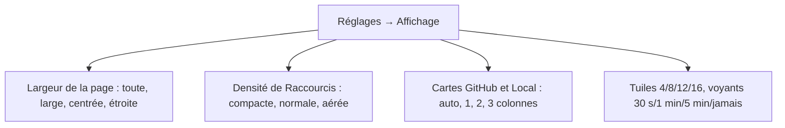
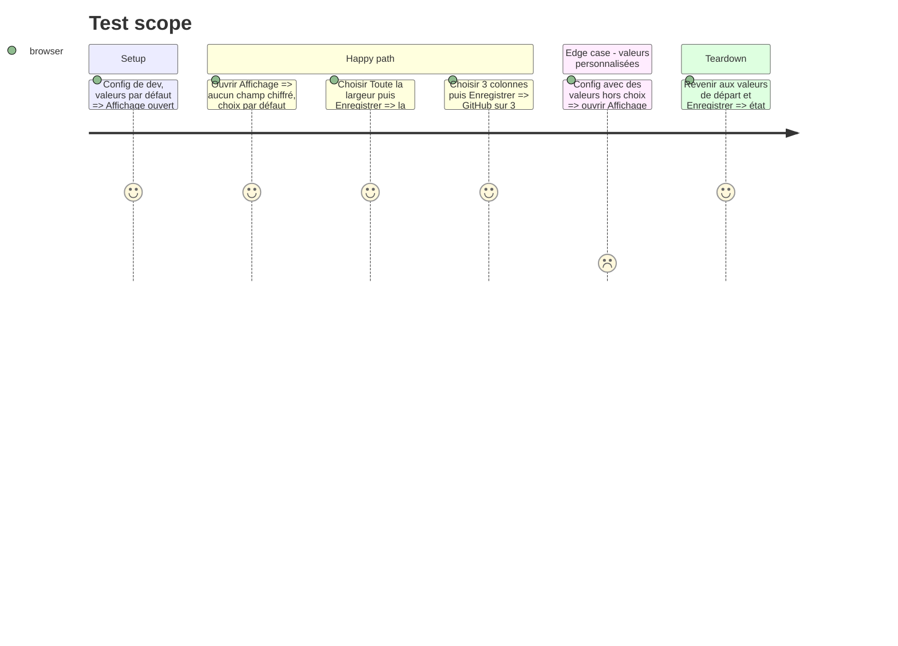

# Instruction: Affichage en choix visuels

## Architecture projection

```txt
.
├── src/components/SetDisplay.tsx    ✅ largeur de page, densité de l'accueil, colonnes GitHub/Local, tuiles, voyants : des miniatures et des boutons
├── src/components/SettingsPage.tsx  ✏️ Affichage = Ce qui s'affiche + SetDisplay ; plus de préréglages d'écran ni de champs chiffrés
├── src/lib/config.ts                ✏️ DISPLAY_PRESETS retiré s'il ne sert plus
├── src/styles/settings-page.css     ✏️ miniatures de page et de densité
└── GUIDE.md, CHANGELOG-dev.md       ✏️
```

## User Journey



## Test Scope



## Tasks to do

### `1)` Choix visuels

1. `SetDisplay` : cinq rangées de choix ; un choix = des valeurs de `ui` (mêmes clés qu'avant, défauts inchangés).
2. Valeur hors choix : rien d'entouré, « personnalisé ».

### `2)` Nettoyage

1. Retirer préréglages et champs chiffrés de SettingsPage ; GUIDE et CHANGELOG-dev.

## Test acceptance criteria

| Task | Acceptance criteria |
| ---- | ------------------- |
| 1 | Chaque choix enregistré change la page comme annoncé ; les défauts sont entourés sur une config neuve |
| 2 | Affichage n'a plus aucun champ chiffré ni préréglage d'écran |
