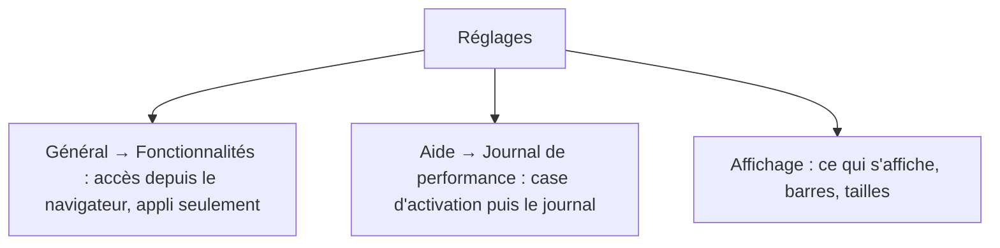
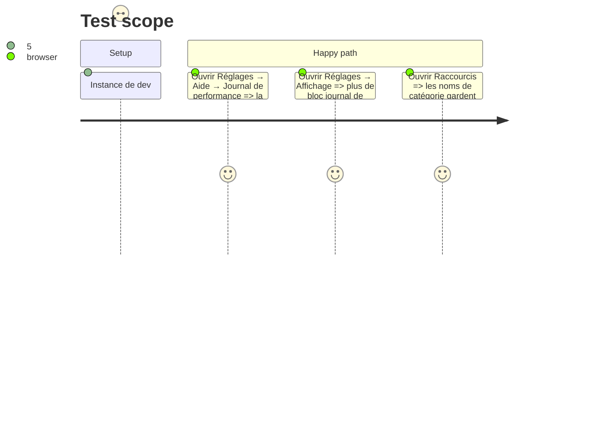

# Instruction: Rangement des Réglages

## Architecture projection

```txt
.
├── src/components/SettingsPage.tsx   ✏️ accès navigateur → Général ; activation du journal de perf → Aide, page toujours listée
├── src/App.tsx                       ✏️ .board pose --cat-w au lieu de --rail-w
├── src/styles/links.css              ✏️ lit --cat-w
└── GUIDE.md                          ✏️ chemins des deux réglages déplacés
```

## User Journey



## Test Scope



## Tasks to do

### `1)` Accès depuis le navigateur

> Le bloc quitte Affichage pour la partie Général (sous Fonctionnalités, appli de bureau seulement).

1. Déplacer le `Block` « Accès depuis le navigateur » dans la carte `set-features`.

### `2)` Journal de performance

> L'activation rejoint le journal, dans Aide, page toujours présente.

1. Retirer le `Block` journal de perf d'Affichage.
2. `PERF` toujours dans le menu ; sa carte montre `SetPerf` puis `PerfLog`.

### `3)` Variable CSS

1. `.board` pose `--cat-w` ; `links.css` lit `--cat-w`.

### `4)` Doc

1. GUIDE : tableau des parties, dépannage localhost:7777, ligne d'accès navigateur.

## Test acceptance criteria

| Task | Acceptance criteria |
| ---- | ------------------- |
| 1 | Dans l'appli, Général montre l'accès navigateur ; Affichage ne le montre plus |
| 2 | Aide liste « Journal de performance » même vide, avec la case en tête ; Affichage ne la montre plus |
| 3 | La colonne des noms de catégorie de Raccourcis a la largeur de `ui.railWidth` |
| 4 | Le GUIDE nomme les nouveaux emplacements |
