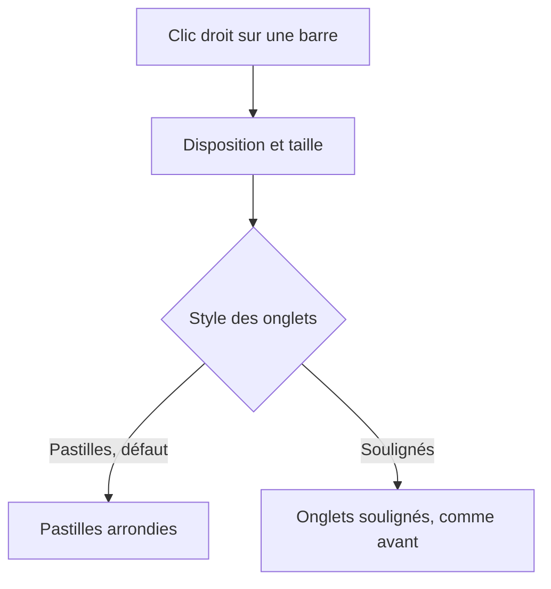
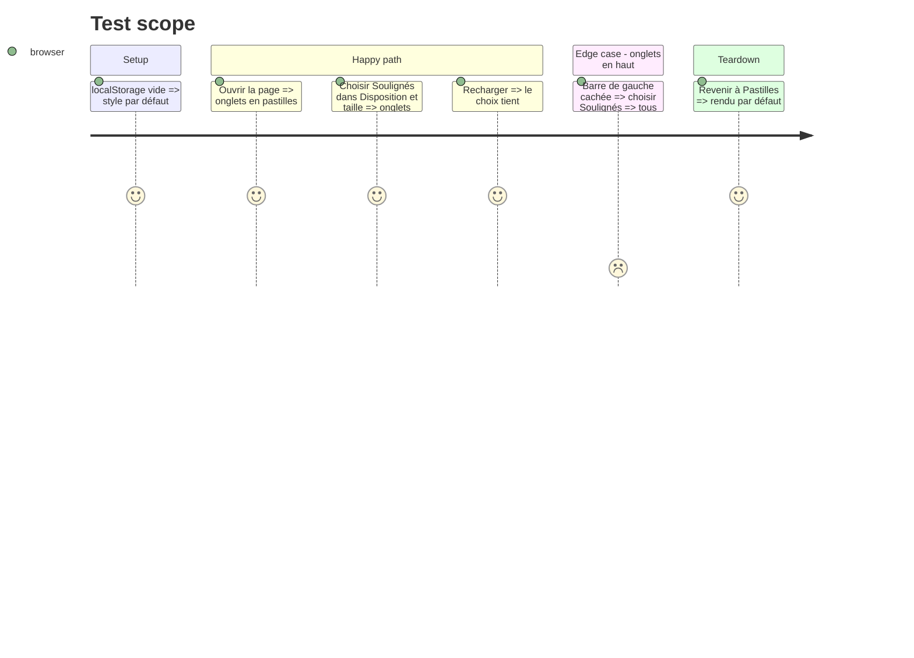

# Instruction: Style des onglets

## Architecture projection

```txt
.
├── src/components/Tabs.tsx              ✏️ prop `look` : pastilles ou soulignés (classe sur la barre)
├── src/components/RailLayoutPicker.tsx  ✏️ choix « Style des onglets »
├── src/App.tsx                          ✏️ pref homedash:tab-style (défaut pastilles)
├── src/styles/github.css                ✏️ variante soulignée (ancien rendu, passage à la ligne gardé)
├── GUIDE.md                             ✏️ le choix
└── CHANGELOG-dev.md                     ✏️ la branche
```

## User Journey



## Test Scope



## Wireframe

```txt
┌ Disposition ──────────────┐
│ [1] dispositions…         │
│ [2] Style des onglets     │
│     (●pastilles) (souligné)│
│ [3] Taille / masquage     │
└───────────────────────────┘
1 inchangé · 2 deux choix à miniature · 3 inchangé
```

## Tasks to do

### `1)` Pref et choix

1. App : `tabStyle` lu/écrit dans `homedash:tab-style`, `pills` par défaut.
2. Picker : section « Style des onglets », deux choix.
3. Tabs : classe `is-underline` sur la barre quand soulignés.

### `2)` Rendu souligné

1. CSS : sans fond ni contour arrondi, bordure basse, actif souligné en bleu ; duo, dossier, compte, éphémère cohérents.

### `3)` Doc

1. GUIDE et CHANGELOG-dev.

## Test acceptance criteria

| Task | Acceptance criteria |
| ---- | ------------------- |
| 1 | Sans réglage, pastilles ; le choix tient au rechargement |
| 2 | Soulignés : actif souligné, rangées sans défilement horizontal, dans les deux thèmes |
| 3 | Le GUIDE décrit le choix |
