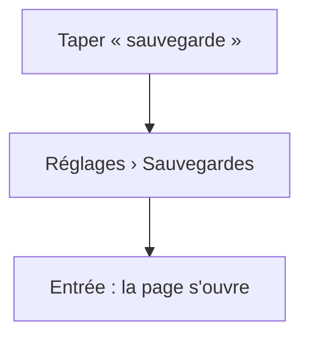
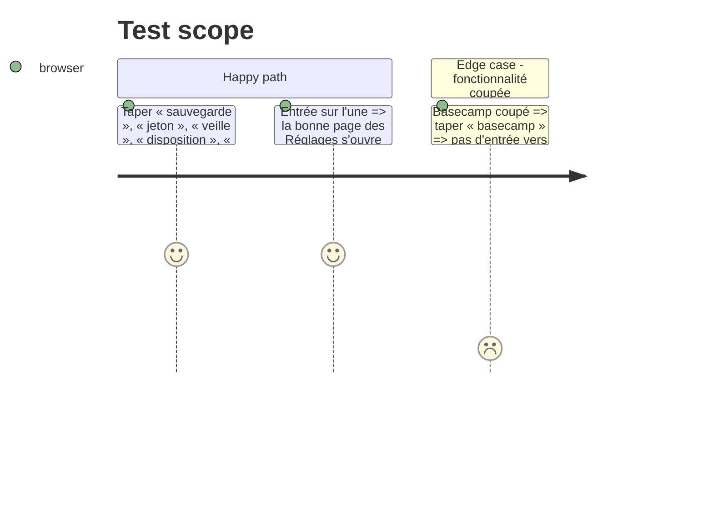

# Instruction: La recherche trouve les Réglages

## Architecture projection

```txt
.
├── src/lib/settingsIndex.ts        ✅ pages et réglages : libellé, partie, mots-clés (synonymes)
├── src/App.tsx                     ✏️ chaque entrée devient une action de recherche qui ouvre sa partie
└── tests-ts/settingsindex.test.ts  ✅ les mots courants trouvent leur page
```

## User Journey



## Test Scope



## Tasks to do

### `1)` Index

1. Une entrée par page et par réglage qu'on cherche (jeton, repos, équipe, restaurer, export, compteur, disposition, en haut, masquer, largeur, colonnes, veille, comptes, dossiers, Docker, accès navigateur, journal, guide, nouveautés).
2. App : actions `Réglages › …`, masquées si la fonctionnalité est coupée.

## Test acceptance criteria

| Task | Acceptance criteria |
| ---- | ------------------- |
| 1 | Chaque mot du test mène à sa page ; une fonctionnalité coupée n'a pas d'entrée |
