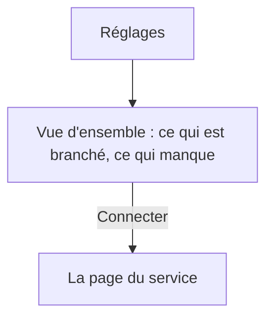
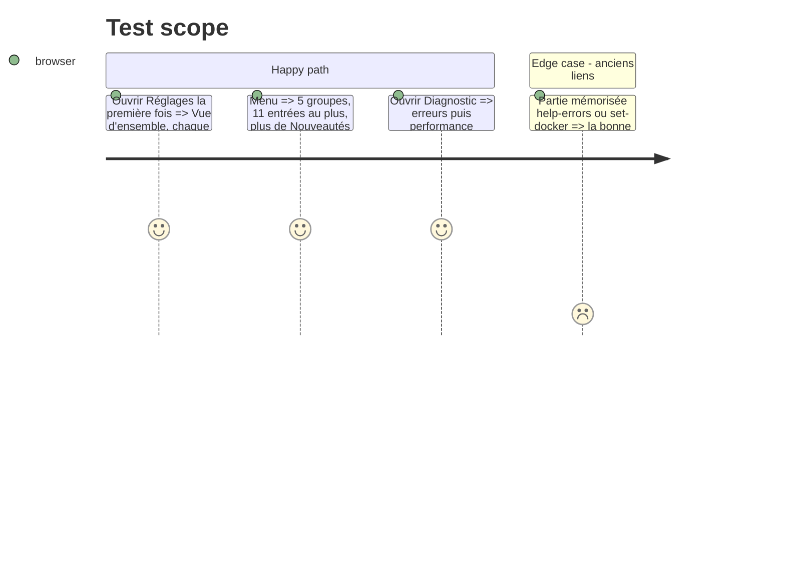

# Instruction: Menu des Réglages et vue d'ensemble

## Architecture projection

```txt
.
├── src/components/SetOverview.tsx   ✅ état : services connectés, notifications du bureau, dernière sauvegarde, liens vers les pages
├── src/components/SettingsPage.tsx  ✏️ groupes Général / Services / La page / Données / Aide ; Docker dans Mes sites ; Diagnostic = erreurs + performance ; Nouveautés hors du menu
└── src/styles/settings-page.css     ✏️ vue d'ensemble
```

## User Journey



## Test Scope



## Wireframe

```txt
┌ Réglages ────────────┬ Vue d'ensemble ───────────────────────────┐
│ GÉNÉRAL              │ [1] Services                               │
│ >Vue d'ensemble      │   🐙 GitHub      ✓ lepetitpaco   [Gérer]   │
│  Fonctionnalités     │   💻 Local       ✓ 1 dossier     [Gérer]   │
│ SERVICES             │   🏕 Basecamp    — non connecté [Connecter]│
│  GitHub · Local …    │ [2] Notifications du bureau ✓ / [Activer]  │
│ LA PAGE …            │ [3] Dernière sauvegarde : il y a 2 h       │
│ DONNÉES · AIDE       │ [4] Apparence : barre, largeur → liens     │
└──────────────────────┴────────────────────────────────────────────┘
1 état + action · 2 état · 3 date · 4 raccourcis
```

## Tasks to do

### `1)` Vue d'ensemble

1. `SetOverview` lit `api/health`, l'état des notifications, la dernière sauvegarde ; chaque ligne mène à sa page.

### `2)` Menu

1. Groupes et ordre ; Docker devient un bloc de Mes sites ; Diagnostic réunit erreurs et performance ; Nouveautés reste ouvrable (menu de l'appli, bouton de version) sans entrée.
2. Anciens identifiants redirigés.

## Test acceptance criteria

| Task | Acceptance criteria |
| ---- | ------------------- |
| 1 | La vue d'ensemble montre l'état réel de chaque service et mène à sa page |
| 2 | Le menu a 11 entrées au plus ; les anciens identifiants ouvrent la bonne page |
