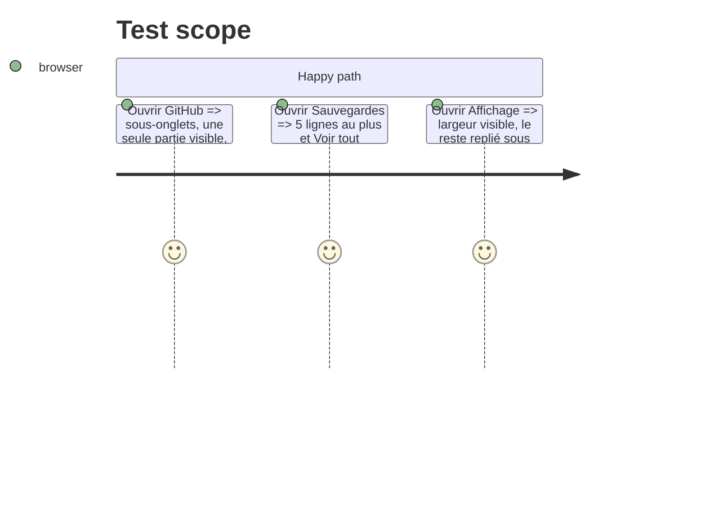

# Instruction: Pages allégées

## Architecture projection

```txt
.
├── src/components/SettingsPage.tsx  ✏️ GitHub en sous-onglets Compte · Repos · Équipe · Onglet (Renovate replié) ; Affichage : « Plus de réglages » replié
├── src/components/SetBackups.tsx    ✏️ les 5 dernières, « Voir tout (n) »
└── src/styles/settings-page.css     ✏️ sous-onglets, repli
```

## User Journey

```mermaid
flowchart TD
  A[GitHub] --> B[Compte | Repos | Équipe | Onglet]
  C[Sauvegardes] --> D[5 dernières] --> E[Voir tout]
```

## Test Scope



## Tasks to do

### `1)` GitHub

1. Quatre sous-onglets, mémorisés ; Renovate sous « Avancé ».

### `2)` Sauvegardes et Affichage

1. Cinq dernières sauvegardes puis « Voir tout ».
2. Affichage : densité, colonnes, tuiles, voyants sous « Plus de réglages ».

## Test acceptance criteria

| Task | Acceptance criteria |
| ---- | ------------------- |
| 1 | Chaque sous-onglet tient sur un écran à 1512×842 |
| 2 | Sauvegardes et Affichage tiennent sur un écran, replis ouverts au clic |
