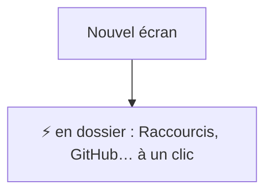
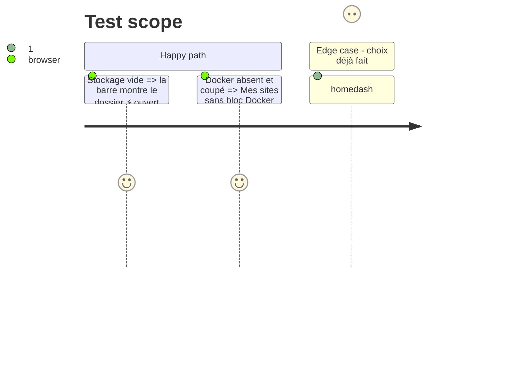

# Instruction: Défauts

## Architecture projection

```txt
.
├── src/App.tsx              ✏️ ⚡ en dossier quand rien n'est choisi
└── src/components/SetTabs.tsx or SettingsPage.tsx ✏️ bloc Docker seulement si Docker est là ou déjà activé
```

## User Journey



## Test Scope



## Tasks to do

### `1)` Défauts

1. ⚡ en dossier par défaut ; un choix enregistré reste respecté.
2. Docker proposé seulement s'il est détecté ou déjà activé.

## Test acceptance criteria

| Task | Acceptance criteria |
| ---- | ------------------- |
| 1 | Sans choix, dossier ⚡ ; un choix enregistré l'emporte ; Docker caché quand absent |
