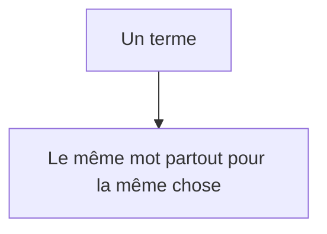
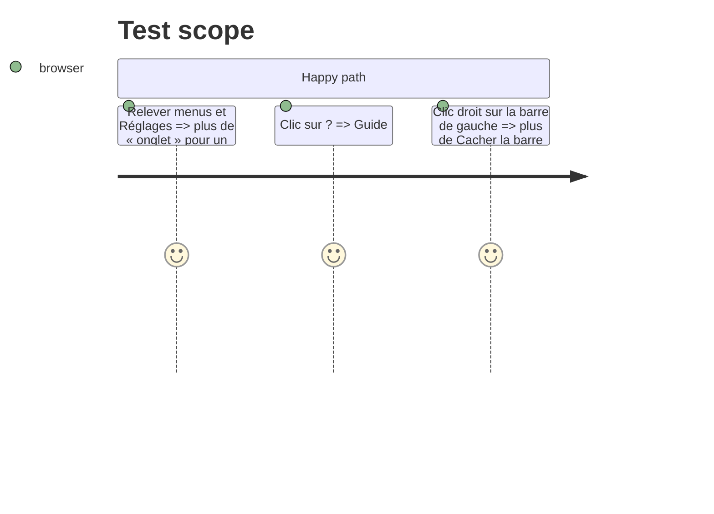

# Instruction: Lexique et finitions

## Architecture projection

```txt
.
├── src/App.tsx, src/components/*.tsx  ✏️ libellés : site, compteur, compte, Activité, Local ; boutons à majuscule initiale ; Basecamp et Trello à l'identique
├── src/components/TopBar.tsx          ✏️ bouton « ? » vers le Guide
├── src/App.tsx                        ✏️ plus de « Cacher la barre » ; icônes au menu d'un lien
├── CLAUDE.md                          ✏️ lexique et règle des réglages
└── GUIDE.md, CHANGELOG-dev.md         ✏️
```

## User Journey



## Test Scope



## Tasks to do

### `1)` Lexique

1. Remplacer les termes ; uniformiser les boutons.

### `2)` Finitions

1. « ? », menu d'un lien avec icônes, « Cacher la barre » retiré.
2. CLAUDE.md : lexique + règle ; GUIDE et CHANGELOG-dev.

## Test acceptance criteria

| Task | Acceptance criteria |
| ---- | ------------------- |
| 1 | Le relevé des textes ne montre plus les doublons de l'audit |
| 2 | « ? » ouvre le Guide ; CLAUDE.md porte le lexique |
