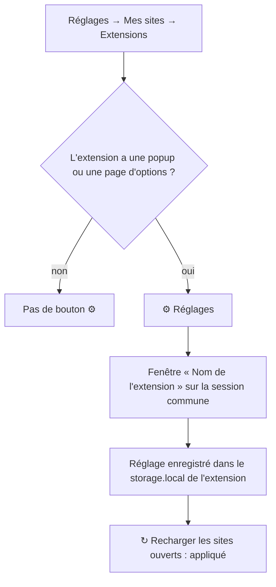
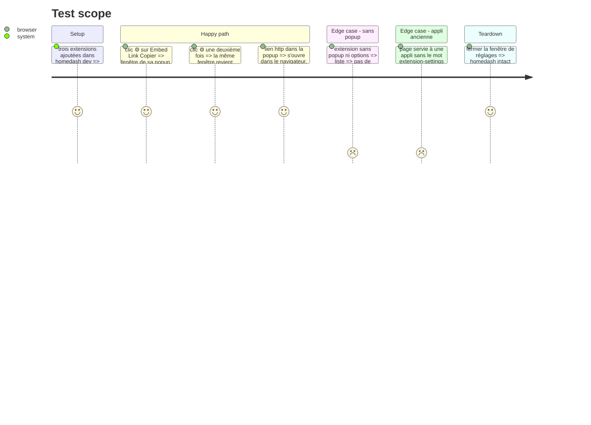

# Instruction: homedash, ⚙ réglages d'une extension

## Architecture projection

```txt
.
├── desktop/main.js            ✏️ action « settings » de homedash:extensions, fenêtre de réglages, page de réglages dans extList
├── desktop/preload.js         ✏️ mot « extension-settings » dans features
├── src/lib/desktop.ts         ✏️ types : action « settings », ExtensionInfo.settings
├── src/components/SetExtensions.tsx ✏️ bouton ⚙ Réglages, texte d'aide
├── GUIDE.md                   ✏️ puce Extensions
├── ARCHITECTURE.md            ✏️ main.js : fenêtre de réglages
├── CLAUDE.md                  ✏️ piège Extensions : popup et options ouvertes à part, session commune
├── CHANGELOG-dev.md           ✏️ entrée de la branche
└── aidd_docs/test-app-full.md ✏️ cas à tester
```

## User Journey



## Test Scope



## Tasks to do

### `1)` Coquille

> Ouvrir la page de réglages d'une extension dans sa fenêtre.

1. `extStatus` garde la page de réglages (popup, sinon page d'options) lue dans `ext.manifest`.
2. `extList()` renvoie `settings: true` quand il y en a une.
3. Action `settings` : charge les extensions dans `PARTITION` si besoin, puis ouvre (ou ramène devant) une `BrowserWindow` enfant, sans Node, sur cette session, à `chrome-extension://<id>/<page>`.
4. Navigation limitée à `chrome-extension://<id>/` ; un lien web s'ouvre dans le navigateur, le reste est refusé.
5. Mot `extension-settings` dans `features` (preload).

### `2)` Page

> Le bouton ⚙ et un texte juste.

1. Types de `desktop.ts`.
2. Bouton ⚙ Réglages sur chaque extension qui en a, si l'appli a le mot.
3. Texte d'aide : la popup s'ouvre par ⚙ ; réglages valables pour la connexion commune, pas pour les comptes.

### `3)` Doc

1. GUIDE, ARCHITECTURE, CLAUDE.md (piège), CHANGELOG-dev, liste de `full`.

## Test acceptance criteria

| Task | Acceptance criteria |
| ---- | ------------------- |
| 1 | ⚙ ouvre la popup de l'extension dans une fenêtre ; un 2e clic la ramène devant ; un lien web part dans le navigateur |
| 2 | Pas de ⚙ pour une extension sans popup ni options, ni dans une appli ancienne |
| 3 | La doc dit où sont les réglages et leur limite (comptes) |
