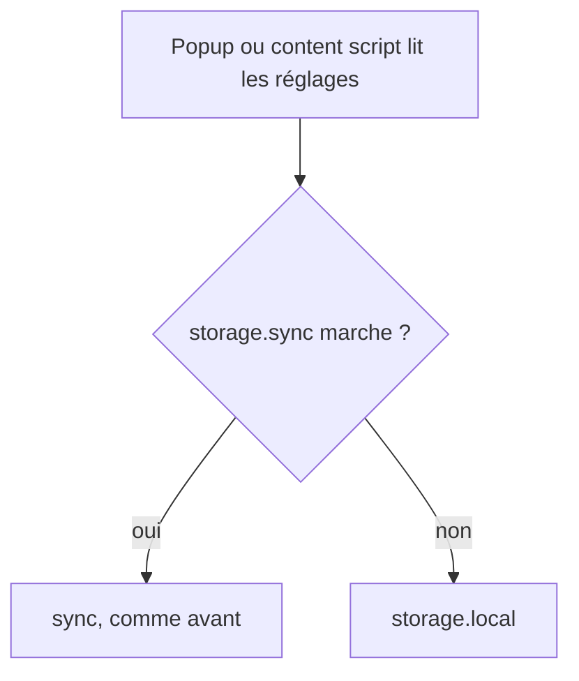
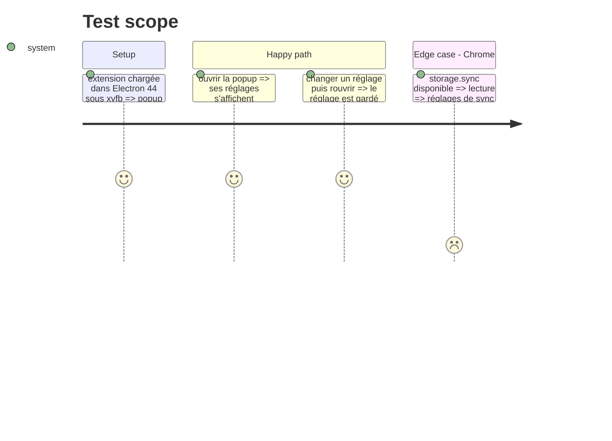

# Instruction: Embed Link Copier, repli sur storage.local

## Architecture projection

```txt
.
└── storage.js ✏️ zone choisie : sync seulement si elle répond, sinon local (CRLF gardé)
```

## User Journey



## Test Scope



## Tasks to do

### `1)` Repli

1. Lire et écrire via un helper : `storage.sync`, et sur erreur `storage.local`.
2. Pas de perte pour Chrome et Firefox : sync reste le premier choix.

## Test acceptance criteria

| Task | Acceptance criteria |
| ---- | ------------------- |
| 1 | Dans Electron, la popup affiche ses réglages et les garde ; dans Chrome, rien ne change |
