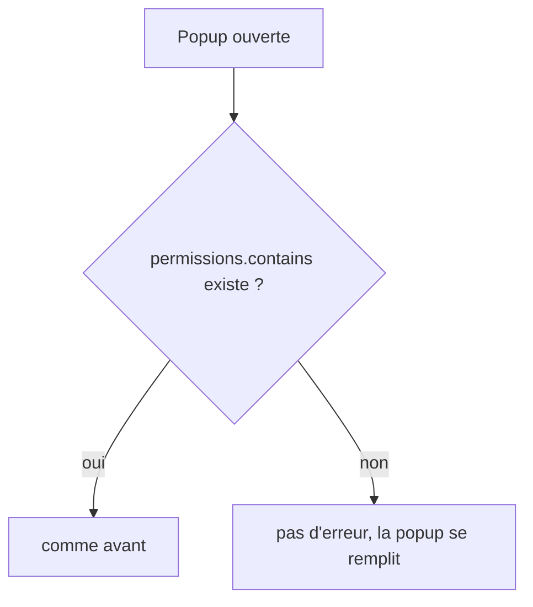
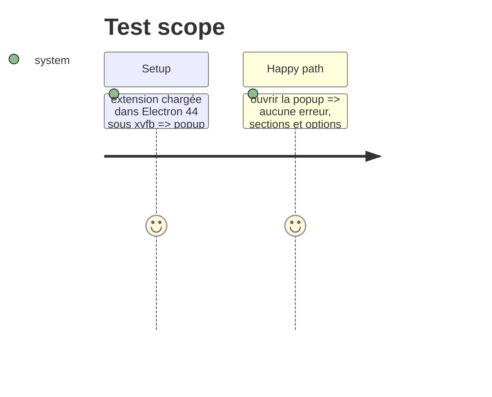

# Instruction: Basecamp User Highlighter, permissions absentes

## Architecture projection

```txt
.
└── popup.js ✏️ permissions.contains absent ou en erreur : on considère l'accès accordé (déclaré dans le manifest)
```

## User Journey



## Test Scope



## Tasks to do

### `1)` Garde

1. Avant `permissions.contains`, tester qu'il existe ; sinon (ou sur erreur) passer la demande d'accès.

## Test acceptance criteria

| Task | Acceptance criteria |
| ---- | ------------------- |
| 1 | Plus d'erreur `contains` à l'ouverture dans Electron ; Chrome et Firefox inchangés |
