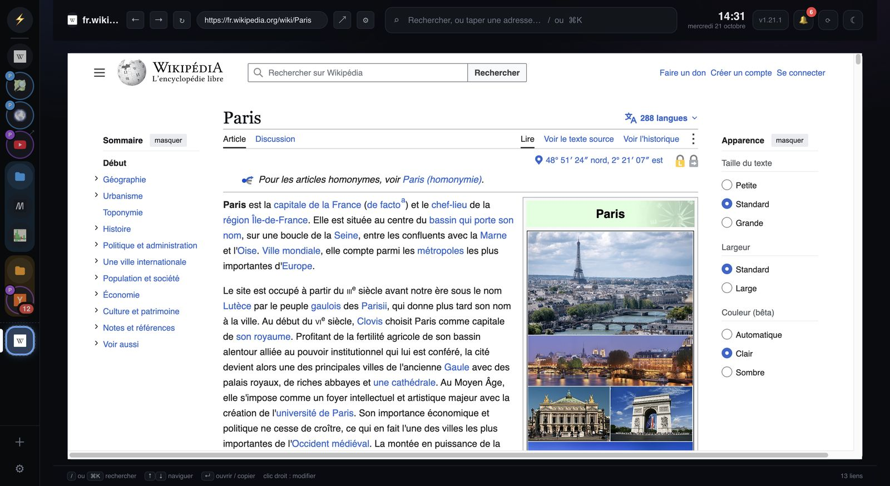
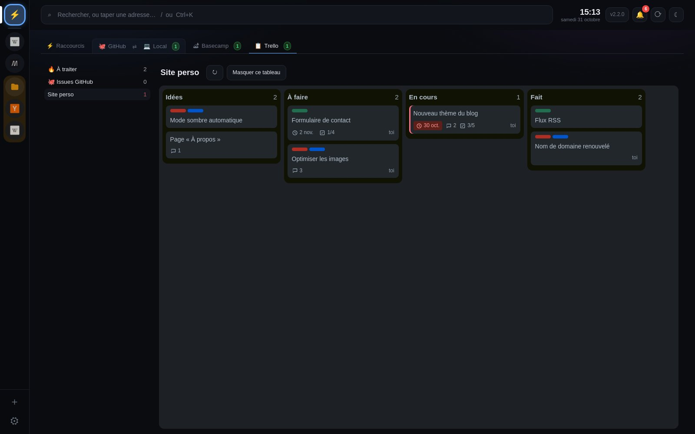
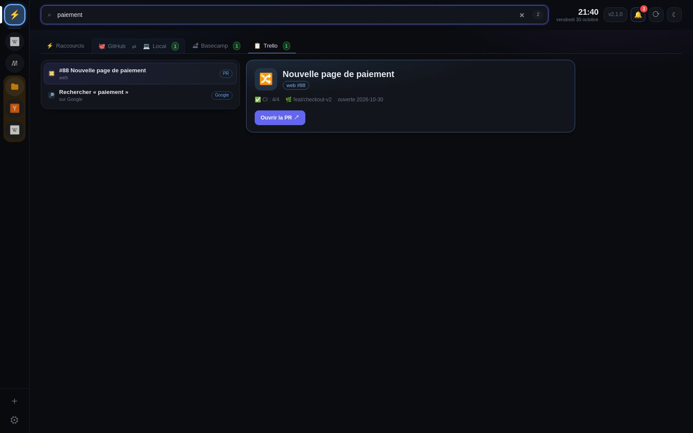

# Aperçu

Captures d'une instance de **démo** (données fictives). Mode d'emploi : [GUIDE.md](../GUIDE.md).

## Un site dans un onglet

Le site prend toute la page. En haut, une seule barre : son nom (l'adresse au survol), ← → ↻, ↗ pour
l'ouvrir dans le navigateur, partager pour copier son lien, ⚙ pour le modifier, puis la recherche. À gauche, la barre des sites :
⚡ pour homedash, une icône par site avec son compte (P) et ses non-lus (3, 12), rangés en dossiers.

## Clic droit

Sur un lien, dans un site : l'ouvrir dans l'onglet de ce site, dans un **onglet temporaire** avec le compte
de son choix, dans le navigateur, ou le copier. Sur du texte : copier, rechercher.

| Sur une icône de la barre | Sur la barre elle-même |
| --- | --- |
|  |  |

Sur une icône : copier le lien, dossier, compte, notifications, son, mise en veille, modifier, supprimer.
Sur la barre : ajouter un site, un onglet temporaire, la largeur, la cacher.

## Onglet temporaire

Un site le temps d'une recherche, en bas de la barre (contour pointillé), avec une barre d'adresse.
Clic droit dessus : le garder, copier son lien, ou l'ajouter à *Mes sites*.

## La barre de gauche

Trois largeurs au choix (clic droit sur la barre). Les dossiers se replient et montrent leurs quatre
premières icônes et le total des non-lus.

## Raccourcis

Tes liens épinglés et les plus utilisés, des notes, des infos à copier (Wi-Fi, IP…), et tes catégories
de liens.

## Ajouter un site

＋ en bas de la barre : une adresse, ou un site courant en un clic.

## GitHub

Tes branches actives avec leur PR et leur CI, les PRs ouvertes, les mergées, et les builds pendant qu'ils tournent.

## Local

Tes clones, branche par branche : ce qui peut partir sans risque, ce qui reste à pousser. Rien n'est
modifié : les commandes sont à copier.

## Basecamp

Tes tâches en retard ou à venir. Un clic ouvre la tâche et sa conversation ; coche ce qui part dans une issue GitHub, et son rapport revient en commentaire.

## Trello

Tes tableaux tels qu'ils sont sur Trello ; tes cartes en retard ou proches en tête ; une carte devient une
issue GitHub.

## Recherche

`/` ou `⌘K` : liens, sites, repos, PRs, tâches, notes… et le web.

## La cloche

CI cassée ou réparée, PR mergée, Renovate, branche locale à nettoyer, nouvelle version de homedash.

## Réglages

Un site par ligne, avec sa mémoire ; un clic l'ouvre. Le catalogue ajoute un site déjà réglé.

Sauvegardes automatiques chaque jour et avant chaque mise à jour, ménage en quelques clics.
