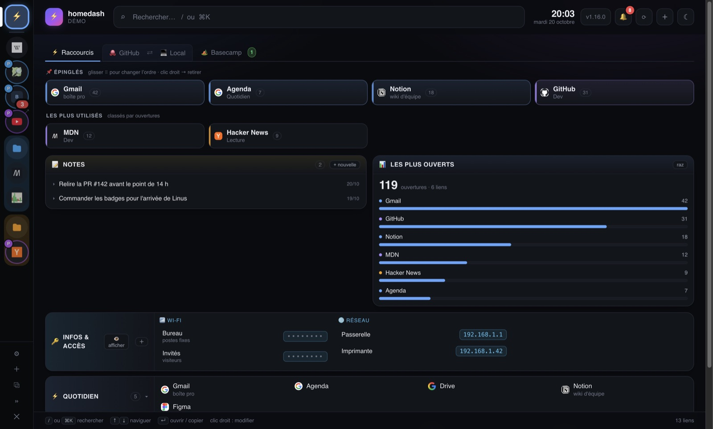
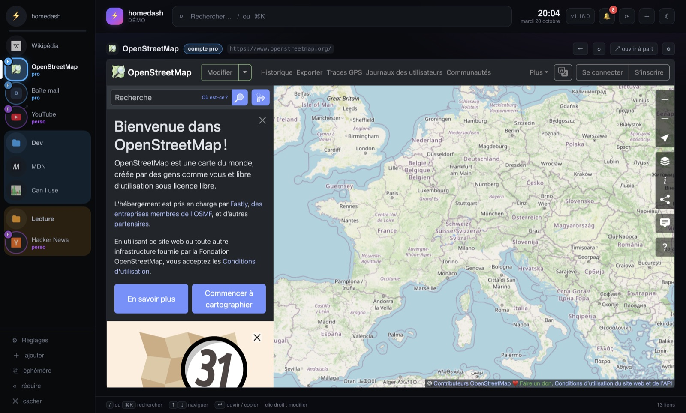
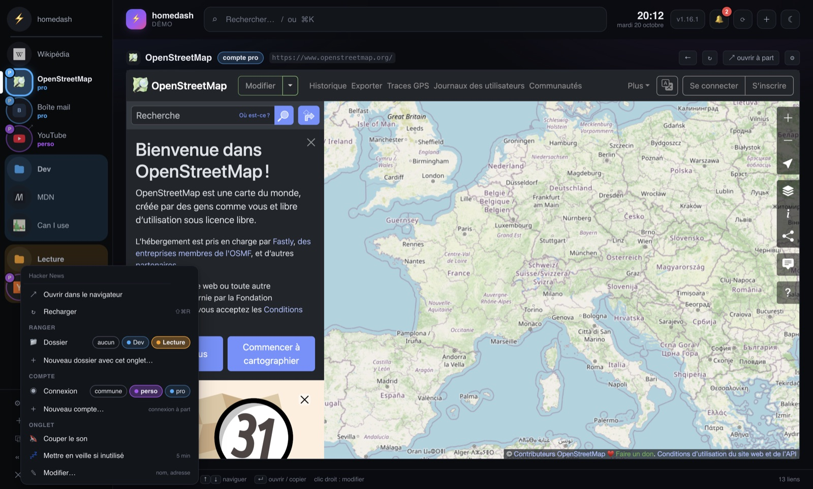
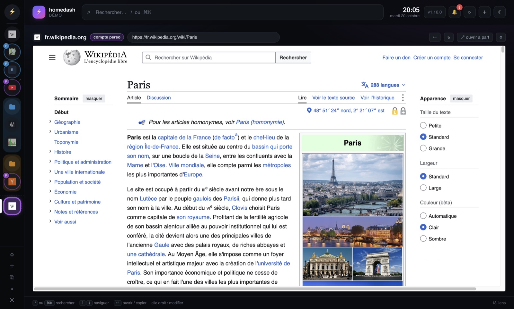
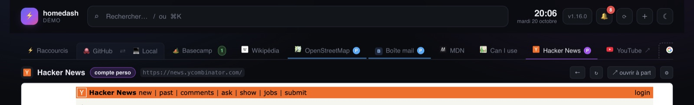
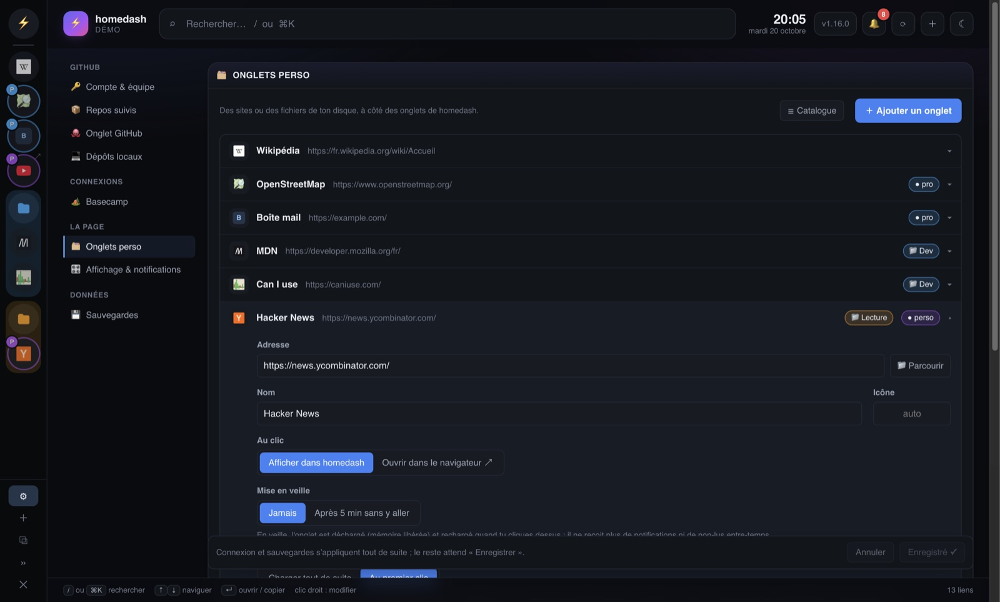
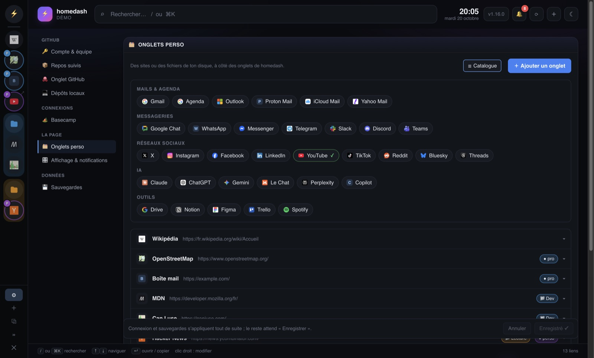
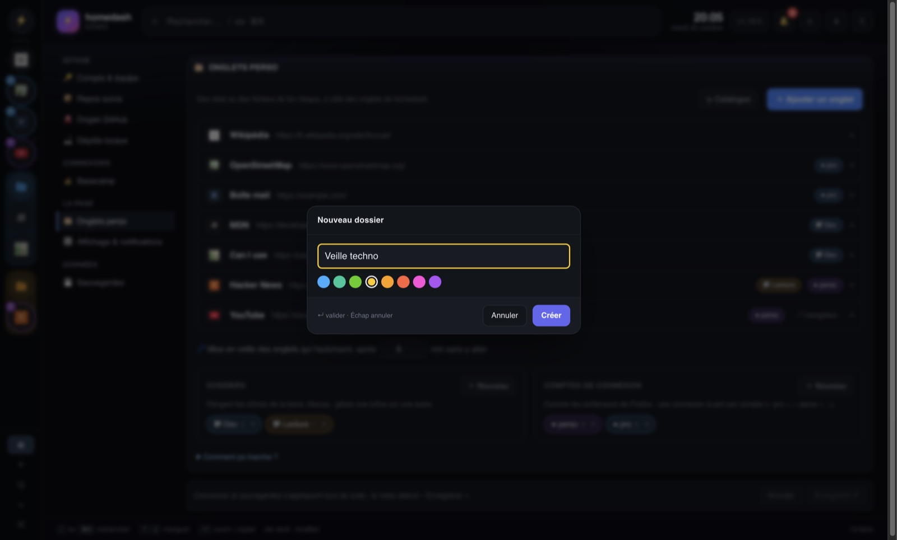
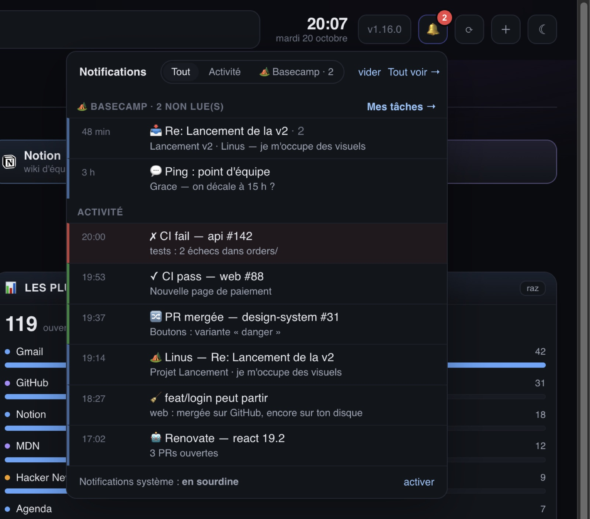

# Aperçu

Captures d'une instance de **démo** : données fictives, aucun compte réel. L'appli de bureau (Mac) y est
utilisée pour les sites affichés dans les onglets ; dans un navigateur, tout le reste est identique.
Mode d'emploi complet : [GUIDE.md](../GUIDE.md).

## La page

**Raccourcis** : tes liens épinglés et les plus utilisés, des notes, des infos à copier (Wi-Fi, IP…). À
gauche, la **barre façon Discord** : ⚡ pour homedash, puis une icône par onglet perso, avec la pastille
de son compte (P, B…) et ses non-lus (le « 3 » rouge).

## Un site dans un onglet

Un onglet perso affiche n'importe quel site (Gmail, Chat, Claude, YouTube…) ou un fichier du disque,
sous la barre du haut. Il reste chargé quand on change d'onglet.

**Barre large** : les noms, les **dossiers** (Dev, Lecture : repliables, colorés) et le **compte** de
chaque onglet (« pro », « perso ») : deux comptes d'un même site, chacun connecté de son côté.

## Clic droit

Sur un lien, dans un site : l'ouvrir dans l'onglet de son site, dans un **onglet éphémère** avec le
compte de son choix, dans le navigateur, ou copier le lien. Copier / rechercher le texte sélectionné.

Sur une icône (ou un onglet du haut) : ouvrir, recharger, puis *Ranger* (dossier en pastilles), *Compte*
(connexion en pastilles, l'actuelle en évidence) et *Onglet* : couper le son, **mise en veille** (libère
la mémoire), modifier.

## Onglets éphémères

**⧉** (ou un lien au clic droit) : un onglet temporaire, contour pointillé, avec une **barre
d'adresse**. *Garder ouvert* pour qu'il survive au redémarrage, *Ajouter à mes onglets* pour le garder
pour de bon.

## Onglets en haut

Barre de gauche cachée : les onglets perso rejoignent la barre du haut, avec le même clic droit, le
glisser-déposer, la couleur de leur compte, et le ✕ des éphémères.

## Réglages

Un onglet par ligne ; un clic l'ouvre : adresse (ou 📁 un fichier), nom, icône, affichage, mise en
veille, dossier, compte.

**☰ Catalogue** : mails, messageries, réseaux sociaux, IA, outils, ajoutés d'un clic.

Dossiers et comptes : un nom et une couleur (glisser une icône sur une autre crée aussi un dossier).

## Notifications, GitHub, Basecamp

**Une seule cloche** : l'activité de homedash (CI, PRs mergées, branches à nettoyer, Renovate) et les
notifications Basecamp non lues, avec un filtre.

**GitHub** : repos suivis, branches actives, PRs ouvertes avec leur CI, PRs mergées, Renovate.

**Basecamp**, en lecture seule : tes tâches, retards et échéances de la semaine.
